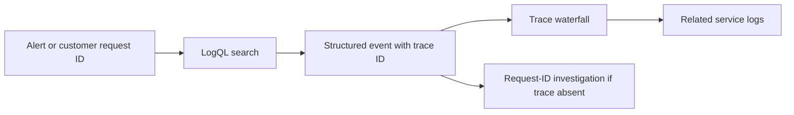

# How to Add Trace Links to a LogQL Investigation Workflow

Author: [nawazdhandala](https://www.github.com/nawazdhandala)

Tags: Loki, Grafana, OpenTelemetry

Description: Keep structured log context while adding trace identifiers, derived links, and a reliable fallback for unsampled requests.

Adding tracing should make an existing log investigation faster, not replace the useful context already present in logs. Keep the request ID, business event, service identity, and explanatory message. Add a trace ID so an investigator can move from a specific log event to the request's distributed execution.

A trace ID belongs in structured log content or supported structured metadata, not usually in a Loki stream label. Labeling every trace creates a vast number of short-lived streams and makes indexing expensive.

## Start with one structured event

The following JSON line preserves a human-readable event and adds the active tracing identifiers:

```json
{
  "level": "INFO",
  "message": "inventory reservation completed",
  "service_name": "checkout",
  "request_id": "req-42",
  "order_id": "order-test-7",
  "trace_id": "4bf92f3577b34da6a3ce929d0e0e4736",
  "span_id": "00f067aa0ba902b7"
}
```

Use the application's tracing context API or supported logging bridge to populate those fields. Do not generate unrelated random IDs in the logging formatter. Keep sensitive identifiers redacted according to the existing logging policy.

Search by the request ID first, then parse fields:

```logql
{service_name="checkout"}
  |= "req-42"
  | json
  | __error__=""
  | request_id="req-42"
```

The initial line filter reduces parsing work. The final field comparison avoids accidental substring matches. If `service_name` is only in the JSON body, use an existing bounded stream selector such as namespace and application, then parse the field.



## Add a derived field that extracts the exact ID

Grafana's Loki data source supports derived fields that link an extracted value to a tracing data source. In a provisioned configuration, the following fragment illustrates a raw-line regex for compact or spaced JSON and a Tempo data-source UID.

```yaml
apiVersion: 1
datasources:
  - name: Application Logs
    type: loki
    access: proxy
    url: http://loki:3100
    jsonData:
      derivedFields:
        - name: TraceID
          matcherRegex: '"trace_id"\s*:\s*"([0-9a-f]{32})"'
          datasourceUid: tempo
          url: '$${__value.raw}'
```

The doubled dollar sign is required in a provisioning file to preserve Grafana's variable expression. Confirm the target data-source UID is actually `tempo`; a display name is not a UID. If your Grafana version offers a field-based matcher for parsed fields, use that supported option rather than relying on raw formatting.

## Keep the return path useful

From a trace, return to logs using the trace ID and a narrow time interval. A LogQL query for the same example is:

```logql
{service_name=~"checkout|inventory"}
  | json
  | trace_id="4bf92f3577b34da6a3ce929d0e0e4736"
```

Service selectors should match your actual bounded labels. Avoid a whole-cluster search when the trace already identifies the services and time range involved.

## Validate sampling and retention expectations

Test a retained request, an unsampled request, and a background log outside a span. A missing trace for the unsampled request is expected; the request ID should still support investigation. A background log should not inherit a stale trace ID from a reused thread.

Trace and log retention may differ. A working link today can legitimately become empty after the trace expires while logs remain. Explain that behavior in the runbook rather than treating every empty trace lookup as a pipeline incident.

Finally, keep business reasoning in logs where it is useful. A trace shows timing and causal structure, while a structured event can explain which rule selected a price or rejected an item. Correlation lets investigators move between those views without discarding either.

## References

The [community question](https://www.reddit.com/r/Observability/comments/1tm7b5i/how_to_move_from_logs_to_traces/) motivated this investigation. The implementation references are [official reference 1](https://grafana.com/docs/grafana/latest/datasources/loki/configure/), [official reference 2](https://grafana.com/docs/loki/latest/query/log_queries/).
