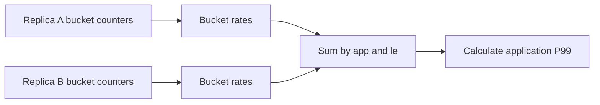

# How to Aggregate Histogram Buckets by Application for Correct P99

Author: [nawazdhandala](https://www.github.com/nawazdhandala)

Tags: Prometheus, Grafana

Description: Preserve le while aggregating classic histogram rates, avoid averaging quantiles, and verify bucket compatibility across replicas.

A classic Prometheus histogram stores cumulative bucket counters labeled by `le`, the bucket's upper bound. To calculate a P99 across application replicas, aggregate the bucket rates while preserving `le`, then apply `histogram_quantile`. Dropping `le` destroys the distribution needed for the calculation.

The examples use classic histograms. Native histograms have a different query shape and do not use separate `_bucket` series. Confirm which type your application exports before adapting the queries.

## Build the distribution before the quantile

Assume `http_request_duration_seconds_bucket` has `app`, `instance`, and `le` labels. The correct application-level query is:

```promql
histogram_quantile(
  0.99,
  sum by (app, le) (
    rate(http_request_duration_seconds_bucket[5m])
  )
)
```

`rate()` runs before aggregation so resets are handled independently for each source counter. The sum combines observations from all replicas of each application. The quantile is then calculated from that combined distribution.



Inspect the intermediate buckets when the output looks wrong:

```promql
sum by (app, le) (rate(http_request_duration_seconds_bucket[5m]))
```

Within an application, rates should be cumulative across increasing bucket bounds. The `+Inf` bucket represents the total observed count rate. Missing or inconsistent buckets can make the distribution incomplete.

## Do not average replica P99 values

The average of two replica P99s is not the P99 of their combined requests. A quiet replica and a busy replica would receive equal weight in an arithmetic average even though their populations differ greatly. Even a traffic-weighted average of quantiles does not reconstruct the combined distribution.

Use the observation count to understand whether the tail estimate has enough data:

```promql
sum by (app) (increase(http_request_duration_seconds_count[5m]))
```

A P99 calculated from only a handful of requests is inherently unstable. Keep the count visible and avoid interpreting a single sparse window as a reliable tail-latency trend.

## Check bucket compatibility

Replicas aggregated into one distribution should expose compatible bucket boundaries. A rolling deployment that changes buckets can temporarily mix schemas. Query the raw label sets and compare the finite bounds and `+Inf` bucket for each version.

A histogram quantile is an estimate within bucket boundaries. If the P99 lands in a wide bucket, the reported value can be far from any observed request duration. Add resolution near the latency range that matters, or consider native histograms where supported, after evaluating their operational tradeoffs.

For a threshold objective, calculate the proportion below a known boundary directly:

```promql
sum by (app) (rate(http_request_duration_seconds_bucket{le="0.5"}[5m]))
/
sum by (app) (rate(http_request_duration_seconds_count[5m]))
```

This asks what fraction completed within 500 milliseconds, assuming that exact bucket exists. It can be more directly aligned with a service objective than interpolating P99.

## Validate labels and units

If an `app` label is absent on some targets, aggregation can create an unlabeled application group. Fix discovery or instrumentation rather than hiding the group. If duration is exported in milliseconds, the resulting quantile is also in milliseconds; changing the Grafana unit does not convert the underlying metric's semantics automatically.

Test two replicas with different traffic volumes and known latency distributions. Compare the merged bucket query with an intentionally incorrect average-of-quantiles query to demonstrate the difference. Preserve `le`, rate before sum, and choose a window with enough observations. Those three decisions make the application P99 explainable rather than merely syntactically valid.

## References

The [community question](https://stackoverflow.com/questions/66758116/grafana-promql-histogram-quantile-query-issue) motivated this investigation. The implementation references are [official reference 1](https://prometheus.io/docs/prometheus/latest/querying/functions/), [official reference 2](https://prometheus.io/docs/practices/histograms/).
