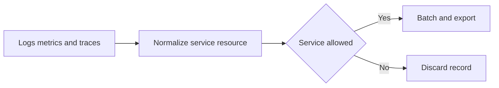

# How to Apply a Service Allowlist to Collector Logs, Metrics, and Traces

Author: [nawazdhandala](https://www.github.com/nawazdhandala)

Tags: OpenTelemetry, Observability

Description: Use the correct OTTL contexts and drop conditions to enforce one service allowlist across all three telemetry signals.

A service allowlist is easy to invert accidentally. The Collector filter processor removes telemetry when a condition is true. A condition that matches an allowed service therefore drops exactly the records you intended to keep.

For Collector Contrib 0.120.0, express the rejection rule directly: discard records whose resource service name is neither `checkout` nor `payments`. Apply it at the span, metric, and log-record contexts. These contexts differ, but they can all read resource attributes.

## Define the resource-level policy

Use one compound condition per signal. Separate filter conditions are combined with OR, so writing one inequality per allowed service would reject every record.

```yaml
processors:
  filter/service_allowlist:
    error_mode: ignore
    traces:
      span:
        - 'resource.attributes["service.name"] != "checkout" and resource.attributes["service.name"] != "payments"'
    metrics:
      metric:
        - 'resource.attributes["service.name"] != "checkout" and resource.attributes["service.name"] != "payments"'
    logs:
      log_record:
        - 'resource.attributes["service.name"] != "checkout" and resource.attributes["service.name"] != "payments"'
```

A missing service name also fails to equal either allowed value and is rejected by this expression. Decide explicitly whether that is the desired policy. If missing identity should be quarantined, route it to a diagnostic destination before applying the allowlist.

`error_mode: ignore` keeps evaluation errors from rejecting entire payloads, but it also means a malformed or type-incompatible condition is not a security boundary. Tenant authorization belongs in authenticated ingress. Monitor evaluation errors and test the data types that your instrumentation produces.

## Enable the filter in every pipeline

A configured processor does nothing until a pipeline references it. Put identity normalization before the filter and batching after it.

```yaml
service:
  pipelines:
    traces:
      receivers: [otlp]
      processors: [memory_limiter, filter/service_allowlist, batch]
      exporters: [otlp/backend]
    metrics:
      receivers: [otlp]
      processors: [memory_limiter, filter/service_allowlist, batch]
      exporters: [otlp/backend]
    logs:
      receivers: [otlp]
      processors: [memory_limiter, filter/service_allowlist, batch]
      exporters: [otlp/backend]
```

This is a pipeline fragment; define the referenced receiver, limiter, batch processor, and exporter in the final configuration. If a resource processor overrides `service.name`, decide whether the policy should evaluate the original or rewritten name and place it accordingly.



## Test the truth table before deployment

The following standalone Python fixture models the Boolean policy. It does not execute OTTL, but it catches the common AND-versus-OR mistake and documents the intended treatment of missing values.

```python
allowed = {"checkout", "payments"}
fixtures = [("checkout", False), ("payments", False), ("search", True), (None, True)]
for service, expected_drop in fixtures:
    drop = service != "checkout" and service != "payments"
    assert drop == expected_drop
    assert drop == (service not in allowed)
print("allowlist truth table passed")
```

Next, send a small OTLP fixture for each service and each signal through a staging Collector with a debug exporter. Verify both acceptance and rejection, including a missing resource name and a misleading span attribute named `service.name`. The latter must not override the resource used by the policy.

## Account for incomplete distributed traces

Filtering a service can remove parent or child spans from a trace that also contains allowed services. That is expected behavior for a service allowlist, but it can make trace topology confusing. If complete traces are required, make retention decisions at trace scope rather than independently discarding services.

For metrics, removing resources changes the population represented by aggregate dashboards. For logs, a library logger name is not a service name. Document these semantics so teams do not interpret the filtered dataset as a complete organization-wide view. Finally, version the allowlist and compare per-service ingress and egress during rollout; an empty destination is not evidence that the filter is correctly rejecting only unwanted services.

## References

The [community question](https://stackoverflow.com/questions/79680084/opentelemetry-filter-syntax) motivated this investigation. The implementation references are [official reference 1](https://raw.githubusercontent.com/open-telemetry/opentelemetry-collector-contrib/v0.120.0/processor/filterprocessor/README.md), [official reference 2](https://opentelemetry.io/docs/collector/configuration/).
