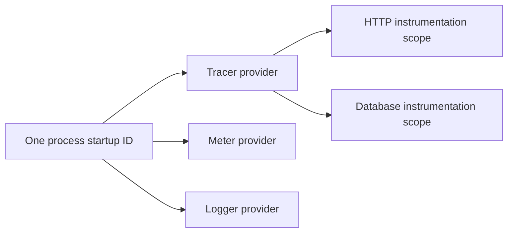

# How to Assign service.instance.id Across Processes and Scopes

Author: [nawazdhandala](https://www.github.com/nawazdhandala)

Tags: OpenTelemetry, Kubernetes

Description: Choose a process-lifetime service instance identifier and reuse it consistently across instrumentation scopes and telemetry signals.

`service.instance.id` identifies one running instance of a service. It should distinguish concurrent replicas of the same logical service and remain stable for the lifetime of that instance. It should not change for every request, tracer, meter, or instrumentation library.

The semantic convention identifies an instance through the combination of service namespace, service name, and instance ID. In practice, a random startup UUID is a simple choice when the platform does not provide a suitable unique process identity. Define the lifetime you mean before choosing a value.

## Generate once, then reuse

This Python example illustrates startup generation. In a real application, place it in process initialization and pass the resulting resource to every provider.

```python
import uuid
resource = {
    "service.namespace": "commerce",
    "service.name": "checkout",
    "service.instance.id": str(uuid.uuid4()),
}
traces_resource = resource
metrics_resource = resource
assert traces_resource["service.instance.id"] == metrics_resource["service.instance.id"]
print(resource)
```

Do not run the UUID generator inside a span creation function. That would create unbounded identity churn and make metrics appear to come from a new instance on every measurement.



Instrumentation scopes identify the libraries creating telemetry. They all belong to the same service instance when they execute in the same process. Giving each scope its own instance ID breaks cross-signal and cross-library correlation.

## Use platform identity with the right granularity

Kubernetes can expose a Pod UID through the downward API:

```yaml
env:
  - name: POD_UID
    valueFrom:
      fieldRef:
        fieldPath: metadata.uid
  - name: OTEL_RESOURCE_ATTRIBUTES
    value: service.instance.id=$(POD_UID)
```

This works when a Pod corresponds to the service instance you intend to identify. If several processes or containers in the Pod emit telemetry for the same service name, the Pod UID alone may not distinguish them. A container restart within the same Pod also preserves the Pod UID, while a newly created Pod receives a new UID.

For process-level identity, combine a stable platform identifier with a startup UUID, or generate a UUID directly. Avoid using PID alone because it is reused across hosts and process lifetimes. Avoid hostname alone in environments where replicas share or recycle names.

The following shell fragment creates an instance ID once before starting an application. It requires Python on the image; prefer the application's own UUID facility if that dependency is undesirable.

```bash
INSTANCE_ID="$(python3 -c 'import uuid; print(uuid.uuid4())')"
export OTEL_RESOURCE_ATTRIBUTES="service.instance.id=${INSTANCE_ID},service.version=2026.11.15"
exec java -jar application.jar
```

## Decide restart semantics explicitly

A process restart can reasonably represent a new instance, especially when counters reset and heap state is lost. If you preserve an instance ID across restarts, ensure the monitoring system still detects resets and that your operational meaning of instance remains consistent.

Do not embed customer names, raw host secrets, or credentials in the identifier. The value propagates into telemetry stores and may become a metric label. Opaque identifiers are usually easier to handle safely.

## Validate identity as a resource contract

Start two replicas and verify their instance IDs differ while service name and namespace match. Restart one replica and confirm the identifier changes or persists according to your documented policy. Within each process, compare logs, metrics, and traces from several instrumentation scopes.

Look for accidental overrides in Collector processors. Replacing every source instance ID with the gateway's ID collapses unrelated workloads into one instance. Conversely, attaching a random ID at every Collector hop creates churn unrelated to application lifecycle.

Finally, use instance identity only where it helps the analysis. Aggregate service-level metrics without the instance label when evaluating overall behavior, while retaining enough raw data to diagnose one replica. A correct identifier improves correlation; indiscriminately copying it onto every derived metric can still increase series cost.

## References

The [community question](https://stackoverflow.com/questions/79587545/what-does-globally-unique-mean-in-practice-for-service-instance-id-resource-at) motivated this investigation. The implementation references are [official reference 1](https://opentelemetry.io/docs/specs/semconv/resource/service/).
