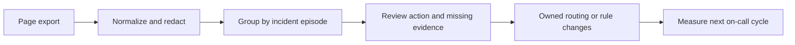

# How to Audit On-Call Pages That Have No Useful Response

Author: [nawazdhandala](https://www.github.com/nawazdhandala)

Tags: SRE, Incident Management, Python

Description: Turn notification exports into an actionable audit by separating incident episodes, duplicate pages, missing runbooks, and response outcomes.

An on-call queue can contain hundreds of messages while representing only a handful of incidents. Audit the response episodes, not just the notification count. A repeated reminder, a duplicate integration delivery, and a genuinely new failure need different fixes. Start with a bounded export and an explicit definition of useful action.

Use Python 3 and a redacted CSV exported from your incident or paging system. The field names below are an internal analysis schema, not a vendor API. Preserve the original event identifier so every aggregate can be traced back to evidence. Exclude credentials and customer payloads from the review dataset.

## Normalize the response record

Give each page a rule name, incident episode, owner, action outcome, and runbook status. Use `unknown` when the incident notes do not establish what happened. Do not silently classify missing notes as no action; otherwise the audit rewards poor documentation and unfairly penalizes busy responders.

```csv
page_id,episode,rule,owner,action,runbook
p1,i1,HighCPU,platform,none,present
p2,i1,HighCPU,platform,duplicate,present
p3,i2,CheckoutErrors,payments,mitigated,present
p4,i3,QueueDepth,workers,unknown,missing
```

Separate notification mechanics from alert quality. If a useful checkout page is delivered eight times because of routing, fix duplication. If a CPU page consistently requires no action and has no urgent implication, reconsider its destination. Combining those cases into one noise score hides the remedy.

## Aggregate with uncertainty visible

The executable fixture reads the example data, counts unique episodes, and summarizes outcomes by rule. Copy it into a local script and replace the embedded string with a file opened using `newline=''` for a real export.

```python
import csv, io
from collections import defaultdict
text = """page_id,episode,rule,owner,action,runbook
p1,i1,HighCPU,platform,none,present
p2,i1,HighCPU,platform,duplicate,present
p3,i2,CheckoutErrors,payments,mitigated,present
p4,i3,QueueDepth,workers,unknown,missing
"""
rows = list(csv.DictReader(io.StringIO(text)))
summary = defaultdict(lambda:{"pages":0,"episodes":set(),"unknown":0})
for row in rows:
    item = summary[row["rule"]]
    item["pages"] += 1
    item["episodes"].add(row["episode"])
    item["unknown"] += row["action"] == "unknown"
for rule,item in summary.items():
    print(rule,item["pages"],len(item["episodes"]),item["unknown"])
assert len({r["episode"] for r in rows}) == 3
```

The fixture has four pages but three episodes. This difference is small in the example and can be large in practice. Keep both numbers: page count measures interruption burden, while episode count measures recurring operational conditions. Neither measures customer impact on its own.



## Turn findings into reviewable changes

Each proposed change should say what signal remains and how missed impact will be detected. Avoid an indefinite silence that conceals the problem without creating ownership. The following internal record is a concrete review item.

```yaml
rule: HighCPU
finding: repeated pages without an urgent response
proposed_change: move to capacity dashboard
retained_page: CheckoutErrors
owner: platform
review_after_days: 14
rollback_trigger: user-impact incident detected later than current baseline
```

For an alert with no owner, fix ownership before adjusting thresholds. For a missing runbook, determine whether a useful response exists before writing documentation. A polished runbook that says to wait does not make a page actionable.

## Validate the audit itself

Sample both high-volume and low-volume rules. A rare alert may be the most important signal in the system. Review at least one incident from each service class and include customer-reported incidents that had no page, so the audit can detect under-alerting as well as noise.

After changes, compare interruption count, unknown-outcome fraction, missed incidents, and response delay over a comparable period. Account for traffic and incident mix; one quiet week is not proof of improvement. Keep the raw export, transformation script, and decision records together. This gives the next on-call engineer a reproducible explanation of why each page exists and a straightforward way to challenge a rule that stops being useful.

Include time-of-day and on-call handoff information when measuring interruption burden. Five pages during a planned maintenance session and five overnight wakeups can have different operational consequences even when they share the same rule. Keep that distinction separate from user impact so the review can improve scheduling and routing without minimizing the incident itself. Use a consistent observation period and record any major deployments or traffic changes that make comparisons uneven.

## References

The [community question](https://www.reddit.com/r/sre/comments/1nm7sbi/alert_fatigue_is_killing_me/) motivated this walkthrough. Implementation references:

- [Official reference 1](https://prometheus.io/docs/practices/alerting/)
- [Official reference 2](https://docs.python.org/3/library/csv.html)
