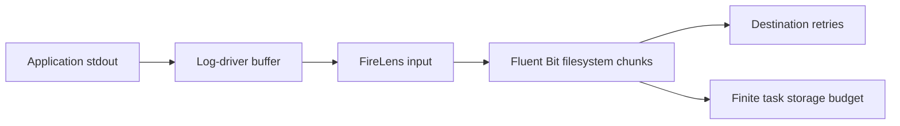

# How to Bound FireLens Backpressure on Fargate Ephemeral Storage

Author: [nawazdhandala](https://www.github.com/nawazdhandala)

Tags: AWS, Fluent Bit

Description: Budget FireLens memory and disk queues separately and define what happens when Fargate log delivery cannot keep up.

FireLens buffering has several boundaries: the application log driver, Fluent Bit input buffers, output retry chunks, and Fargate task storage. Increasing one limit can move pressure into another. An unlimited retry policy with filesystem buffering eventually consumes finite task storage when the destination remains unavailable.

Plan an explicit outage budget. Decide how much log loss is acceptable, how long an outage should be buffered, and whether application logging should block or discard when its own buffer fills. The examples are fragments for a controlled task definition and custom Fluent Bit configuration, not a complete ECS service.

## Estimate backlog in bytes

Use observed serialized log volume rather than only lines per second. Include the size variation caused by stack traces and structured payloads.

```python
bytes_per_second = 2 * 1024 * 1024
outage_seconds = 15 * 60
buffer_bytes = bytes_per_second * outage_seconds
print("raw backlog GiB:", round(buffer_bytes / 2**30, 2))
```

At this illustrative rate, fifteen minutes creates about 1.76 GiB before storage-format overhead and safety margin. The task also needs space for container images and application files. Do not allocate the entire ephemeral volume to log backlog.



## Set the application-side buffer deliberately

The `awsfirelens` log driver supports a buffer limit measured in log lines. This task-definition fragment demonstrates the setting:

```json
{
  "logConfiguration": {
    "logDriver": "awsfirelens",
    "options": {
      "Name": "cloudwatch_logs",
      "region": "eu-west-2",
      "log_group_name": "/ecs/example",
      "log_stream_prefix": "application-",
      "log-driver-buffer-limit": "10000"
    }
  }
}
```

The destination fields are illustrative CloudWatch output options. A line-count limit has a variable memory cost, so measure the actual line-size distribution. Keep the log router's own diagnostics on an independent path where practical.

## Bound filesystem buffering

A custom Fluent Bit configuration can set storage location and a per-output backlog cap:

```ini
[SERVICE]
    storage.path                /var/log/flb-storage
    storage.max_chunks_up       32

[OUTPUT]
    Name                        cloudwatch_logs
    Match                       application.*
    region                      eu-west-2
    log_group_name              /ecs/example
    log_stream_prefix           application-
    storage.total_limit_size    1G
    Retry_Limit                 10
```

Enable filesystem storage on the input that actually receives application logs. FireLens generates input sections, so inspect the generated configuration and use the supported custom-configuration approach for your AWS for Fluent Bit version. Adding a second matching output by accident duplicates delivery and storage work.

`storage.max_chunks_up` limits chunks resident in memory; it is not the total disk quota. `storage.total_limit_size` bounds an output's logical backlog and can cause older queued chunks to be discarded. Neither turns ephemeral storage into durable storage across task replacement.

## Reserve storage and monitor the loss boundary

Fargate supports a task-level ephemeral storage configuration for supported platform versions:

```json
{"ephemeralStorage":{"sizeInGiB":40}}
```

Choose the size from a budget that includes images, application scratch files, and buffers. Verify platform support and current service limits in the official documentation. A larger volume only extends the outage horizon if incoming logs continue indefinitely.

In staging, interrupt the destination while maintaining representative logging. Observe task storage usage, Fluent Bit queue metrics, application latency, dropped records, and recovery drain time. Ensure recovery throughput exceeds new incoming volume or the backlog will never clear.

Test task termination as well as a router restart. A router process restart with the same volume differs from replacing the entire Fargate task. Document the expected loss in each case and preserve sequence-number canaries to verify it. The reliable design is a finite, observable buffering policy with known behavior at capacity, not a promise that retries prevent every loss.

## References

The [community question](https://www.reddit.com/r/aws/comments/1iyhxl3/) motivated this investigation. The implementation references are [official reference 1](https://docs.aws.amazon.com/AmazonECS/latest/developerguide/firelens-docker-buffer-limit.html), [official reference 2](https://docs.aws.amazon.com/AmazonECS/latest/developerguide/fargate-task-storage.html), [official reference 3](https://docs.fluentbit.io/manual/administration/buffering-and-storage).
