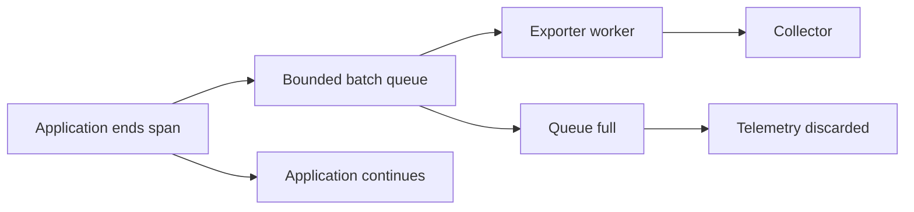

# How to Bound Java Telemetry Buffers During Collector Outages

Author: [nawazdhandala](https://www.github.com/nawazdhandala)

Tags: OpenTelemetry, Java

Description: Set finite Java SDK trace and log queues, calculate their outage horizon, and verify application behavior when export fails.

The Java OpenTelemetry SDK should not turn a Collector outage into an application memory outage. Batch processors use bounded queues, but the correct limits depend on telemetry volume, record size, and the failure behavior you can tolerate. A queue is a short buffer, not durable storage.

This example uses the standard Java SDK autoconfiguration properties used by the Java agent and SDK autoconfigure module. Verify the effective settings in your installed agent release. An application that manually creates its own processors may ignore these environment variables entirely.

## Bound the trace path explicitly

Set queue capacity, export batch size, schedule delay, and export timeout together. Values ending in milliseconds below use the SDK's documented environment-variable conventions.

```bash
export OTEL_BSP_MAX_QUEUE_SIZE=2048
export OTEL_BSP_MAX_EXPORT_BATCH_SIZE=256
export OTEL_BSP_SCHEDULE_DELAY=1000
export OTEL_BSP_EXPORT_TIMEOUT=5000
export OTEL_EXPORTER_OTLP_TIMEOUT=5000
export OTEL_EXPORTER_OTLP_ENDPOINT=https://collector.example.net:4318
export OTEL_EXPORTER_OTLP_PROTOCOL=http/protobuf
```

The maximum export batch must not exceed queue capacity. Shorter schedule delays improve low-volume delivery latency but create more export operations. A shorter timeout limits how long a failed operation waits; it does not make unavailable infrastructure recover faster.

Do not confuse processor timeout with the exporter's own timeout and retry behavior. They operate at different layers. Read both settings for the exporter in use and inspect actual failure logs during a staging outage.



## Estimate the time the queue buys

Use ended sampled spans per second rather than HTTP request rate. One request can create many spans, and background jobs can create telemetry without HTTP traffic.

```python
spans_per_second = 1500
queue_records = 2048
estimated_bytes_per_record = 2500
print("queue-only seconds:", queue_records / spans_per_second)
print("payload estimate MiB:", queue_records * estimated_bytes_per_record / 2**20)
```

The example predicts about 1.37 seconds of queue capacity at that arrival rate. The memory figure is only a payload estimate: Java object overhead, references, strings, in-flight batches, and exporter buffers add more. Measure heap usage with representative attributes and exception events.

Once arrival rate exceeds successful drain rate, any finite queue eventually fills. Increasing it changes the time to loss, not the long-term outcome. If an outage must be buffered for minutes, prefer a nearby Collector with a bounded persistent queue and appropriate disk provisioning.

## Treat logs and metrics separately

Java's batch log record processor has its own configuration. Bounding traces does not automatically bound log queues.

```bash
export OTEL_BLRP_MAX_QUEUE_SIZE=1024
export OTEL_BLRP_MAX_EXPORT_BATCH_SIZE=128
export OTEL_BLRP_SCHEDULE_DELAY=1000
export OTEL_BLRP_EXPORT_TIMEOUT=5000
export OTEL_METRIC_EXPORT_INTERVAL=30000
export OTEL_METRIC_EXPORT_TIMEOUT=5000
```

Metrics are aggregated in SDK state and periodically exported; they do not behave like a FIFO of every measurement. Attribute cardinality, aggregation temporality, and export failures determine what the next successful collection represents. Avoid describing one metric export timeout as the loss of every measurement made during that interval.

## Validate application behavior during failure

In staging, make the configured Collector unreachable while keeping request load constant. Observe application latency, heap, GC, thread count, and telemetry failure messages. Confirm memory reaches a bounded steady state rather than continuing to grow. Restore connectivity and verify new records resume, recognizing that discarded spans cannot be recovered.

Test shutdown too. A flush or shutdown hook can wait for pending exports; a small container termination grace period may interrupt it. Set a deliberate application shutdown budget and document the expected loss boundary.

Finally, distinguish exporter warnings from request failures. Logging every export error synchronously at high volume can itself create pressure. Keep enough independent diagnostics to see the outage while ensuring the diagnostic path does not become the next unbounded queue.

## References

The [community question](https://stackoverflow.com/questions/78928471/handle-collector-failures-when-using-opentelemetry-in-java) motivated this investigation. The implementation references are [official reference 1](https://opentelemetry.io/docs/languages/java/configuration/).
