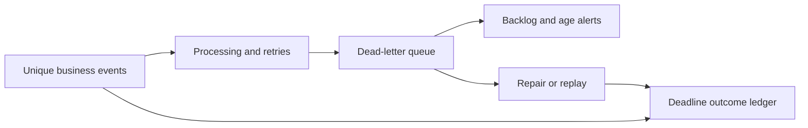

# How to Budget Dead-Letter Queues by Backlog Size and Message Age

Author: [nawazdhandala](https://www.github.com/nawazdhandala)

Tags: SLO, Monitoring, Python

Description: Combine dead-letter backlog and age with unique-event accounting so queue gauges guide response without becoming a misleading error budget.

A dead-letter queue with one week-old payment event may be more urgent than a queue with a thousand events that arrived seconds ago. Backlog size measures scope; age measures delay. Use both for operational response, and use unique business events for the SLO denominator. Repeatedly sampling a queue gauge does not count new failures.

This walkthrough uses a vendor-neutral message ledger and Python 3. For Amazon SQS, the official metrics are approximate and the dead-letter age metric has specific semantics: it reflects time since movement to the DLQ, not necessarily the original event's age. Preserve the original business timestamp if the user promise begins earlier.

## Define the relevant age

Store original event time, first processing attempt, DLQ entry time, and final successful completion where available. A message can spend hours retrying before entering the DLQ, so DLQ residence time alone can understate the customer's delay.

```json
{"event_id":"payment-17","created_at":"2026-11-15T08:00:00Z","dlq_entered_at":"2026-11-15T09:00:00Z","status":"unresolved","attempts":5}
```

Use a stable event identifier for deduplication. Multiple deliveries or retries should not become multiple eligible business events unless the product explicitly defines them that way. Keep retry counts as diagnostic context, separate from the customer-facing success denominator.

## Evaluate backlog and deadline risk together

The fixture has a small backlog but one event already past its two-hour deadline. It demonstrates why a count-only threshold would miss the urgent condition. Real policy can also include a large-backlog threshold for capacity or expected repair time.

```python
ages_seconds = [60,120,10800]
backlog = len(ages_seconds)
oldest = max(ages_seconds,default=0)
deadline_seconds = 7200
large_backlog = 1000
needs_action = backlog >= large_backlog or oldest > deadline_seconds
print({"backlog":backlog,"oldest_seconds":oldest,"needs_action":needs_action})
assert needs_action and backlog == 3
```

An empty queue should have a clearly defined age state, such as zero with a separately known zero backlog. A missing metric should remain unknown. Some queue services emit metrics only while active, so validate missing-data behavior in your monitoring backend instead of assuming absence means empty.



## Calculate an event-based budget

For a delivery SLO, count eligible events completed by their deadline. The fixture includes an event recovered after the deadline; it remains a bad event for the original promise even though the queue is now empty.

```python
events = [
 {"id":"a","completed_seconds":30},
 {"id":"b","completed_seconds":9000},
 {"id":"c","completed_seconds":None},
]
deadline = 7200
good = sum(e["completed_seconds"] is not None and e["completed_seconds"] <= deadline for e in events)
print({"good":good,"eligible":len(events),"success_fraction":good/len(events)})
assert good == 1
```

Only finalize outcomes after the deadline has passed; otherwise in-progress young events would be counted as failures prematurely. Keep the observation cutoff in the report so another engineer can reproduce the result.

## Design safe response steps

A large backlog with low age may call for throughput investigation. A small old backlog may indicate poison messages, a schema incompatibility, or missing customer-specific credentials. Inspect failure classes and a redacted sample before replaying. A blind replay can repeat side effects or create another retry storm.

Make consumers idempotent and preserve the original event identity during redrive. Record repair actions and verify downstream business completion, not just disappearance from the DLQ. Purging a queue can make backlog charts green while permanently losing work.

Test both dimensions: a single stale message, a fresh burst, repeated deliveries of one event, and a telemetry outage. The operational dashboard should display backlog, oldest business age, DLQ residence age when available, and overdue unique events. The SLO report should count business outcomes once, regardless of how many times the queue was sampled or the message retried.

## References

The [community question](https://www.reddit.com/r/devops/comments/1r3i7kl/how_do_you_set_slos_for_longrunning_batch_jobs/) motivated this walkthrough. Implementation references:

- [Official reference 1](https://docs.aws.amazon.com/AWSSimpleQueueService/latest/SQSDeveloperGuide/sqs-available-cloudwatch-metrics.html)
- [Official reference 2](https://sre.google/workbook/implementing-slos/)
