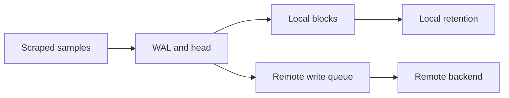

# How to Budget Prometheus Disk When Using Remote Write

Author: [nawazdhandala](https://www.github.com/nawazdhandala)

Tags: Prometheus, Storage, Monitoring

Description: Size Prometheus local blocks, WAL, and compaction headroom even when remote write sends every sample to another metrics backend.

Remote write does not turn a normal Prometheus server into a diskless forwarding process. The server still maintains local storage while a separate path sends samples to a remote endpoint. A remote dashboard showing complete history is therefore compatible with a local Prometheus volume running out of space.

Build the disk budget from measured components rather than multiplying the remote vendor's billed ingestion by retention days. This walkthrough uses Prometheus 3.x server mode, Python 3, and read-only access to its metrics and data-volume usage. Agent mode has different storage behavior and should be evaluated separately if you do not need local queries or rules.

## Measure the workload at the server

Count samples actually appended to the local TSDB. Do not estimate solely from the number of targets: a single exporter can create many series, and relabeling can substantially change ingestion. Evaluate the following over both a normal period and a known peak.

```promql
rate(prometheus_tsdb_head_samples_appended_total[15m])
```

Next inspect block storage, WAL, and head chunks independently. Use the configured storage path inside the correct container or host mount. Directory sizes may briefly change while the command runs, so this is a diagnostic snapshot rather than an atomic accounting report.

```bash
du -sk /prometheus/wal /prometheus/chunks_head
df -k /prometheus
```

A large WAL should not be modeled using compressed historical block bytes per sample. Those structures serve different purposes. Preserve enough disk for peak WAL and head usage, plus temporary compaction overlap. Increasing remote-write queues mostly affects memory and does not eliminate those local requirements.

## Build an explicit capacity model

The fixture below uses invented planning inputs. Replace every input with measurements from your own workload. It estimates compacted blocks, adds observed operational overhead, and reserves free space. The reserve is applied to the total rather than accidentally counted as extra usable capacity.

```python
samples_per_second = 50_000
retention_days = 7
measured_block_bytes_per_sample = 1.6
peak_wal_and_head_gib = 12
other_overhead_gib = 3
reserve_fraction = 0.20
blocks = samples_per_second * 86400 * retention_days * measured_block_bytes_per_sample
minimum_gib = (blocks / 2**30 + peak_wal_and_head_gib + other_overhead_gib) / (1-reserve_fraction)
print(f"Planning minimum: {minimum_gib:.1f} GiB")
assert minimum_gib > blocks / 2**30
```

Round upward to a supported volume size and check expected growth. This model is not a prediction of a particular Prometheus deployment. Series churn, scrape interval, compression, compaction, and retention boundaries change the result. Measure a week with representative deployments rather than a quiet afternoon.



## Set local retention intentionally

For a 200 GiB volume, an illustrative size threshold below the physical capacity leaves room for temporary work. Time and size limits are both constraints: the one reached first determines which old blocks become eligible for removal. A size limit is not a promise that all files stay below that number at every instant.

```bash
# Arguments for the Prometheus server process; adapt paths and values.
prometheus \
  --config.file=/etc/prometheus/prometheus.yml \
  --storage.tsdb.path=/prometheus \
  --storage.tsdb.retention.time=7d \
  --storage.tsdb.retention.size=150GB
```

Keep enough local history for your actual rule lookbacks and operational debugging. If operators use the local server during a remote outage, reducing history to a few hours changes their incident workflow. Document that change explicitly and test the dashboards against the intended datasource.

## Include the failure case

Track remote-write lag and pending samples alongside disk forecasts. A healthy local disk does not mean the remote backend is current, and remote-write retry storage is not an unlimited durable message queue. Conversely, a remote endpoint failure does not justify deleting the local WAL. Expand capacity or reduce unwanted ingestion through a reviewed configuration change first. The acceptance test is a representative peak period with adequate free disk, stable compaction, current remote data, and the promised local query window.

## References

The [community question](https://stackoverflow.com/questions/50742163/prometheus-no-space-left-on-device-while-using-remote-writer) motivated this walkthrough. Implementation references:

- [Official reference 1](https://prometheus.io/docs/prometheus/latest/storage/)
- [Official reference 2](https://prometheus.io/docs/practices/remote_write/)
