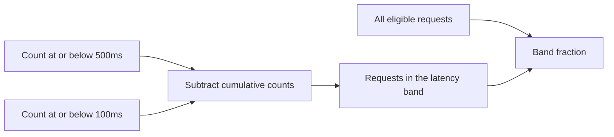

# How to Calculate Request Fractions Between Histogram Buckets

Author: [nawazdhandala](https://www.github.com/nawazdhandala)

Tags: Prometheus, SLO, Python

Description: Subtract cumulative Prometheus histogram buckets with matching labels to measure an exact latency band and handle empty traffic safely.

Classic Prometheus histogram buckets are cumulative. The bucket with `le="0.5"` includes every observation at or below half a second, including observations already counted in `le="0.1"`. To measure the fraction strictly above 100 milliseconds and at or below 500 milliseconds, subtract the smaller cumulative bucket from the larger one.

This walkthrough uses a classic histogram called `http_request_duration_seconds` with both boundaries configured. Native histograms use different query functions and interpolation behavior; do not apply `_bucket` syntax to a native histogram. Confirm the metric type and actual exported `le` values before copying the query.

## Prove the arithmetic with cumulative counts

The fixture models the increase in cumulative buckets over one interval. It gives the middle band 120 observations out of 1,000 total, or 12%. The lower boundary is exclusive and the upper boundary inclusive because each classic bucket includes its own upper bound.

```python
buckets = {0.1:800,0.5:920,float("inf"):1000}
band = buckets[0.5]-buckets[0.1]
fraction = band/buckets[float("inf")]
print({"band_count":band,"fraction":fraction})
assert band == 120 and fraction == 0.12
```

Do not add cumulative bucket counts to obtain the total; that double-counts observations. Use the histogram `_count` series or its positive-infinity bucket. Validate that bucket counts are monotonic and correspond to the same population before interpreting a negative band as meaningful data.

## Apply rate before aggregation

Counter resets happen per series. Apply `rate` to each bucket series before summing across instances. Aggregate away `le` so the two sides of subtraction have matching label sets. Keep the service dimension if you want a separate result per service.

```promql
(
  sum by (service) (rate(http_request_duration_seconds_bucket{le="0.5"}[5m]))
  -
  sum by (service) (rate(http_request_duration_seconds_bucket{le="0.1"}[5m]))
)
/
sum by (service) (rate(http_request_duration_seconds_count[5m]))
```

Directly subtracting two raw bucket vectors without handling their different `le` labels can produce no matches. Explicit aggregation makes the population and matching rule easier to review. Apply the same route, environment, and status filters to all three terms; otherwise the numerator may describe a different request set from the denominator.



## Record the band for a reporting window

For a 28-day request-weighted SLI, use increases over the same 28-day interval. The following shows the numerator only. Divide it by the corresponding 28-day increase of `_count` using the same service grouping.

```promql
sum by (service) (increase(http_request_duration_seconds_bucket{le="0.5"}[28d]))
-
sum by (service) (increase(http_request_duration_seconds_bucket{le="0.1"}[28d]))
```

This range can be costly on a large installation. If you precompute shorter intervals, preserve counts and coverage rather than averaging percentages. An average of low-traffic and high-traffic interval ratios is not generally equal to the ratio of their request totals.

## Handle boundaries and absent traffic

If the desired threshold is 300 milliseconds but the exported buckets are 250 and 500 milliseconds, subtraction cannot recover an exact 300-millisecond count. Add the desired bucket boundary prospectively or accept a documented approximation. A quantile estimate answers a different question and is not a substitute for an exact threshold count.

When the denominator is zero, the fraction is undefined. Show no eligible traffic and monitor telemetry availability separately. Avoid filling every missing series with zero, which can conceal missing exporters or a schema change. If one bucket is absent on some instances, fix instrumentation consistency before trusting the aggregate.

Finally, test with a few known observations around both boundaries, a counter reset, and a zero-traffic interval. Verify the metric's units: a seconds histogram compared against `500` would mean 500 seconds, not 500 milliseconds. These small checks prevent the most common histogram SLI errors while leaving the calculation easy to explain.

## References

The [community question](https://stackoverflow.com/questions/64693235/latency-slo-calculation-of-requests) motivated this walkthrough. Implementation references:

- [Official reference 1](https://prometheus.io/docs/practices/histograms/)
- [Official reference 2](https://prometheus.io/docs/prometheus/latest/querying/functions/)
- [Official reference 3](https://prometheus.io/docs/prometheus/latest/querying/operators/)
