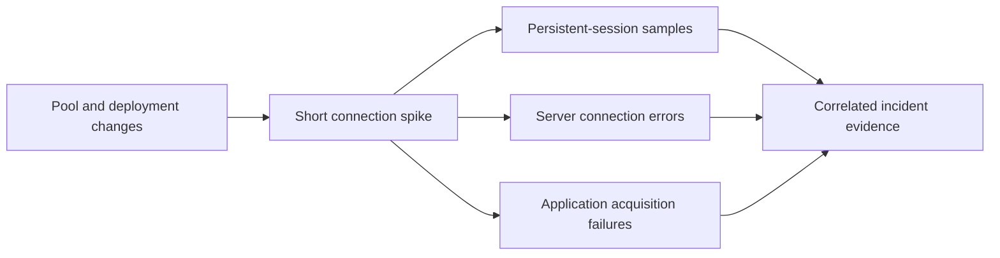

# How to Capture Brief PostgreSQL Connection Exhaustion

Author: [nawazdhandala](https://www.github.com/nawazdhandala)

Tags: PostgreSQL, Monitoring, SRE

Description: Keep a bounded persistent diagnostic session and structured connection logs so short connection spikes remain explainable after they disappear.

Connection exhaustion can disappear before an engineer opens a database console. A one-minute dashboard scrape may miss a five-second spike, and a new diagnostic connection may be rejected during the peak. Prepare a small persistent diagnostic session and retain server connection errors before the next incident occurs.

This walkthrough targets PostgreSQL 17 and `psql`. The queries are read-only. Use an approved monitoring role with the visibility required for activity fields, and avoid treating privileged emergency capacity as an application pool. Keep sampling bounded: excessive diagnostic queries can add load when the database is already stressed.

## Establish the actual connection budget

Inspect server limits and reserved capacity. The maximum is not the number of ordinary application sessions that can always connect. Include monitoring, migrations, background jobs, and every application replica in the budget.

```sql
SHOW max_connections;
SHOW reserved_connections;
SHOW superuser_reserved_connections;
```

Then compare configured client pool maxima multiplied by replica counts. A deployment surge can temporarily run old and new replicas together, increasing the possible connection total. Do not assume the steady-state replica count describes the worst case.

## Sample through one existing connection

Save the following as `connection-watch.sql` and run it with `psql`. The `\watch` command repeats the query in the same session, avoiding a new connection for every sample. Use it for a bounded investigation and stop it after the agreed window.

```sql
SELECT clock_timestamp() AS sampled_at,
       application_name, usename, state, COUNT(*) AS sessions
FROM pg_stat_activity
WHERE backend_type = 'client backend'
GROUP BY application_name, usename, state
ORDER BY sessions DESC;
\watch 1
```

Run outside an explicit long transaction so activity snapshots refresh normally. The result identifies which application and state dominate the spike, but it is still sampling and can miss sub-second events. Use connection logs and application acquisition failures to fill that gap.

```bash
# DIAGNOSTIC_DSN should come from approved secret configuration.
psql "$DIAGNOSTIC_DSN" --no-psqlrc --file=connection-watch.sql \
  > connection-watch.log
```

Protect the output because usernames and application identities may be sensitive. Do not put passwords directly into shell history. A pre-established monitoring connection is useful during exhaustion, but it must be managed and secured like any other database access.



## Enable appropriate connection evidence

For PostgreSQL 17, connection and disconnection logging can reveal rapid churn. Review log volume and retention before enabling it broadly. Include timestamp, process ID, application name, user, and database in your log format, while keeping SQL parameters and secrets out of logs.

```text
# PostgreSQL 17 configuration fragment; review before deployment.
log_connections = on
log_disconnections = on
log_line_prefix = '%m [%p] app=%a user=%u db=%d '
```

Reload or restart requirements depend on the setting; inspect the configuration status through your normal change process. Do not assume a file edit became active. Managed services may expose these settings through parameter groups or restrict them, so use the supported administrative path.

## Distinguish churn from held connections

A burst of short-lived sessions suggests missing pooling, pool fragmentation, or an aggressive reconnect loop. Many long-lived idle sessions may be normal pooling but still consume connection slots. Many idle-in-transaction sessions point toward application transaction handling and can have consequences beyond the connection count.

Correlate the sample timestamps with rollout events and application errors. The most useful record includes the rejected connection message, total client sessions near the event, dominant application names, and configured pool budgets. Increasing `max_connections` without checking memory and workload can move the bottleneck rather than solve it.

Test the capture workflow in staging and verify that the monitoring role can see the needed fields. The next short spike should leave enough evidence to identify the connection owner and lifecycle even after the count returns to normal.

## References

The [community question](https://stackoverflow.com/questions/31784505/tracking-out-of-database-connection-issues-with-python-and-postgresql) motivated this walkthrough. Implementation references:

- [Official reference 1](https://www.postgresql.org/docs/17/monitoring-stats.html)
- [Official reference 2](https://www.postgresql.org/docs/17/runtime-config-logging.html)
- [Official reference 3](https://www.postgresql.org/docs/17/runtime-config-connection.html)
