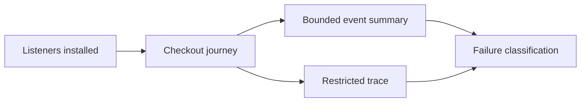

# How to Capture Console and Network Evidence for Failed Checkout Tests

Author: [nawazdhandala](https://www.github.com/nawazdhandala)

Tags: Playwright, TypeScript, Monitoring

Description: Attach bounded, redacted console and network summaries to failed Playwright checkout runs and use restricted traces for deeper investigation.

A screenshot of a failed checkout often shows only a spinner. Capture console error categories, failed requests, and HTTP error responses during the run so the failure can be located without repeating a purchase flow. Keep the evidence bounded and avoid recording payment data, cookies, authorization headers, or full response bodies by default.

This example uses Playwright Test and a dedicated non-purchasing checkout journey. It assumes an authorized checkout URL and an accessible Checkout heading. Adapt the flow to build a test cart if required, and stop before submitting an order unless a separately approved test-payment environment is configured.

## Listen before navigation

Register listeners before loading the page. HTTP 4xx and 5xx responses are not the same as transport failures, so collect both `response` and `requestfailed` events. The sample maps URLs to a small allowlist rather than recording arbitrary paths or query strings that may contain customer identifiers.

```typescript
// tests/checkout-evidence.spec.ts
import { test, expect } from '@playwright/test';

test('checkout evidence', async ({ page }, testInfo) => {
  const target = process.env.SYNTHETIC_CHECKOUT_URL;
  if (!target) throw new Error('Missing authorized checkout URL');
  const events: object[] = [];
  const add = (event: object) => { if (events.length < 200) events.push(event); };
  const endpoint = (raw: string) => {
    const url = new URL(raw);
    return ['/checkout', '/cart'].includes(url.pathname) ? url.pathname : 'other';
  };
  page.on('console', msg => {
    if (msg.type() === 'error') add({ kind: 'console-error', at: Date.now() });
  });
  page.on('requestfailed', request => add({
    kind: 'transport-failure', endpoint: endpoint(request.url()), at: Date.now(),
  }));
  page.on('response', response => {
    if (response.status() >= 400) add({
      kind: 'http-error', endpoint: endpoint(response.url()),
      status: response.status(), at: Date.now(),
    });
  });
  try {
    await page.goto(target);
    await expect(page.getByRole('heading', { name: 'Checkout', exact: true })).toBeVisible();
  } finally {
    await testInfo.attach('checkout-events', {
      body: JSON.stringify(events, null, 2), contentType: 'application/json',
    });
  }
});
```

The bounded summary is attached for every run, so failure capture does not depend on when the runner finalizes test status. If you only retain failed-run summaries, move the attachment decision into an `afterEach` hook where final status is available. The conservative console record counts errors without copying their text; add reviewed, redacted error codes if your application provides them.

## Retain a trace for deeper inspection

Trace files can include DOM snapshots and network details beyond the safe summary. Restrict access and retention, and use test accounts with minimal data. The following configuration fragment retains traces only when a run fails.

```typescript
// playwright.config.ts
import { defineConfig } from '@playwright/test';
export default defineConfig({
  timeout: 45_000,
  retries: 0,
  use: { trace: 'retain-on-failure', screenshot: 'only-on-failure' },
});
```

Do not assume screenshot masking also redacts a trace. Review the artifact contents in your environment before broad publication. Avoid attaching saved authentication state to a test report, even when the report itself is private.

```bash
npx playwright test tests/checkout-evidence.spec.ts
npx playwright show-trace test-results/example-run/trace.zip
```

Replace the example trace path with the actual result path emitted by your run. Open artifacts locally or through your approved artifact system. A trace viewer is a diagnostic tool, not proof that the application failure has been reproduced independently.



## Interpret the sequence

A transport failure before any checkout response suggests connectivity, TLS, or cancellation. A 403 with a challenge page suggests an edge boundary that needs separate verification. A 200 response followed by console errors and a missing form suggests client rendering or initialization. An unrelated analytics request failing should not automatically be called a checkout outage.

Add stage markers around cart creation, checkout navigation, and form readiness so timestamps can be correlated with the failed assertion. Preserve the first failure when retries are enabled; a successful retry does not erase the degraded first attempt.

Exercise the collector with a deliberately failing selector and a controlled HTTP error in staging. Confirm the summary remains bounded, excludes secrets, and contains enough information to choose the next investigation. Monitor artifact upload failures separately so missing evidence is visible. A useful failed run leaves an explanation of where the journey stopped, with deeper data available only to the people who need it.

Bounded evidence still needs a schema version and run identifier when sent to a central store. Add the release, browser version, monitoring region, and stage name as controlled metadata rather than embedding them in free-form error text. This allows comparison across failed runs without inspecting every trace. Record when the 200-event cap is reached, because truncation can hide later failures; a dropped-event count makes that limitation visible. Keep the original assertion error in the test report so the summary is interpreted alongside the exact condition that failed.

## References

The [community question](https://www.reddit.com/r/devops/comments/1r8jmez/sreish_monitoring_for_a_blackbox_paas_shopify/) motivated this walkthrough. Implementation references:

- [Official reference 1](https://playwright.dev/docs/network)
- [Official reference 2](https://playwright.dev/docs/trace-viewer)
- [Official reference 3](https://playwright.dev/docs/api/class-testinfo)
