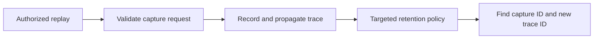

# How to Capture One Replayed Request Without Raising Global Sampling

Author: [nawazdhandala](https://www.github.com/nawazdhandala)

Tags: OpenTelemetry, Observability

Description: Target a controlled replay with trusted sampling context, a capture identifier, and a temporary tail-retention rule.

When one request reproduces a bug, increasing the global trace sample rate can generate a large amount of unrelated data. A better diagnostic path selects the replay at a trusted boundary, records its identity, and ensures every downstream sampling layer retains it.

There is no universal public HTTP header that forces every OpenTelemetry SDK and backend to keep a trace. The W3C sampled flag communicates a sampling decision, but each service's sampler and each Collector policy still determine what happens. Design and test a controlled capture path before relying on it during an incident.

## Give the replay a distinct identity

Generate a new trace context for the replay. Do not reuse the original request's trace ID: that would merge separate executions and confuse timing and topology. The following local script generates a valid nonzero W3C context and a separate capture ID.

```python
import secrets
trace_id = secrets.token_hex(16)
parent_id = secrets.token_hex(8)
print("traceparent:", f"00-{trace_id}-{parent_id}-01")
print("capture_id:", "replay-" + secrets.token_hex(6))
```

A sampled remote parent can cause parent-based samplers to record the downstream request. Because the supplied parent span may not exist in the backend, the server span can appear to have an external or missing parent. That is acceptable for a diagnostic replay if documented; an instrumented replay client can produce the parent span when complete topology matters.

```bash
curl --fail-with-body https://staging.example.net/api/quote \
  -H 'traceparent: 00-4bf92f3577b34da6a3ce929d0e0e4736-00f067aa0ba902b7-01' \
  -H 'X-Debug-Capture: replay-incident-42' \
  -H 'Content-Type: application/json' \
  --data '{"product":"test-product","quantity":1}'
```

Use a safe test account and an idempotent or explicitly sandboxed operation. The example is a staging request; replaying a payment or provisioning command against production can repeat its side effects.

## Translate authorization into a retention attribute

An authenticated gateway or application middleware should validate capture permission and then set a span attribute such as `debug.capture_id`. Do not copy arbitrary public headers into a privileged retention rule. Apply a rate limit and expiry to the capture mechanism.

```yaml
processors:
  tail_sampling:
    decision_wait: 20s
    num_traces: 20000
    policies:
      - name: incident-42-replay
        type: string_attribute
        string_attribute:
          key: debug.capture_id
          values: [replay-incident-42]
      - name: baseline
        type: probabilistic
        probabilistic:
          sampling_percentage: 1
```

This fragment uses Collector Contrib 0.120.0. The tail policy sees the attribute only if the span carrying it was recorded and exported. It cannot override an SDK decision that discarded the entire trace upstream.



## Prove the entire chain once

Check the incoming sampled flag, the server's recording state, downstream propagation, Collector receipt, and final backend retrieval. A visible server span with missing database spans indicates a different failure from a completely absent trace. Inspect instrumentation and context propagation at the missing boundary.

Compare the replay's request shape, feature flags, service versions, and relevant data state with the original incident. A trace of a different code path is not a successful reproduction even if capture worked perfectly.

Remove the temporary policy or expire its authorization after the investigation. Keep the capture ID in the incident record so the new trace is clearly distinguished from the original request. This gives developers a precise diagnostic sample without changing the retention policy for all users.

## References

The [community question](https://www.reddit.com/r/kubernetes/comments/1vk2v5t/how_do_you_debug_a_specific_request_when_the/) motivated this investigation. The implementation references are [official reference 1](https://www.w3.org/TR/trace-context/), [official reference 2](https://raw.githubusercontent.com/open-telemetry/opentelemetry-collector-contrib/v0.120.0/processor/tailsamplingprocessor/README.md), [official reference 3](https://opentelemetry.io/docs/concepts/sampling/).
