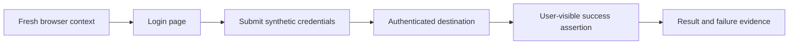

# How to Catch Broken Login Flows Behind a Healthy HTTP Endpoint

Author: [nawazdhandala](https://www.github.com/nawazdhandala)

Tags: Playwright, Monitoring, TypeScript

Description: Use a dedicated Playwright login journey with user-visible assertions and failure evidence to detect authentication failures hidden by a healthy process endpoint.

A health endpoint returning HTTP 200 proves only the condition that endpoint checks. It may say the process can answer requests while the login button, identity provider redirect, session cookie, or account API is broken. Add a synthetic login journey that verifies the authenticated result a user actually needs.

Use a supported Playwright Test release, its matching browser binaries, and a dedicated synthetic account. The example assumes an application with accessible Email and Password labels, a Sign in button, and an Account heading after successful login. Adapt these selectors to your application. Run against an environment you own and use an account that cannot perform sensitive customer actions.

## Start with a fresh session

A reused authenticated state skips the login path and cannot detect every login regression. Keep a dedicated fresh-login check alongside any faster authenticated journey checks. Validate required credentials before starting so a missing secret is reported as monitor configuration failure.

```typescript
// tests/login.spec.ts
import { test, expect } from '@playwright/test';

test('customer can log in', async ({ page }) => {
  const email = process.env.SYNTHETIC_EMAIL;
  const password = process.env.SYNTHETIC_PASSWORD;
  if (!email || !password) throw new Error('Synthetic credentials are missing');
  await page.goto('/login');
  await page.getByLabel('Email', { exact: true }).fill(email);
  await page.getByLabel('Password', { exact: true }).fill(password);
  await page.getByRole('button', { name: 'Sign in', exact: true }).click();
  await expect(page).toHaveURL(/\/account(?:\?|$)/);
  await expect(page.getByRole('heading', { name: 'Account', exact: true })).toBeVisible();
});
```

The final heading assertion prevents a redirect to an empty or broken account shell from counting as success. Add a harmless account-specific read if the page can render without a working session. Avoid checking only that the login button disappeared, because an error page can satisfy that condition too.

## Bound the check and preserve evidence

Set explicit timeouts and retain failure artifacts. Retries can help distinguish a transient failure, but record the first attempt and do not let retries hide a degraded success rate. The configuration below uses no retries so every scheduled run has one clear outcome.

```typescript
// playwright.config.ts
import { defineConfig } from '@playwright/test';
export default defineConfig({
  testDir: './tests',
  timeout: 45_000,
  retries: 0,
  use: {
    baseURL: process.env.SYNTHETIC_BASE_URL,
    storageState: { cookies: [], origins: [] },
    trace: 'retain-on-failure',
    screenshot: 'only-on-failure',
  },
});
```

Treat traces and screenshots as potentially sensitive. They can contain account details, URLs, and authentication traffic. Store them with restricted access and bounded retention. Use the dedicated account to minimize exposure, but do not assume its artifacts are safe to publish.

```bash
npx playwright test tests/login.spec.ts
```

This minimal configuration uses the default browser. Add explicit browser projects if the login promise includes other engines. Install the matching browser through your normal CI setup and pin the dependency in the lockfile. A missing browser binary is a runner failure, not an application outage.



## Classify failures before paging

Separate DNS or TLS failure, page-load failure, rejected credentials, identity-provider challenge, and authenticated-page failure. Each has a different owner and response. Keep the raw outcome available even if your paging policy requires two consecutive failures or agreement from another region.

Test the monitor by deliberately breaking the final assertion in staging and by using an expired test credential. Verify that the evidence explains the failure and that secret rotation restores the check. Monitor the scheduler itself so a check that stops running does not appear healthy.

The health endpoint remains useful for process supervision. The login journey adds evidence about authentication and the user interface. Together they let responders distinguish a running process from a working customer workflow.

Include a separate account-maintenance owner in the monitor metadata. Password rotation, account suspension, MFA enrollment, and identity-provider policy changes can break the synthetic account while customer login remains available. These failures still need prompt repair because monitoring coverage is lost, but their incident classification should be explicit. Test the account through the same supported authentication mechanism as its intended user class, and document any deliberate exceptions. A privileged automation-only login path may provide useful coverage, but it cannot establish that the ordinary customer path works.

## References

The [community question](https://www.reddit.com/r/sre/comments/1xu7xdn/what_do_you_actually_put_behind_health/) motivated this walkthrough. Implementation references:

- [Official reference 1](https://playwright.dev/docs/auth)
- [Official reference 2](https://playwright.dev/docs/test-assertions)
- [Official reference 3](https://playwright.dev/docs/trace-viewer)
