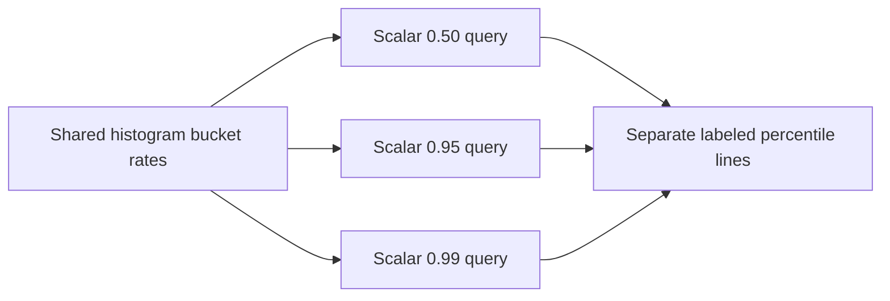

# How to Chart Multiple Latency Percentiles Without Broken Grafana Variables

Author: [nawazdhandala](https://www.github.com/nawazdhandala)

Tags: Prometheus, Grafana

Description: Use one scalar quantile per query and label each result instead of interpolating a multivalue variable into histogram_quantile.

`histogram_quantile` expects one scalar quantile argument, such as 0.95. A Grafana multivalue variable can expand to a list or regular expression, which is not a scalar. Substituting several selected percentiles into the first argument therefore produces invalid PromQL or an unintended expression.

The simplest reliable dashboard uses one query per percentile. Keep filtering variables for label matchers and use a single scalar for each quantile calculation. The examples use a classic histogram and a bounded `app` label.

## Give each percentile its own query

Create query A for P50:

```promql
histogram_quantile(
  0.50,
  sum by (app, le) (rate(http_request_duration_seconds_bucket[$__rate_interval]))
)
```

Create query B for P95:

```promql
histogram_quantile(
  0.95,
  sum by (app, le) (rate(http_request_duration_seconds_bucket[$__rate_interval]))
)
```

Create query C for P99:

```promql
histogram_quantile(
  0.99,
  sum by (app, le) (rate(http_request_duration_seconds_bucket[$__rate_interval]))
)
```

Set distinct legends such as `{{app}} P50`, `{{app}} P95`, and `{{app}} P99`. Choose the time unit that matches the metric. A useful panel also shows request volume so a high percentile from a nearly empty window is not overinterpreted.



## Use multivalue variables where they belong

An application variable can select several label values through a regex matcher:

```promql
histogram_quantile(
  0.99,
  sum by (app, le) (
    rate(http_request_duration_seconds_bucket{app=~"${app:regex}"}[$__rate_interval])
  )
)
```

The regex formatter escapes selected values appropriately for that context. It does not make a multivalue percentile variable valid in a scalar function argument. Inspect the expanded query in Grafana's query inspector when variable interpolation is confusing.

If you want one selectable percentile instead of several lines, use a single-value custom variable containing values such as `0.5`, `0.95`, and `0.99`. Disable multivalue and the all option. Validate that the expanded expression contains exactly one numeric value in the quantile position.

## Preserve identity when combining results

If several quantile expressions are combined with PromQL `or`, they need distinguishing labels. Without one, results for the same application can share the same label set, and the union keeps only one side. Separate Grafana queries avoid that problem and make legends easier to manage.

For reusable server-side recording rules, assign a normal `quantile` label to each recorded result. That creates three clear series per application and avoids depending on dashboard interpolation. Keep the evaluation window fixed and document it in the recording-rule name or description.

## Check the underlying histogram before blaming variables

All queries must retain `le` when aggregating classic buckets. Do not average per-instance percentiles to produce an application percentile. Ensure the selected applications use compatible bucket boundaries and the same duration unit.

`$__rate_interval` depends on Grafana's configured scrape interval and query step. An incorrect scrape interval can leave too few samples in the range even when the quantile expression is valid. Compare the raw bucket rate query and observation count when the lines are empty or jump unexpectedly.

Finally, test the panel with one application, several applications, and no matching application. Verify the expected number of lines and legend labels. This makes percentile selection a presentation concern while preserving the scalar and label rules that PromQL requires.

## References

The [community question](https://stackoverflow.com/questions/51776726/grafana-multivalue-float-histogram-quantile) motivated this investigation. The implementation references are [official reference 1](https://prometheus.io/docs/prometheus/latest/querying/functions/), [official reference 2](https://grafana.com/docs/grafana/latest/datasources/prometheus/template-variables/), [official reference 3](https://prometheus.io/docs/practices/histograms/).
