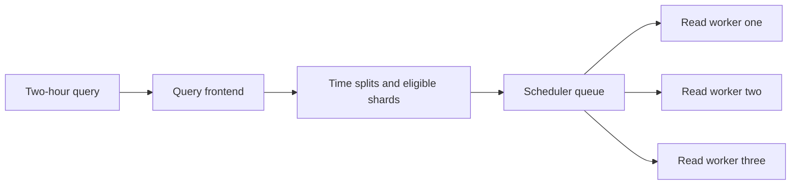

# How to Check Whether Loki Query Splitting Uses Read Replicas

Author: [nawazdhandala](https://www.github.com/nawazdhandala)

Tags: Loki, Kubernetes

Description: Verify the query frontend path, split intervals, worker discovery, and per-replica work before scaling Loki reads.

Adding read replicas does not guarantee that one Loki query uses all of them. The request must enter the appropriate frontend path, be eligible for splitting or sharding, and reach workers connected to the scheduler or frontend. Tenant limits and available work then constrain parallel execution.

Investigate with a fixed historical query long enough to produce several time splits. A five-minute query cannot demonstrate useful time splitting with a one-hour interval, though other sharding may still occur depending on the storage schema and query engine.

## Confirm the configured split interval

A Loki configuration fragment can set a time split interval:

```yaml
limits_config:
  split_queries_by_interval: 15m
```

Check the deployed version's configuration reference and tenant overrides. The fragment alone does not create a distributed read path. It must be applied to the components that plan queries, and a zero interval disables time splitting.

Estimate the available pieces for a simple planning example:

```python
import math
query_minutes = 120
split_minutes = 15
print("approximate time pieces:", math.ceil(query_minutes / split_minutes))
```

This gives eight approximate pieces. Alignment, caching, limits, and additional sharding can change the actual work, so use query statistics and logs to observe the real plan.



## Verify the request path

Check that Grafana points to the intended gateway or frontend endpoint, not directly to one querier. Inspect the Kubernetes Service endpoints and the chart's generated routing configuration.

```bash
kubectl -n loki get services
kubectl -n loki get endpointslices -o wide
kubectl -n loki get pods -l app.kubernetes.io/name=loki -o wide
```

In simple scalable mode, read components can contain several logical responsibilities. In distributed mode, frontends, schedulers, and queriers are separate deployments. Use the topology actually installed rather than copying component addresses from a different deployment mode.

If using a scheduler, confirm every intended querier discovers and connects to the scheduler set. A healthy Pod that has no worker connection cannot consume scheduled query work.

## Observe distribution on a controlled query

Run the fixed query through the same endpoint used by Grafana and save its statistics:

```bash
curl --fail-with-body --get http://localhost:3100/loki/api/v1/query_range \
  --data-urlencode 'query={namespace="checkout"} |= "completed"' \
  --data-urlencode 'start=2026-11-15T10:00:00Z' \
  --data-urlencode 'end=2026-11-15T12:00:00Z' \
  --data-urlencode 'limit=1000' > split-query.json
```

Correlate the query with per-worker query logs or tracing. Count completed subqueries on each replica and examine queue duration. CPU alone is weak evidence because a worker may be waiting on storage or serving unrelated queries.

Repeat once with caches cold enough for meaningful work and once with a warm cache, recording the conditions. A fully cached result may return quickly without involving all replicas, which is expected.

## Interpret limited parallelism correctly

Per-query parallelism, per-tenant capacity limits, worker concurrency, and the number of uncached splits all cap utilization. More workers cannot accelerate a query that has only one eligible piece or waits on one saturated storage dependency.

Making split intervals extremely small can create excessive scheduler overhead, cache fragmentation, and many outstanding requests. Increase parallelism only after checking the resulting queue and object-store request load.

The desired evidence is a consistent request path, observed subquery distribution, and lower elapsed time for an equivalent workload without increased errors. If one worker still does all the work, follow discovery and routing first. If all workers participate but latency remains high, investigate shared storage and query shape before adding replicas again.

## References

The [community question](https://www.reddit.com/r/grafana/comments/1e67f8k/how_is_your_large_volume_grafana_loki_environment/) motivated this investigation. The implementation references are [official reference 1](https://grafana.com/docs/loki/latest/configure/), [official reference 2](https://grafana.com/docs/loki/latest/reference/loki-http-api/), [official reference 3](https://grafana.com/docs/loki/latest/operations/query-fairness/).
