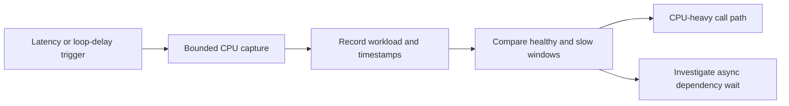

# How to Choose a Node.js Profile Window for Intermittent Slowdowns

Author: [nawazdhandala](https://www.github.com/nawazdhandala)

Tags: Node.js, Profiling

Description: Capture a bounded CPU profile around a known slowdown and compare it with event-loop delay and a healthy workload window.

A profile collected for an hour can bury a five-second slowdown under normal traffic. A one-second profile started after the incident can miss it entirely. Choose the capture window from the symptom's timing and preserve enough context to compare slow and healthy work.

CPU profiling answers where execution time was spent while samples were collected. It cannot directly explain time waiting on a remote service. Pair the capture with request latency and event-loop delay so you know whether the slowdown involved CPU work, blocking, or asynchronous waiting.

## Use a bounded inspector capture

This CommonJS helper uses the in-process Inspector API and does not open a remote debugging port. Save it as `capture.cjs` and invoke the exported function from an authorized diagnostic path in your application.

```javascript
const inspector = require('node:inspector');
const fs = require('node:fs/promises');
const { promisify } = require('node:util');
const delay = promisify(setTimeout);

async function captureCpu(file, durationMs = 10000) {
  const session = new inspector.Session();
  session.connect();
  const post = promisify(session.post).bind(session);
  try {
    await post('Profiler.enable');
    await post('Profiler.start');
    await delay(durationMs);
    const { profile } = await post('Profiler.stop');
    await fs.writeFile(file, JSON.stringify(profile));
  } finally {
    session.disconnect();
  }
}
module.exports = { captureCpu };
```

Prevent concurrent captures and bound file retention in the production integration. A timer fires only when the event loop can run, so a long synchronous block can extend the actual capture beyond the requested duration. Use the profile's recorded timestamps when interpreting it.

## Record event-loop delay alongside the profile

A small diagnostic fragment can summarize delay over the same interval:

```javascript
const { monitorEventLoopDelay } = require('node:perf_hooks');
const histogram = monitorEventLoopDelay({ resolution: 20 });
histogram.enable();
setTimeout(() => {
  histogram.disable();
  console.log({ p99DelayMs: histogram.percentile(99) / 1e6 });
}, 10000);
```

The histogram reports nanoseconds, hence the conversion. This is a process-level signal, not a per-request causal explanation. A slow dependency can increase request latency without producing high event-loop delay.



## Choose the window from recurrence

For a slowdown every few minutes, capture several short windows around the expected recurrence rather than one enormous profile. For an unpredictable symptom, use a supported continuous profiler with bounded retention or a trigger that starts promptly. A post-trigger CPU capture cannot recover samples from before the trigger unless the profiling system already retained them.

Create the output directory and check JavaScript syntax before integrating the helper:

```bash
mkdir -p profiles
node --check capture.cjs
```

For a controlled command-line reproduction, a process-lifetime profile is convenient:

```bash
node --cpu-prof --cpu-prof-dir=./profiles reproduction.js
```

Let the process terminate cleanly and preserve the Node version, source revision, request count, and input shape with the profile.

## Compare equivalent work

A slow profile containing many more requests will naturally contain more CPU samples. Compare normalized call-path shape and absolute CPU per completed operation. Include errors and retries in the workload accounting so extra work is not hidden.

If the profile is dominated by startup or module loading, warm the process before the incident capture unless startup itself is the problem. If garbage collection dominates, inspect allocation behavior and heap pressure rather than immediately increasing the capture duration.

Finally, test the capture mechanism under a known synchronous CPU spike and a known asynchronous delay. The CPU spike should appear in the profile; the asynchronous delay may appear primarily in request timing. That establishes what your chosen window and measurement can explain before relying on it during a production incident.

## References

The [community question](https://stackoverflow.com/questions/34244107/node-js-flame-graph-note-working-properly) motivated this investigation. The implementation references are [official reference 1](https://nodejs.org/api/cli.html), [official reference 2](https://nodejs.org/api/inspector.html), [official reference 3](https://nodejs.org/api/perf_hooks.html).
