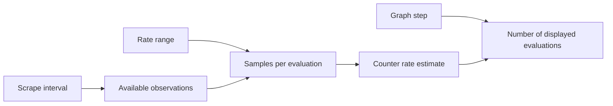

# How to Choose a PromQL Rate Window When Event Counts Look Doubled

Author: [nawazdhandala](https://www.github.com/nawazdhandala)

Tags: Prometheus, Grafana

Description: Avoid two-sample extrapolation surprises by choosing stable rate windows and checking scrape timing before adjusting counters.

When a range contains only two counter samples, one observed increment can be extrapolated into a much larger estimated increase. A dashboard can make that look like a doubled event count. The remedy is usually to inspect scrape timing and choose a suitable rate window, not divide the result by two.

The query's range, Grafana's step, and the scrape interval are different settings. The range determines which samples each evaluation uses. The step determines how frequently the expression is evaluated for a graph. Reducing the step does not create more scraped observations.

## Count the observations in the window

Inspect sample density for the exact target and time range:

```promql
count_over_time(job_completed_total{job="worker"}[30s])
```

Then compare short and longer estimates:

```promql
increase(job_completed_total{job="worker"}[30s])
```

```promql
increase(job_completed_total{job="worker"}[5m])
```

The five-minute result answers a different time-window question. It should not be compared as if it were another estimate of the same 30 seconds. For rate panels, compare per-second rates over different windows instead.



## Use a range that tolerates scrape jitter

A practical starting point is a rate range of at least several scrape intervals, commonly four, so one delayed or failed scrape does not leave too little information. In Grafana, `$__rate_interval` is designed for Prometheus rate queries using the configured scrape interval and query step.

```promql
sum by (service) (
  rate(http_requests_total[$__rate_interval])
)
```

Set the Prometheus data source's scrape interval correctly, and account for per-query minimum step settings. If the data source assumes 15 seconds while the target is scraped every minute, the generated range can still be unsuitable.

For alerting and recording rules, choose a fixed window based on the operational question. A dashboard variable does not exist in Prometheus rule evaluation. A five-minute rate may be appropriate for sustained traffic, while a shorter window may be needed for fast overload detection, provided it contains enough samples.

## Distinguish smoothing from exactness

Longer windows reduce volatility and boundary effects but smooth short bursts. They do not turn a sampled counter into an exact event ledger. A one-off job occurring between scrapes can remain difficult to place precisely in time even with a long window.

Avoid multiplying or dividing by a constant derived from one screenshot. The extrapolation factor changes with sample spacing, gaps, and evaluation alignment. `irate()` also does not solve exact counting: it uses the most recent pair for an instantaneous rate and is particularly volatile for sparse counters.

If the count remains near exactly twice the expected value over a long stable interval, investigate duplicate instrumentation or duplicate targets. Compare `job`, `instance`, replica, and exporter labels before aggregating them away. A two-sample artifact and double ingestion require different fixes.

## Build a small verification record

Capture the raw counter samples, the target's scrape interval, the evaluation timestamp, and the expression. Check `up` for scrape failures during the same range. Then replay the expression at neighboring timestamps to see whether the estimate shifts with the window boundary.

For sparse business events, display a longer-window estimate alongside the last event timestamp or a durable event count when exactness matters. Name the panel clearly, such as requests per second averaged over five minutes. This prevents readers from interpreting an extrapolated and smoothed rate as an exact count of events in the latest scrape interval.

## References

The [community question](https://stackoverflow.com/questions/48218950/increase-in-prometheus-sometimes-doubles-values-how-to-avoid) motivated this investigation. The implementation references are [official reference 1](https://prometheus.io/docs/prometheus/latest/querying/functions/), [official reference 2](https://grafana.com/docs/grafana/latest/datasources/prometheus/template-variables/).
