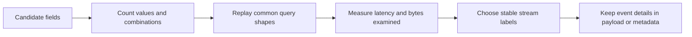

# How to Choose Log Fields to Index at Terabyte Scale

Author: [nawazdhandala](https://www.github.com/nawazdhandala)

Tags: Loki, Observability, Python

Description: Profile log field cardinality and query selectivity to choose stable Loki labels without turning request identifiers into expensive streams.

At terabyte-scale ingestion, indexing every field is a policy with a cost, not a harmless default. The right question is which fields consistently reduce the data examined by useful queries. Loki is a useful concrete example because it indexes stream labels rather than every word in the log body. That makes field selection visible in both stream count and query behavior.

Use a representative, redacted JSON Lines export and Python 3 for this exercise. Include ordinary traffic, deployments, failures, and batch jobs. A random hour from one service will underestimate values that appear only during incidents. The example records are synthetic and contain no user data.

## Inventory candidate dimensions

Begin with source dimensions that engineers already know before opening a log search: environment, service, and region. Contrast them with event identifiers discovered during an investigation, such as a trace ID. Measure observed combinations as well as individual value counts. Independent cardinalities multiplied together can overstate actual streams, while a single sample can understate future churn.

```json
{"environment":"prod","service":"checkout","region":"eu","trace_id":"t1","message":"payment rejected"}
```

```python
rows = [
 {"environment":"prod","service":"checkout","region":"eu","trace_id":"t1"},
 {"environment":"prod","service":"checkout","region":"eu","trace_id":"t2"},
 {"environment":"prod","service":"catalog","region":"us","trace_id":"t3"},
]
for field in rows[0]:
    print(field, len({row[field] for row in rows}))
base = ["environment", "service", "region"]
for fields in [base, base+["trace_id"]]:
    streams = {tuple(row[f] for f in fields) for row in rows}
    print(fields, len(streams))
assert len({row["trace_id"] for row in rows}) == 3
```

This fixture produces two base streams and three streams after adding trace IDs. The small difference is intentional: it demonstrates the mechanism, not a production benchmark. At real request volume, an event-specific label keeps creating new streams. Measure the rate of new combinations over time, not just the final number in a file.

## Replay real investigative questions

Collect a week of query shapes, remove sensitive values, and classify what the operator knew at the start. A useful candidate index field should reduce the search set in recurring queries. A rarely known field can still be valuable, but its benefit needs evidence rather than intuition.

```logql
{environment="prod", service="checkout", region="eu"}
  |= "payment rejected"
  | json
  | trace_id="t1"
```

The selector narrows source streams before parsing the body. Keep the trace identifier in structured metadata or structured log content according to your ingestion setup. Do not pretend that adding a JSON filter creates an index. Also avoid making raw URL paths labels when they contain order IDs; use a bounded route template if it is meaningful and available.



## Make the experiment comparable

Use the same redacted data, time window, query result limit, and cache condition for each layout. Run both common narrow searches and expensive incident searches. Record ingestion overhead, stream creation, object counts, query latency, and bytes examined. A layout that accelerates one trace lookup while multiplying tiny streams may increase total cost and operational risk.

For an initial decision record, create a table with field name, observed values, new values per hour, common query use, and proposed storage location. Require a named owner for changes to the label allowlist. This makes cardinality a reviewed schema decision rather than an accidental side effect of logging middleware.

## Recognize the limits

Loki's label model is not a universal description of every search engine. Other systems offer full-text, column, or specialized indexes with different tradeoffs. Even in Loki, query accelerations and structured metadata capabilities depend on the deployed version and storage schema. Confirm them before extrapolating a test.

Revisit the choice after a major product change or traffic shift. The correct outcome is a measured shortlist of fields that support actual investigation, together with a repeatable query benchmark. It is not the fewest possible labels at any cost: removing the service dimension can save little while forcing every useful query to scan unrelated data.

## References

The [community question](https://www.reddit.com/r/Observability/comments/1t37phh/at_what_scale_do_log_indexing_costs_become_the/) motivated this walkthrough. Implementation references:

- [Official reference 1](https://grafana.com/docs/loki/latest/get-started/labels/)
- [Official reference 2](https://grafana.com/docs/loki/latest/get-started/labels/cardinality/)
- [Official reference 3](https://grafana.com/docs/loki/latest/query/log_queries/)
