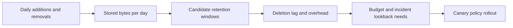

# How to Choose Loki Retention from Ingestion and Storage Growth

Author: [nawazdhandala](https://www.github.com/nawazdhandala)

Tags: Loki, Storage, Python

Description: Estimate Loki storage for different retention windows using measured compressed growth, deletion lag, and operational headroom.

Choosing seven, thirty, or ninety days of Loki retention starts with two measurements: how much usable history engineers need and how quickly the stored representation grows. Raw application log bytes alone are insufficient because compression, stream layout, index data, and object lifecycle behavior affect the storage footprint.

This exercise assumes a Loki 3.x deployment with compactor retention already working. Use daily object inventories or storage metrics for the same bucket and prefix, plus ingestion measurements from the same time interval. The Python examples use invented GiB values to make the method reproducible without access to a production account.

## Measure growth before steady state

When retention has not yet started deleting data, net storage growth can approximate new stored bytes. After steady state, net growth is additions minus removals and cannot be used as ingestion volume. Prefer an inventory that distinguishes newly created chunks, deleted chunks, indexes, and temporary objects.

```csv
sample_day,new_chunk_gib,new_index_gib,deleted_gib
1,82,4,0
2,90,5,0
3,88,4,0
4,110,6,0
```

Include weekdays, weekends, deployments, and incident logging. A verbose debug period may dominate a monthly bill even if the median day is quiet. Keep peak and typical values instead of averaging away the event that determines capacity. If object versioning retains old versions, account for those bytes separately from active Loki data.

## Compare candidate windows

The model below uses a conservative daily stored-data input plus room for deletion delay and other overhead. It estimates capacity, not the exact bucket size at an arbitrary moment. Replace the delay estimate with observed compactor behavior rather than assuming expiration and physical deletion happen simultaneously.

```python
daily_gib = 96
deletion_lag_days = 0.25
index_and_working_gib = 40
reserve = 0.20
for days in [7,14,30]:
    required = (daily_gib*(days+deletion_lag_days)+index_and_working_gib)/(1-reserve)
    print(days, round(required), "GiB planning capacity")
assert daily_gib*(7+deletion_lag_days) == 696
```

For object storage, the reserve represents a budgeting buffer rather than a filesystem free-space requirement. For filesystem-backed components, free space can be a hard availability constraint. Keep those interpretations separate. Also avoid counting index growth twice if it is already included in your measured daily total.



## Choose retention by use case

Interview engineers about the actual oldest data used in recent incidents. A two-week incident detection delay may make seven days insufficient even if it is cheap. Conversely, development debug logs may not justify the production retention window. Define source classes and explicit owners before adding per-stream exceptions.

```yaml
# Loki configuration fragment; requires configured compactor retention.
limits_config:
  retention_period: 336h
  retention_stream:
    - selector: '{environment="development"}'
      priority: 10
      period: 48h
    - selector: '{log_class="audit"}'
      priority: 20
      period: 720h
```

These are illustrative technical policies, not a compliance recommendation. The labels must exist on the stored streams. A JSON field named `log_class` does not match a stream selector unless it is actually a label. Separate archive requirements may call for a different durable path rather than extending Loki retention indefinitely.

## Verify that the chosen policy reaches equilibrium

After rollout, watch newly ingested canary streams through their full retention window. Confirm both query behavior and object removal. Current Loki documentation warns that retention changes are not retroactive, so do not promise immediate cost savings from changing a setting today. Observe enough time for the new policy to dominate the stored population.

If storage keeps growing, compare additions and removals before shortening retention again. Increased traffic, higher-cardinality labels, or a stuck deletion pipeline require different fixes. If the model underestimates storage consistently, update its measured daily input and explain the discrepancy. Finish with a scheduled capacity review and a documented trigger, such as a sustained ingestion increase, that forces the estimate to be recalculated. The useful output is a retention policy supported by actual investigation needs and measured storage behavior.

## References

The [community question](https://www.reddit.com/r/devops/comments/1r3d4u0/log_scraper_loki_storage_usage_and_best_practices/) motivated this walkthrough. Implementation references:

- [Official reference 1](https://grafana.com/docs/loki/latest/operations/storage/retention/)
- [Official reference 2](https://grafana.com/docs/loki/latest/get-started/labels/)
