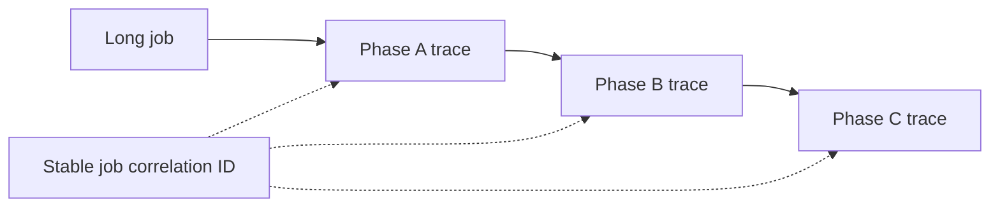

# How to Choose Tail-Sampling Windows for Long-Running Jobs

Author: [nawazdhandala](https://www.github.com/nawazdhandala)

Tags: OpenTelemetry, Observability

Description: Use span arrival timing and bounded job phases to avoid retaining hours of trace state for long-running workloads.

A job that lasts an hour does not automatically require an hour-long tail-sampling window. What matters is when spans from that trace first and last arrive at the sampler. A single root span exported at completion can arrive all at once; a job exporting many completed children while its root remains open creates a very different retention problem.

Before increasing `decision_wait`, measure arrival behavior. The Collector Contrib 0.120.0 tail sampler starts its decision timer from the first observed span. It does not receive an authoritative message declaring that a distributed trace is complete.

## Measure the relevant interval

Create a diagnostic export containing trace ID and Collector arrival timestamp. In this illustrative JSON schema, timestamps are seconds from a common clock. The script calculates the spread for each trace, not its execution duration.

```python
from collections import defaultdict
arrivals = [
    {"trace": "job-a", "received_s": 10},
    {"trace": "job-a", "received_s": 1810},
    {"trace": "job-b", "received_s": 1900},
    {"trace": "job-b", "received_s": 1902},
]
groups = defaultdict(list)
for row in arrivals:
    groups[row["trace"]].append(row["received_s"])
print({trace: max(times) - min(times) for trace, times in groups.items()})
```

The first job has a 30-minute arrival spread. The second may have run just as long but arrived within two seconds. Sample representative jobs, including retries and worker failures, before choosing a percentile or maximum allowance.



## Prefer bounded traces for independent phases

Split long workflows at meaningful boundaries such as dequeue, processing chunk, checkpoint, and finalization. Preserve a stable job identifier in logs and trace attributes, and use span links to express causal relationships when a new trace begins. This retains the workflow relationship without requiring one giant in-memory trace.

A Java fragment for a new root with a link to the preceding phase looks like this:

```java
SpanContext previousPhase = previousSpanContext;
Span phase = tracer.spanBuilder("job.finalize")
    .setNoParent()
    .addLink(previousPhase)
    .setAttribute("job.id", jobId)
    .startSpan();
try (Scope scope = phase.makeCurrent()) {
    finalizeJob();
} finally {
    phase.end();
}
```

The fragment assumes application variables and a configured tracer. Store job IDs where their cardinality is acceptable. They usually belong in traces and logs, not as an unbounded metric label.

## Size a window for the phase, not the entire workflow

After restructuring, use a decision window that covers phase arrival spread plus expected export delay. For example:

```yaml
processors:
  tail_sampling:
    decision_wait: 45s
    num_traces: 30000
    policies:
      - name: phase-errors
        type: status_code
        status_code:
          status_codes: [ERROR]
```

The value is illustrative. Calculate concurrent retained traces from arrival rate and window, then measure memory using representative span sizes. Long windows can exhaust trace capacity even when the number of running jobs seems small because many other traces share the sampler.

A decision cache can preserve an earlier keep or drop decision for later spans. It does not retroactively revise a discarded trace after a late failure arrives. This distinction matters when someone proposes a larger cache as a substitute for waiting for the final outcome.

## Preserve final job outcomes separately

Emit a durable job-completion record containing job ID, final status, attempts, and elapsed time. That record provides workflow truth even if a phase trace was dropped or the worker crashed before ending its root span.

If splitting is impossible, isolate long-running traces into a separately sized sampling tier or retain them without outcome-based sampling under a measured volume budget. Test restart behavior and late arrivals explicitly. The decision is a tradeoff between memory, completeness, and cost; no finite timer can prove that an arbitrary distributed job will never emit another span.

## References

The [community question](https://stackoverflow.com/questions/77654922/otel-collector-tail-sampling) motivated this investigation. The implementation references are [official reference 1](https://raw.githubusercontent.com/open-telemetry/opentelemetry-collector-contrib/v0.120.0/processor/tailsamplingprocessor/README.md), [official reference 2](https://opentelemetry.io/docs/languages/java/api/).
