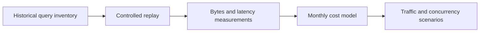

# How to Compare Indexing and Scan Costs for Long Log Lookbacks

Author: [nawazdhandala](https://www.github.com/nawazdhandala)

Tags: Observability, Loki, Python

Description: Build a repeatable workload and break-even model for indexed versus scanned log searches without confusing storage price with query cost.

A cheap log archive can become expensive when engineers repeatedly scan thirty days of data. An expensive index can also be wasteful when almost nobody queries old logs. Compare the entire workload: ingestion, retained storage, query volume, latency, and operational work. A single price per gigabyte cannot answer that question.

This tutorial builds a vendor-neutral model using Python 3 and an illustrative workload. All monetary values are invented inputs, not current vendor prices. Obtain the rates from your own contract and account for included allowances before using the model for a purchasing decision. Keep the raw inputs in version control so the calculation can be reviewed.

## Describe query work before choosing a backend

Separate narrow incident lookups, recurring dashboards, and broad exploratory queries. For each class, record lookback, frequency, useful selector fields, and acceptable response time. A dashboard refreshed every minute is fundamentally different from an auditor requesting one historical export.

```json
{"query_class":"incident_lookup","queries_per_month":120,"lookback_days":14,"selected_fraction":0.02,"latency_target_seconds":20}
```

Selected fraction is the portion of retained data remaining after effective pruning. It is not necessarily the fraction of matching results. A query that returns one line may still scan a large amount of compressed data. Use the engine's reported query statistics where available and document whether its billing uses scanned, processed, compressed, or uncompressed bytes.

## Calculate a workload-specific break-even point

The example separates fixed monthly costs from per-query scan costs. It asks how many similar searches would pay for an extra index. Real systems may charge for provisioned compute instead, in which case replace the per-query line with measured compute allocation.

```python
indexed_fixed = 1800
scan_fixed = 700
indexed_query = 0.08
scan_query = 2.50
break_even = (indexed_fixed-scan_fixed)/(scan_query-indexed_query)
for queries in [100, 500, 2000]:
    indexed = indexed_fixed + queries*indexed_query
    scanned = scan_fixed + queries*scan_query
    print(queries, round(indexed,2), round(scanned,2))
print("Break-even queries:", round(break_even))
assert 454 < break_even < 455
```

The model crosses near 455 queries per month. That number only applies to these invented values and this query mix. Repeat the calculation for several mixes rather than claiming one break-even point for the organization. Burst concurrency can require capacity that monthly averages hide.

## Test pruning with realistic selectors

For Loki, compare a bounded stream selector with an unnecessarily broad one over the same interval. Both examples search the same term, but the first gives the engine a more useful starting point. Replace labels with those that actually exist.

```logql
{environment="prod", service="checkout", region="eu"} |= "payment rejected"
```

```logql
{environment="prod"} |= "payment rejected"
```

Run a cold-cache pass and a warm-cache pass, recording them separately. Use identical result limits and a fixed historical dataset. Do not compare one product's first run with another's cached run. Include queries that return no results because these can still be costly and are common during incident investigation.



## Include time as an operational cost

A cheaper query that takes minutes may be acceptable for an audit and unacceptable during a payment outage. Record latency targets by query class. Add retrieval delays if data must be restored before it can be scanned. Include analyst time spent exporting data or rewriting queries, but distinguish measured labor from a hypothetical estimate.

Storage tiers can impose minimum-duration charges, request charges, or retrieval costs. An index can require replicas, backups, and upgrade work. Do not count archived bytes as immediately searchable unless your recovery test proves that path. Conversely, do not price every archived gigabyte as a full scan if partition pruning reliably avoids it.

## Decide with a sensitivity range

Vary query frequency, retained volume, and selected fraction independently. If a small change flips the decision, prefer a reversible pilot and preserve a portable raw archive. If one approach remains cheaper while meeting latency targets across a broad range, document the assumptions that make it so. The final artifact should be the workload file, repeatable query set, raw measurements, and model inputs. That is enough for another engineer to update the decision when traffic or pricing changes.

## References

The [community question](https://www.reddit.com/r/Observability/comments/1t37phh/at_what_scale_do_log_indexing_costs_become_the/) motivated this walkthrough. Implementation references:

- [Official reference 1](https://grafana.com/docs/loki/latest/get-started/labels/)
- [Official reference 2](https://grafana.com/docs/loki/latest/query/log_queries/)
