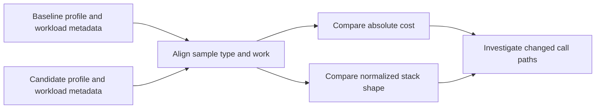

# How to Compare Production and Staging Go Profiles for Regressions

Author: [nawazdhandala](https://www.github.com/nawazdhandala)

Tags: Go, Profiling

Description: Align workload, binaries, sample types, and normalization before interpreting differences between pprof captures.

A larger box in a staging profile does not automatically indicate a release regression. Production and staging may have different traffic mixes, CPU limits, request volumes, cache warmth, or background jobs. A profile comparison is useful only after the measurements describe sufficiently comparable work.

Start with the question: did the release increase CPU per request, allocation per operation, retained heap, or latency? Each requires a different sample type and normalization. A CPU profile cannot establish a memory leak, and a normalized flame graph can hide an increase in total CPU cost.

## Capture equivalent intervals and preserve metadata

Collect a bounded CPU profile from each environment using the same duration:

```bash
curl --fail --output baseline.pprof \
  'http://127.0.0.1:6060/debug/pprof/profile?seconds=30'
```

Use a separate authenticated tunnel or diagnostic endpoint for each environment, and save the second capture as `candidate.pprof`. Record release SHA, Go version, architecture, CPU quota, request count, request mix, and capture timestamps alongside each profile.

An illustrative metadata file is:

```json
{
  "release": "candidate-sha",
  "profile_type": "cpu",
  "duration_seconds": 30,
  "completed_requests": 12000,
  "workload": "checkout-read-80-write-20",
  "cpu_limit_cores": 2
}
```

The values are examples, not measured results. Retain the exact binary and relevant source revision for each build so symbolization and source listings are meaningful.



## Compare absolute and normalized differences

For profiles with comparable work, use a differential view:

```bash
go tool pprof -top -diff_base=baseline.pprof candidate.pprof
```

Then inspect a normalized shape comparison:

```bash
go tool pprof -top -normalize -diff_base=baseline.pprof candidate.pprof
```

Normalization scales the baseline total for comparison and emphasizes where relative cost moved. It can conceal a uniform increase across all functions, so always retain the absolute totals and request-normalized service measurements.

Positive and negative entries indicate differences under the tool's comparison semantics, not proof of causation. A function may become more prominent because another function became cheaper. Inlining and compiler changes can move samples between symbols without a corresponding source-level regression.

## Normalize to useful work

If one capture handled twice as many requests, compare CPU seconds per completed request or allocation bytes per operation outside the flame graph. Keep failed and retried requests in the accounting model so the denominator does not hide extra work.

For heap analysis, select the intended sample type, such as allocated bytes versus in-use bytes. A high allocation rate can increase GC cost without a growing live heap, while a retention regression may require repeated comparable snapshots over time.

Use a replayable staging workload shaped from production traffic where permitted, with sensitive data removed. Match cache state and dependency behavior as closely as practical. If production has a different hardware architecture or quota, treat the comparison as a hypothesis generator rather than a definitive benchmark.

## Confirm a suspected call-path regression

Inspect the changed function and its callers, then design a focused benchmark or controlled request test. Measure the candidate and baseline repeatedly under the same conditions. Validate that a proposed fix improves both the profile evidence and the application outcome.

Check background activity such as GC, telemetry export, periodic refreshes, and startup work. A short capture can overrepresent a scheduled task that ran in only one interval.

Finally, store the comparison metadata with the profiles. A useful regression report states the workload, the absolute cost change, the affected call path, and the remaining environmental differences. A colorful differential graph is supporting evidence, not a substitute for those facts.

## References

The [community question](https://www.reddit.com/r/golang/comments/1uasllf/how_do_you_do_continuous_profiling_execution/) motivated this investigation. The implementation references are [official reference 1](https://pkg.go.dev/net/http/pprof), [official reference 2](https://raw.githubusercontent.com/google/pprof/main/doc/README.md).
