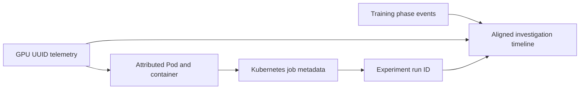

# How to Connect GPU Utilization Dips to Kubernetes Training Jobs

Author: [nawazdhandala](https://www.github.com/nawazdhandala)

Tags: GPU, Kubernetes, Prometheus

Description: Join GPU device telemetry with bounded workload metadata and compare dips with training phases, input waits, and checkpoint events.

A GPU utilization dip says the device was less active during an interval. It does not explain whether the training job was loading data, checkpointing, synchronizing workers, restarting, or intentionally idle. Connect device telemetry to the job and its phase before treating every dip as wasted capacity.

Start with trustworthy Pod attribution from DCGM exporter and a stable job identifier from Kubernetes metadata. Keep experiment details in logs or an experiment tracker when they would create excessive metric cardinality.

## Preserve the device and workload dimensions

Inspect utilization by GPU UUID, namespace, and Pod:

```promql
avg by (UUID, namespace, pod) (
  DCGM_FI_DEV_GPU_UTIL{namespace="training",pod!=""}
)
```

This average assumes duplicate scrape series have been handled appropriately. If one GPU is shared by several Pods, the same hardware measurement may appear with multiple workload labels. Do not sum those copies to estimate physical utilization.



## Join a bounded job label

Suppose kube-state-metrics is configured to expose a controlled Pod label `training_job`. An illustrative join is:

```promql
DCGM_FI_DEV_GPU_UTIL{namespace="training",pod!=""}
* on (namespace, pod) group_left(label_training_job)
max by (namespace, pod, label_training_job) (
  kube_pod_labels{namespace="training",label_training_job!=""}
)
```

The right-hand side must be unique per namespace and Pod. Verify the actual sanitized label name and allowlist configuration in kube-state-metrics. Add cluster identity to both sides in a multi-cluster metric store to avoid matching unrelated Pods with the same names.

Do not attach a new training-step number to every GPU sample. That creates a rapidly changing series dimension. Keep fine-grained phase and step details in structured events.

```json
{
  "event": "training.phase",
  "run_id": "experiment-42",
  "pod": "trainer-0",
  "phase": "checkpoint",
  "step": 1200,
  "timestamp": "2026-11-15T12:00:00Z"
}
```

## Compare competing explanations

Align the utilization dip with data-loader queue depth, CPU usage, storage read latency, network throughput, and distributed synchronization time. A GPU waiting for input can have low compute activity while CPU or storage is saturated. A collective communication phase can show different compute and link behavior across workers.

Inspect all ranks, not just the average. One slow worker can make the others wait at synchronization barriers. Preserve per-device or per-rank views long enough to identify the straggler, then aggregate for a summary.

Use training throughput, such as samples per second or step duration, as the outcome metric. A higher utilization percentage is not automatically better if the model processes fewer useful samples or spends more time recomputing work.

## Run one controlled change

If the evidence points to input starvation, change data-loader workers or prefetch depth in a representative test. If checkpointing dominates, measure checkpoint duration and storage bandwidth. If batch size changes, also track memory use and model behavior so performance improvements do not violate the experiment's requirements.

Record the GPU model, driver, DCGM version, sharing mode, batch size, and dataset. Those conditions affect comparisons. Do not compare two experiments' raw utilization percentages as if they used equivalent hardware and work.

Finally, distinguish allocated time from useful work. A Pod can reserve a GPU while initializing, downloading a model, or waiting for another resource. Measure those phases explicitly. Correlating the device, Pod, job, and experiment timeline turns a utilization dip into a testable workload explanation rather than a vague recommendation to increase GPU usage.

## References

The [community question](https://www.reddit.com/r/MachineLearning/comments/1qj0bcc/d_how_do_you_guys_handle_gpu_waste_on_k8s/) motivated this investigation. The implementation references are [official reference 1](https://docs.nvidia.com/datacenter/dcgm/latest/installation/install-dcgm-exporter.html), [official reference 2](https://docs.nvidia.com/datacenter/dcgm/latest/reference/dcgm-exporter-metrics.html), [official reference 3](https://raw.githubusercontent.com/kubernetes/kube-state-metrics/main/docs/metrics/workload/pod-metrics.md).
