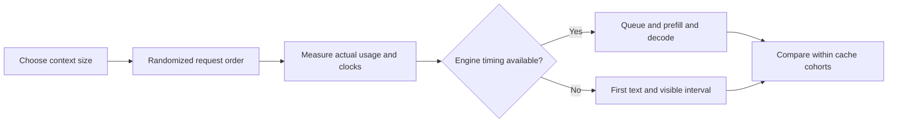

# How to Correlate LLM Context Length with Prefill and Decode Latency

Author: [nawazdhandala](https://www.github.com/nawazdhandala)

Tags: AI, LLM, Python, Observability

Description: Build controlled context-length experiments and separate queueing, prefill, and decode measurements without overreading client latency.

Longer conversations often take longer to start answering, but context length is only one variable. A warmed prefix cache, a different output length, or more concurrent requests can reverse an apparent trend. To understand the relationship, build a controlled experiment and preserve the distinctions between engine timing and what the client sees.

Prefill processes the input context. Decode generates output incrementally. Client time to first text also includes transport, scheduling, queueing, and possibly moderation. If your provider does not expose prefill duration, label the measurement first-text latency. Renaming it prefill does not make the other components disappear.

## Design a comparable workload

Use the same model revision, instructions, output budget, sampling configuration, region, and concurrency. Increase a meaningful source document rather than repeating meaningless padding. Keep the answer task constant: for example, extract the same fact from differently sized policy documents. Move the fact across positions in a separate experiment, since position changes task difficulty.

The following manifest is application-defined experiment configuration. Its requested input lengths are targets; record the actual tokenizer or provider counts after constructing each request. Python fixtures below need only Python 3.11 or later.

```json
{
  "experiment": "context-sweep-01",
  "target_input_tokens": [512, 2048, 8192],
  "repeats_per_size": 20,
  "concurrency": 1,
  "output_budget": 128,
  "randomize_order": true,
  "cache_measurement": "record-provider-usage"
}
```

Do not assume a fresh process gives a cold provider cache. Record cached-input usage when available and analyze warm and cold cohorts separately. The official prompt-caching documentation explains that reuse depends on a matching rendered prefix and compatible settings. A common prefix can make a long request substantially different from an equally long uncached request.



## Compute an engine breakdown correctly

Use this offline fixture to verify timestamp relationships before connecting telemetry. All timestamps are from the same monotonic clock. Queue time ends when execution begins, and prefill ends when the first token becomes available. Some engines expose slightly different boundaries, so document yours explicitly.

```python
sample = {"admitted": 100.0, "scheduled": 100.2,
          "first_token": 100.8, "last_token": 101.7,
          "output_tokens": 10, "input_tokens": 2048}
queue_s = sample["scheduled"] - sample["admitted"]
prefill_s = sample["first_token"] - sample["scheduled"]
decode_s = sample["last_token"] - sample["first_token"]
assert all(x >= 0 for x in (queue_s, prefill_s, decode_s))
print({"queue_s": round(queue_s, 3), "prefill_s": round(prefill_s, 3),
       "decode_tps": round((sample["output_tokens"] - 1) / decode_s, 3)})
```

This produces 0.2 seconds of queueing, 0.6 seconds of prefill, and 10 tokens per second across the nine decode intervals. Never combine server and client timestamps in this subtraction unless you have a justified clock-synchronization model.

## Summarize by context bucket

The next synthetic dataset demonstrates the grouping logic. It deliberately excludes cached requests from the cold-context comparison. Production analysis should also group by model and serving configuration. With very few observations, display the individual points rather than pretending a percentile estimate is stable.

```python
from collections import defaultdict
from statistics import median

rows = [
    {"input": 512, "cached": 0, "ttft": 0.30},
    {"input": 512, "cached": 0, "ttft": 0.34},
    {"input": 2048, "cached": 0, "ttft": 0.70},
    {"input": 2048, "cached": 0, "ttft": 0.74},
    {"input": 2048, "cached": 1792, "ttft": 0.20},
]
groups = defaultdict(list)
for row in rows:
    if row["cached"] == 0:
        groups[row["input"]].append(row["ttft"])
for size, values in sorted(groups.items()):
    print(size, len(values), round(median(values), 3))
```

The medians are 0.32 and 0.72 seconds for this fixture. Those values illustrate a calculation, not a scaling law. Avoid fitting one line across hardware changes, context-window boundaries, or batch sizes. Prefill and decode can respond differently to memory pressure and scheduling.

## Use the result to choose the next experiment

If cold first-text latency increases with input length while queueing stays flat, investigate input processing. If engine prefill stays flat but the client slows, examine the gateway and transport. If decode throughput changes, compare output length, active batches, and memory use before blaming prompt growth.

Report sample count, missing usage count, failures, cache-hit fraction, and output-token distribution beside latency. Repeat the sweep in randomized order to reduce warmup and traffic effects. A context budget should be chosen from measured user experience and answer quality together; faster requests that remove the required evidence are not an improvement.

## References

This tutorial addresses the problem in the [community question](https://www.reddit.com/r/LocalLLaMA/comments/1kk1dkh/time_to_first_token_and_tokenssecond/). Implementation details were checked against these primary sources:

- [Official documentation 1](https://developers.openai.com/api/docs/guides/prompt-caching)
- [Official documentation 2](https://developers.openai.com/api/docs/guides/streaming-responses)
