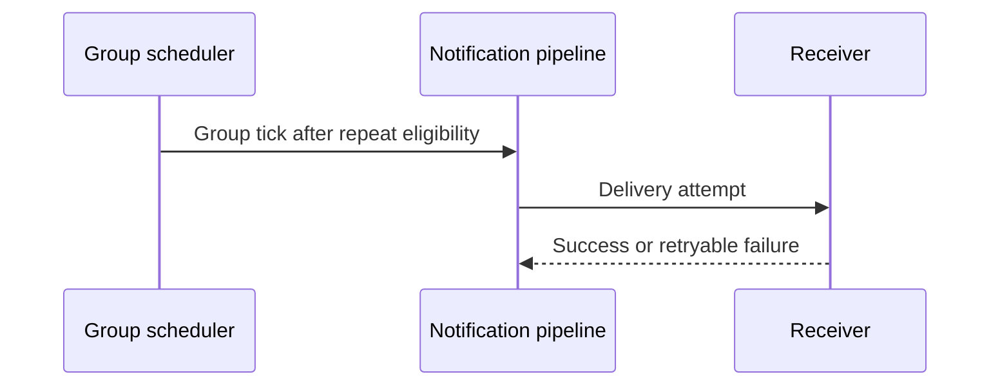

# How to Debug Late Alertmanager Reminder Notifications

Author: [nawazdhandala](https://www.github.com/nawazdhandala)

Tags: Alertmanager, Monitoring, Python

Description: Calculate reminder eligibility on Alertmanager group ticks and separate timer behavior from receiver retries and route changes.

A repeat interval is not an independent alarm clock attached to each chat message. Alertmanager evaluates notification changes at group intervals, and an unchanged group becomes eligible for a reminder when the repeat interval has elapsed. When these intervals do not align, the reminder can arrive later than a casual reading of the configuration suggests.

This walkthrough uses the documented behavior of current Alertmanager and a small Python 3 timing model. The model covers an unchanged group after a successful notification. It deliberately excludes network delivery delay, receiver retries, grouping changes, and high-availability coordination, which must be investigated separately.

## Recover the effective route

Locate the route that actually matches the alert labels and record its inherited `group_wait`, `group_interval`, and `repeat_interval`. A root setting is irrelevant if a child route overrides it. Record the receiver and grouping keys as well, because changing either can create a different notification context.

```yaml
route:
  receiver: timing-sink
  group_by: [environment, service, alertname]
  group_wait: 30s
  group_interval: 5m
  repeat_interval: 12m
receivers:
  - name: timing-sink
    webhook_configs:
      - url: http://notification-sink:8080/alerts
```

Here the repeat interval is not a multiple of the five-minute group interval. An unchanged group's next reminder is checked at group ticks, so twelve minutes does not mean the next notification must be emitted exactly twelve minutes after the previous one. Prefer aligned values when predictable schedules matter.

## Model eligibility before delivery

The fixture rounds repeat eligibility up to a group tick. It produces fifteen minutes for a twelve-minute repeat interval checked every five minutes. It does not include the initial group wait because that controls the first notification, not this simplified reminder calculation.

```python
import math
group_interval_seconds = 5*60
repeat_interval_seconds = 12*60
eligible_at = math.ceil(repeat_interval_seconds/group_interval_seconds)*group_interval_seconds
print("Earliest aligned reminder:", eligible_at//60, "minutes")
assert eligible_at == 15*60
```

A message received at sixteen minutes could be compatible with fifteen-minute eligibility plus delivery delay. It could also reflect retries or a different effective route. Do not infer the cause from the final receiver timestamp alone. Keep notification attempt time and receiver receipt time as separate fields.



## Build a useful timing record

Use an internal observation format that includes the last successful notification and each relevant state change. The following JSON is a worksheet, not an Alertmanager API schema. Populate it from logs, test-sink receipts, and the alert's label history.

```json
{"group":"prod/checkout/CheckoutErrors","last_success":"2026-11-15T10:00:00Z","repeat_interval_seconds":720,"group_interval_seconds":300,"next_eligible_tick":"2026-11-15T10:15:00Z","receiver_received":"2026-11-15T10:15:02Z"}
```

Changes to group membership can trigger an update notification before the ordinary repeat interval. A newly firing instance or a resolved member is new information. An alert that resolves and later fires again also differs from an unchanged ongoing alert. Keep these events in the timeline instead of calling every notification a reminder.

## Check other sources of delay

Inspect receiver errors, rate limits, connection timeouts, and notification retries. Verify Alertmanager persistence and retention settings because notification-history retention interacts with very long repeat intervals. In a high-availability cluster, verify peer health and whether duplicate or delayed messages correlate with partition events.

Avoid shortening timers until the mechanism is understood. Lowering group interval increases update opportunities and may increase notification volume without fixing a slow receiver. A receiver that acknowledges a request but delays posting the message requires investigation on that side of the boundary.

For acceptance, use a stable test alert and a local timestamping sink, hold its labels and firing state constant, and observe several reminders. Then introduce one group membership change and one controlled receiver failure. Compare each event with the expected route behavior. This separates normal scheduler quantization from delivery incidents and gives responders a schedule they can explain rather than a timer setting they merely hope will work.

## References

The [community question](https://stackoverflow.com/questions/78728184/why-alertmanager-is-re-sending-notifications-after-group-interval-repeat-inte) motivated this walkthrough. Implementation references:

- [Official reference 1](https://prometheus.io/docs/alerting/latest/configuration/)
