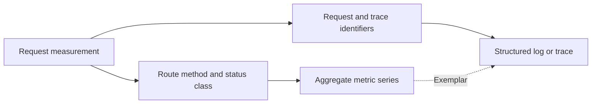

# How to Decide Which Ephemeral Labels Belong in Logs Instead of Metrics

Author: [nawazdhandala](https://www.github.com/nawazdhandala)

Tags: Prometheus, Observability

Description: Separate bounded metric dimensions from per-request identifiers and retain correlation through logs, traces, and exemplars.

A metric label is part of a time series' identity. A request ID that appears once creates a new series rather than adding searchable context to an existing counter. The same problem appears with session IDs, raw URLs, experiment runs, and short-lived resource identifiers.

Choose labels according to the questions the metric must answer. Metrics are effective for aggregate counts and distributions over bounded dimensions. Logs and traces are better suited to identifying one particular request or execution. Exemplars can connect an aggregate measurement to a representative trace without turning the trace ID into a series label.

## Estimate the proposed label's cost

The following calculation compares a bounded route metric with the same metric carrying a unique request ID. It is an illustrative model, not a measured backend allocation.

```python
routes = 30
methods = 4
status_classes = 5
replicas = 6
bounded_series = routes * methods * status_classes * replicas
requests_per_day = 2_000_000
print({"bounded_counter_series": bounded_series,
       "possible_daily_request_id_series": requests_per_day})
```

The request-ID dimension can create one series per observed request even when the other labels repeat. Histograms multiply the problem further because classic buckets, sum, and count are separate series.



## Keep a bounded metric contract

A Prometheus exposition example uses a route template rather than the raw path:

```text
http_requests_total{route="/orders/{order_id}",method="GET",status_class="2xx"} 4281
```

The braces inside the route value are literal text. Normalize the route using the framework's matched route template, not a homemade regex that might leak identifiers or accidentally merge unrelated endpoints.

Keep detailed identity in a structured event:

```json
{
  "event": "http.request.completed",
  "route": "/orders/{order_id}",
  "request_id": "req-42",
  "trace_id": "4bf92f3577b34da6a3ce929d0e0e4736",
  "status_code": 200,
  "duration_ms": 84
}
```

Log only the identifiers and fields needed for investigation, applying privacy and retention policies. Moving a sensitive value from a metric label to a log does not make it safe by itself.

## Use bounded categories for operational decisions

If a team needs per-customer metrics, first determine whether the customer set is small and controlled. A handful of contract tiers may answer the alerting question without a series per customer. If individual-customer service objectives are required, budget that dimension explicitly and isolate the workload where necessary.

Avoid replacing a UUID with its hash and assuming cardinality is fixed. A one-to-one hash preserves the number of distinct values. Bucketing into a fixed number of categories bounds cardinality but changes the meaning and introduces collisions; only do that when the resulting aggregate is useful.

## Migrate without breaking counter semantics

Change instrumentation to stop emitting the unwanted label, or aggregate through a supported stage that understands the metric. A scrape relabel rule that simply drops a label can cause distinct samples to become identical. It does not add them together.

Run both schemas temporarily under distinct metric names if a compatibility period is necessary. Update dashboards and alert rules to the new bounded dimensions, then retire the old metric. Watch scrape errors and compare aggregate rates across the migration.

## Check the investigation workflow

Trigger a test request, find its metric contribution in the relevant aggregate, and use the request ID or exemplar to reach the detailed event. Confirm that an investigator can still answer which deployment, route, and dependency were involved.

Document the maximum expected values for every label and who owns changes to that contract. A label that is bounded today can become unbounded when a feature starts inserting tenant-provided names. Reviewing cardinality at instrumentation design time is cheaper and safer than deleting labels after Prometheus memory has already grown.

## References

The [community question](https://www.reddit.com/r/devops/comments/12aygos/) motivated this investigation. The implementation references are [official reference 1](https://prometheus.io/docs/practices/naming/), [official reference 2](https://prometheus.io/docs/practices/histograms/).
