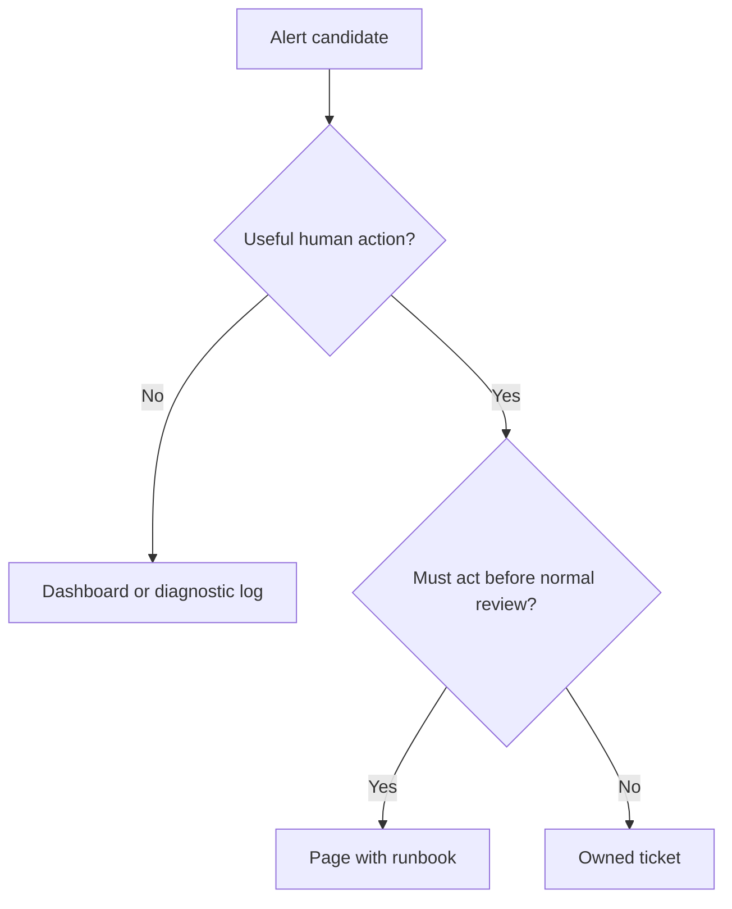

# How to Decide Which Noisy Alerts Belong on Dashboards

Author: [nawazdhandala](https://www.github.com/nawazdhandala)

Tags: SRE, Monitoring, Python

Description: Classify alerts by user impact, response urgency, and available action, then replay incidents before moving informational signals off the pager.

An alert belongs on the pager when an engineer needs to act before the next normal review opportunity. A metric being unusual is insufficient. High CPU, cache misses, and isolated retries can be useful diagnostic panels even when they should not wake someone. Make the decision using incident evidence and response deadlines rather than a blanket rule against noisy metrics.

This walkthrough uses a small, explicitly internal alert inventory and Python 3. It is a review aid, not an automated suppression engine. Keep existing paging active while evaluating candidates, then change one class at a time with an owner and rollback criterion.

## Capture the response contract

For every alert, record the user-visible symptom, required response, latest safe response time, and runbook. If the only action is to open a dashboard and wait, identify what would make intervention useful. Some capacity warnings belong in a ticket because action is necessary but can happen during working hours.

```json
{"alert":"CacheMissRateHigh","user_impact":"none observed","action":"inspect cache efficiency at weekly review","response_deadline_minutes":10080,"destination":"dashboard","owner":"catalog"}
```

Do not confuse absence of recorded action with proof that no action was needed. Review the incident notes and ask the responder whether the alert was useful confirmation, an early warning, or unrelated noise. Missing documentation is a data-quality problem in the audit itself.

## Create a candidate classification

The fixture below uses deliberately simple policy fields. It shows how to identify review candidates while keeping the decision interpretable. Replace the thresholds with your operational expectations and review every proposed downgrade.

```python
alerts = [
 {"name":"CheckoutFailures","impact":True,"action":True,"deadline":10},
 {"name":"DiskForecast","impact":False,"action":True,"deadline":1440},
 {"name":"CacheMissRate","impact":False,"action":False,"deadline":10080},
]
for alert in alerts:
    destination = "page" if alert["action"] and alert["deadline"] <= 30 else (
        "ticket" if alert["action"] else "dashboard")
    print(alert["name"], destination)
assert alerts[0]["impact"]
```

This classification does not require present user impact for every page. A near-certain impending failure, such as imminent data loss, can justify urgent action. The important evidence is a defensible deadline and a useful response. Document that exception instead of forcing every signal into a generic error-rate rule.



## Preserve the diagnostic panel

Moving a cause metric off the pager should not remove it from investigations. Keep a panel with a stable query, clear units, and a link from the symptom alert. For a cache hit-ratio panel, the following uses illustrative application counters and handles only positive request volume.

```promql
sum(rate(cache_hits_total[5m]))
/
sum(rate(cache_requests_total[5m]))
```

Show no traffic as no data or an explicit idle state rather than interpreting division by zero as cache failure. Keep the relevant service and environment dimensions when multiple systems share the datasource. The panel should help explain a checkout symptom, not create another unexplained global average.

## Replay known incidents before downgrading

For each candidate, examine several past incidents and ask whether another retained page would have reached the correct responder in time. Include incidents with partial outages and low traffic, because global symptoms can hide a small but important customer segment. Record the detection delay before and after the proposed change.

Then trial the new destination for a bounded period. Measure page count, actionable-page fraction, missed incidents, and time to detection. A lower page count alone is not success if customer reports become the primary detector. Keep an easy reversal path and an explicit owner for reviewing unexpected failures.

The final output is a small catalog: pages with urgent actions, tickets with deadlines, and panels with diagnostic purpose. This makes the on-call queue explainable and lets engineers retain useful telemetry without treating every interesting graph as an interruption.

## References

The [community question](https://www.reddit.com/r/sre/comments/18ggb3p/whats_your_strategy_for_reducing_alert_fatigue/) motivated this walkthrough. Implementation references:

- [Official reference 1](https://prometheus.io/docs/practices/alerting/)
- [Official reference 2](https://sre.google/workbook/alerting-on-slos/)
