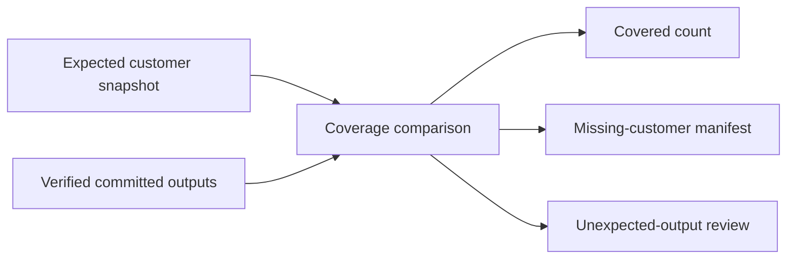

# How to Define a Coverage SLO for Batch Runs That Skip Customers

Author: [nawazdhandala](https://www.github.com/nawazdhandala)

Tags: SLO, Python, Monitoring

Description: Freeze the expected customer population, count verified outputs, and expose missing coverage even when a batch job reports success.

A batch job that exits successfully after processing 98 of 100 expected customers has not achieved complete coverage. Job status describes process execution; coverage describes whether the promised outputs exist for the intended population. Build the denominator from an authoritative snapshot taken before processing begins.

The examples use Python 3 sets and a custom batch manifest. Customer identifiers in the fixture are synthetic. Keep detailed customer-level evidence in a controlled manifest or database rather than creating an unbounded Prometheus label for every customer. Aggregate metrics should summarize the run while preserving a path to the missing records.

## Freeze the expected population

Store the eligibility rule, snapshot time, and expected customer IDs with the run. If the customer list changes while the job executes, a moving denominator can conceal omissions or falsely accuse the pipeline of missing newly created customers. Decide how mid-run additions and deactivations affect the next run.

```json
{"run_id":"run-209","eligibility_version":2,"population_snapshot":"customers-2026-11-15T00:00Z","expected_count":4,"deadline":"2026-11-15T02:00:00Z"}
```

Do not use the set of customers that happened to produce output as the denominator. That makes coverage appear perfect by construction. The expected population must come from a source independent of successful processing, such as a reviewed account snapshot or a durable work manifest.

## Compare sets, not only totals

Equal counts do not prove equal membership. A duplicate output or an unexpected customer can mask a missing expected customer. Count unique verified outputs, then explicitly calculate missing and unexpected sets.

```python
expected = {"c1","c2","c3","c4"}
verified_outputs = ["c1","c2","c2","c4","c9"]
actual = set(verified_outputs)
covered = expected & actual
missing = expected-actual
unexpected = actual-expected
coverage = len(covered)/len(expected) if expected else None
print({"coverage":coverage,"missing":sorted(missing),"unexpected":sorted(unexpected)})
assert coverage == 0.75 and missing == {"c3"}
```

The fixture reports 75% coverage even though five output records exist for four expected customers. This is why a processed-row count alone is insufficient. Verification should also establish that each output is readable, belongs to the correct run, and passes required content checks.



## Expose bounded operational metrics

Publish aggregate gauges for the latest finalized run and a timestamp identifying when the result was checked. The following is illustrative Prometheus text exposition. The run ID belongs in the manifest link rather than a continually changing metric label.

```text
batch_expected_customers{pipeline="billing"} 4
batch_verified_customers{pipeline="billing"} 3
batch_missing_customers{pipeline="billing"} 1
batch_coverage_checked_timestamp_seconds{pipeline="billing"} 1794708000
```

Add exporter freshness monitoring so a previously complete run cannot remain green forever. If several runs execute concurrently, define which run each aggregate represents or use a bounded schedule slot dimension. Avoid overwriting a failed run's evidence before its deadline review is complete.

## Define the SLO event and deadline

You can count customer-run pairs as eligible events, making each expected customer's output one opportunity to succeed. Alternatively, define a run as good only if coverage exceeds a threshold by its deadline. These produce different error budgets. A large customer should not silently receive the same weight as a small one unless that matches the product promise.

Record late recovery separately from on-time coverage. Backfilling the missing output improves current completeness but does not retroactively make the original deadline successful. Preserve the finalized deadline result for reporting and the current repair status for operations.

Test an empty expected population, duplicate outputs, a skipped customer, a partially written object, and a population change mid-run. For zero expected customers, report no eligible work rather than dividing by zero. The final runbook should link the aggregate failure to the exact missing-customer manifest, allowing the responder to repair the omission without rescanning the entire pipeline blindly.

## References

The [community question](https://www.reddit.com/r/devops/comments/1r3i7kl/how_do_you_set_slos_for_longrunning_batch_jobs/) motivated this walkthrough. Implementation references:

- [Official reference 1](https://sre.google/workbook/data-processing/)
- [Official reference 2](https://sre.google/workbook/implementing-slos/)
- [Official reference 3](https://prometheus.io/docs/practices/instrumentation/)
