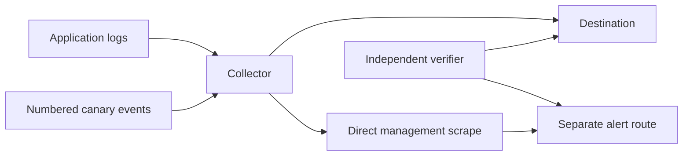

# How to Detect Collector Data Loss When Its Error Logs Also Disappear

Author: [nawazdhandala](https://www.github.com/nawazdhandala)

Tags: OpenTelemetry, Monitoring

Description: Build independent Collector health checks and sequence-number canaries so pipeline failures remain visible during log delivery outages.

Sending Collector error logs through the same pipeline they describe creates a circular dependency. When the exporter or destination fails, the evidence may disappear alongside application logs. The solution is to observe several boundaries independently and use a small end-to-end canary with a known sequence.

Three questions need separate answers: is the Collector running, is it accepting data, and does the destination contain what was accepted? A successful health check answers only the first. A receiver counter answers the second. Neither proves durable storage downstream.

## Keep the observer outside the failure path

Scrape the Collector's internal metrics directly using a separate Prometheus deployment or independent monitoring route. Preserve stderr through the container runtime and a second retrieval method. Current Collector internal-telemetry configuration uses readers; the old metrics address setting is ignored from 0.123.0 onward.

```yaml
service:
  telemetry:
    logs:
      level: info
      encoding: json
    metrics:
      readers:
        - pull:
            exporter:
              prometheus:
                host: 0.0.0.0
                port: 8888
```

Expose that port only on a restricted management network. For older releases, consult the version-specific schema rather than assuming the fragment works unchanged. Check the actual metric names on the endpoint before installing alerts.

```bash
curl --fail --silent http://127.0.0.1:8888/metrics > collector-metrics.txt
rg 'accepted_log_records|refused_log_records|enqueue_failed|send_failed|queue_' \
  collector-metrics.txt
```

Watch failures and sustained queue pressure together. A send-failure counter may include attempts that are retried; accepted records may still sit in a queue. Subtracting two instantaneous counters is therefore not an exact loss calculation.

```promql
max by (instance, exporter) (otelcol_exporter_queue_size)
/
max by (instance, exporter) (otelcol_exporter_queue_capacity)
```



## Add a sequence-aware canary

Create a synthetic stream whose identity includes a run identifier and monotonically increasing sequence. Send it through the same ingestion and routing path as the logs you care about. A stream sent directly to the destination would bypass the failure you are trying to detect.

The following local verifier operates on destination results exported as JSON. Each object must contain the two fields shown; adapt the retrieval step to your backend.

```python
import json
from pathlib import Path
run_id = "pipeline-canary-20261115-a"
expected = set(range(1, 101))
rows = json.loads(Path("destination-results.json").read_text())
seen = [int(r["sequence"]) for r in rows if r["run_id"] == run_id]
missing = sorted(expected - set(seen))
duplicates = len(seen) - len(set(seen))
print({"missing": missing, "duplicates": duplicates})
```

Wait through the documented ingestion-latency allowance and retry horizon before classifying missing records as lost. Report late arrivals separately. Count duplicates too, because retries can provide at-least-once behavior without guaranteeing exactly-once storage.

## Test the failure you expect to survive

In a non-production environment, interrupt the destination while retaining the independent scrape. Confirm that queues grow, error counters move, and the separate alert route still works. Restore the destination and check every canary sequence after the drain interval. Repeat with a Collector restart if persistent queues are part of the design.

Disk-backed queues protect only data actually committed to their storage and only while the volume survives. They do not protect records rejected before enqueue, permanent backend rejections, expired retries, or a lost disk. Document each boundary in the incident runbook. This gives operators evidence that distinguishes delayed delivery from irreversible loss even when the primary log search is unavailable.

## References

The [community question](https://www.reddit.com/r/OpenTelemetry/comments/1gv36u3) motivated this investigation. The implementation references are [official reference 1](https://opentelemetry.io/docs/collector/internal-telemetry/), [official reference 2](https://raw.githubusercontent.com/open-telemetry/opentelemetry-collector/v0.120.0/exporter/exporterhelper/README.md).
