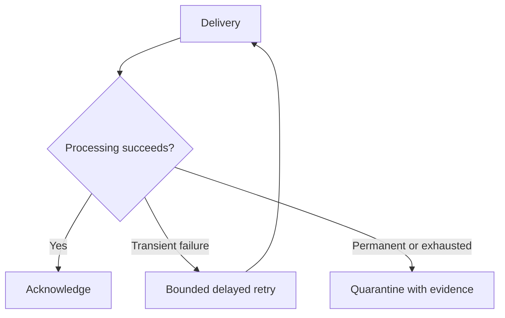

# How to Detect RabbitMQ Requeue Loops Behind Unacked Messages

Author: [nawazdhandala](https://www.github.com/nawazdhandala)

Tags: RabbitMQ, Monitoring, Python

Description: Correlate unacknowledged deliveries with redelivery and acknowledgement progress to identify poison-message loops without purging useful work.

A queue full of unacknowledged messages can reflect slow processing, a stuck consumer, or a rapid requeue loop. In the loop case, consumers repeatedly receive the same failing messages and return them to the queue, consuming resources without completing business work. Queue depth alone cannot identify that pattern.

This walkthrough uses RabbitMQ 4.x AMQP 0-9-1 semantics and read-only CLI diagnostics. Use the CLI version matching the deployed broker. The examples do not purge, close connections, or alter policies. Preserve message identities and a redacted failure sample before changing consumer behavior.

## Separate ready and unacknowledged counts

Ready messages are waiting for delivery; unacknowledged messages have been delivered and are awaiting a consumer acknowledgement. A purge is not a general remedy for unacknowledged deliveries, and deleting work can hide the symptom while losing business events.

```bash
rabbitmqctl list_queues -p / \
  name messages_ready messages_unacknowledged consumers
rabbitmqctl list_channels \
  connection number consumer_count messages_unacknowledged prefetch_count
```

Compare counts with delivery, redelivery, and acknowledgement rates from the management or Prometheus integration configured in your deployment. Metric names vary with the integration, so inspect the exported names and labels. A high delivery rate with few acknowledgements is not necessarily throughput; it may be repeated attempts at the same messages.

## Look for repeated failure identity

Log a stable message or business-event identifier, delivery redelivered flag, failure category, and attempt policy outcome. Do not log full message bodies if they contain sensitive data. The broker's redelivered flag indicates prior delivery, but it is not a complete universal retry counter.

```json
{"event_id":"invoice-17","redelivered":true,"failure_class":"unsupported-schema","decision":"quarantine","consumer":"billing-worker"}
```

A deterministic schema error will not become successful through immediate requeueing. A temporary dependency outage needs backoff and a bounded retry policy. Treat those cases separately so a short downstream outage does not permanently discard work and a poison message does not spin forever.



## Quantify progress rather than activity

The fixture uses interval deltas, not cumulative totals. It shows a large amount of broker activity with little completion. These thresholds are illustrative and require comparison with the application's normal retry behavior.

```python
deliveries = 10000
redeliveries = 9800
acknowledgements = 20
print({"redelivery_fraction":redeliveries/deliveries,
       "ack_fraction":acknowledgements/deliveries})
assert redeliveries/deliveries > 0.9
assert acknowledgements/deliveries < 0.01
```

This pattern supports a loop hypothesis but does not prove it. Inspect event IDs and error categories to establish that the same work is repeating. Multiple consumers failing on the same dependency can produce similar rates without one single poison message.

## Repair the retry policy safely

Use delayed, bounded retries with a documented terminal path. For RabbitMQ dead-lettering, rejecting or negatively acknowledging with requeue false can route to a configured dead-letter exchange; without a suitable route, work can be discarded. Verify exchange existence, routing, permissions, and queue-type delivery guarantees before relying on that path.

Avoid immediate `nack` with requeue true in an unconditional exception handler. It can return the message to a position where it is redelivered immediately. Adding consumers can intensify the loop rather than increase useful processing. Prefetch limits bound outstanding deliveries but do not fix a deterministic processing failure.

Test a valid message, a transient dependency failure, an unsupported schema, and exhausted retries in a disposable queue. Confirm that successful business completion is acknowledged once, retry delays occur as intended, and terminal failures remain inspectable. The recovery signal is advancing unique business work and reduced repeated failures, not merely a lower visible queue count.

## References

The [community question](https://stackoverflow.com/questions/25114230/rabbitmq-purge-a-queue-from-all-of-its-unacked-messages) motivated this walkthrough. Implementation references:

- [Official reference 1](https://www.rabbitmq.com/docs/confirms)
- [Official reference 2](https://www.rabbitmq.com/docs/man/rabbitmqctl.8)
- [Official reference 3](https://www.rabbitmq.com/docs/dlx)
