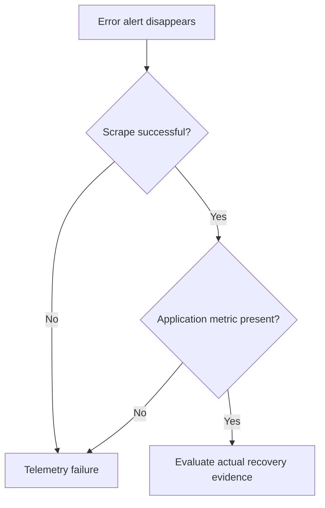

# How to Detect Resolved Alerts Caused by Missing Prometheus Metrics

Author: [nawazdhandala](https://www.github.com/nawazdhandala)

Tags: Prometheus, Alertmanager, Monitoring

Description: Separate recovery from missing telemetry with explicit scrape and metric-absence alerts, then test the failure and recovery timeline.

An alert marked resolved means its firing condition stopped producing an active alert. It does not necessarily mean the service recovered. If an error-ratio expression loses its input series, it can become empty and stop firing while the underlying service remains unavailable. Treat missing evidence as a separate observable condition.

This walkthrough assumes Prometheus 3.x and an application exporting a custom `checkout_requests_total` counter. The metric is illustrative; substitute your actual request counter and stable target labels. Use a test environment to simulate missing scrapes before modifying production notifications.

## Distinguish three states

A successful scrape with zero errors is healthy evidence. A failed scrape produces `up == 0`. A target removed from service discovery may produce no current `up` series at all. A successful scrape can also omit one application metric because instrumentation changed. These cases need different checks.

```yaml
# rules.yml
groups:
  - name: checkout-telemetry
    rules:
      - alert: CheckoutScrapeFailed
        expr: up{job="checkout"} == 0
        for: 3m
        labels:
          severity: warning
        annotations:
          summary: Checkout target cannot be scraped
      - alert: CheckoutJobMissing
        expr: absent_over_time(up{job="checkout"}[10m])
        labels:
          severity: warning
        annotations:
          summary: No checkout target samples for ten minutes
```

The first rule keeps target labels; the second detects disappearance of the entire selected job. It cannot enumerate missing instances that are no longer discoverable. For per-instance absence, maintain an expected-target inventory or compare against another independent source of truth.

## Check the application metric separately

Do not use a zero-filled error ratio as a shortcut for availability. Replacing every missing input with zero can paint the dashboard green during telemetry loss. Keep the request ratio and the telemetry state side by side.

```promql
absent_over_time(checkout_requests_total{job="checkout"}[10m])
```

This expression detects complete absence over the interval. It does not prove counters are fresh if a broken exporter keeps serving unchanged values, and it does not establish that the endpoint processes real traffic. A synthetic user journey or another independent signal may be needed for that distinction.



## Test the transition explicitly

Use `promtool` with the version matching your server. The fixture below verifies that a sustained failed scrape activates the first rule. Save it as `test.yml` alongside the rules file. Add separate cases for missing series, a healthy recovery, and target removal in your deployment.

```yaml
rule_files: [rules.yml]
evaluation_interval: 1m
tests:
  - interval: 1m
    input_series:
      - series: 'up{job="checkout",instance="api:8080"}'
        values: '1 0 0 0 0 0'
    alert_rule_test:
      - eval_time: 5m
        alertname: CheckoutScrapeFailed
        exp_alerts:
          - exp_labels:
              job: checkout
              instance: api:8080
              severity: warning
            exp_annotations:
              summary: Checkout target cannot be scraped
```

```bash
promtool check rules rules.yml
promtool test rules test.yml
```

The expected firing time includes the rule's `for` duration and evaluation interval. Missing samples and stale markers have different semantics, so model both when the incident involved discovery changes. Do not assume a missing time-series fixture is equivalent to a real scrape failure.

## Make notifications describe the evidence

Name the application alert resolution as a condition change and let the telemetry alert explain uncertainty. If brief gaps cause flapping, `keep_firing_for` can preserve a firing alert for a bounded period, but it does not replace missing-data detection. Alertmanager's `send_resolved` option controls notification delivery, not the truth of the underlying condition.

During an incident, record the last successful scrape, the last application sample, and the first independent evidence of recovery. Close the incident based on the user-facing recovery criterion. This prevents the monitoring pipeline's own failure from becoming the event that convinces the team everything is healthy.

Initialize application counters consistently, including zero-valued failure counters when the instrumentation supports that pattern. Otherwise a never-seen error label can be absent even during healthy traffic. Test that case separately from a metric disappearing after an outage. Also inspect the alert rule labels for changing values: replacing an instance label or adding a live measurement can create a new alert identity and make the old identity resolve. A complete missing-data investigation therefore checks both the underlying series and the label set of the generated alert.

## References

The [community question](https://stackoverflow.com/questions/71399800/prometheus-send-resolved-notification-when-metric-data-missing) motivated this walkthrough. Implementation references:

- [Official reference 1](https://prometheus.io/docs/prometheus/latest/configuration/alerting_rules/)
- [Official reference 2](https://prometheus.io/docs/prometheus/latest/querying/functions/)
- [Official reference 3](https://prometheus.io/docs/prometheus/latest/configuration/unit_testing_rules/)
