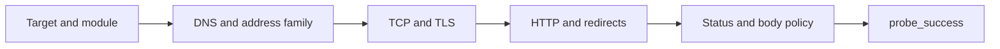

# How to Diagnose a Blackbox Probe When curl Succeeds

Author: [nawazdhandala](https://www.github.com/nawazdhandala)

Tags: Prometheus, Monitoring, Kubernetes

Description: Compare the exporter network path, IP family, TLS, redirects, status policy, and timeout using Blackbox Exporter debug output.

A URL working with curl on your laptop does not prove it is reachable under the Blackbox Exporter's configuration. The exporter may use a different DNS resolver, IP family, network path, TLS trust store, proxy, redirect policy, or timeout. Reproduce the probe itself before changing the success criteria.

Use the Blackbox Exporter version deployed in your environment and inspect its matching configuration reference. The examples target the documented HTTP module and local exporter endpoint. Replace the sample URL with an endpoint you own. Debug output can include internal hostnames and response details, so keep it in a controlled incident workspace.

## Request the exporter's debug trace

Call `/probe` with the same module and target that Prometheus uses, adding `debug=true`. A successful HTTP response from this endpoint means the exporter answered; the probe's result is reported inside the body.

```bash
curl -fsSG 'http://localhost:9115/probe' \
  --data-urlencode 'module=http_2xx' \
  --data-urlencode 'target=https://app.example.com/login' \
  --data-urlencode 'debug=true'
```

Read the trace from DNS resolution through connection, TLS negotiation, redirects, and final validation. Record the selected address and final status. A timeout before receiving HTTP headers is different from a received 403 or a body-regex mismatch. Preserve the first failing stage rather than focusing only on `probe_success 0`.

## Compare equivalent requests

Run curl from the same network namespace or a diagnostic container with equivalent routing and DNS. Match timeout, redirect handling, authentication, and IP family. The following examples compare IPv4 and IPv6 explicitly; they are diagnostic probes, not an instruction to force one family permanently.

```bash
curl -4 -v --location --max-time 10 'https://app.example.com/login'
curl -6 -v --location --max-time 10 'https://app.example.com/login'
```

If IPv6 fails while IPv4 succeeds, inspect address selection and routing rather than assuming the application is down. If only the exporter fails TLS verification, compare trust stores and server-name behavior. Do not disable certificate verification merely to turn the monitor green; that removes part of the availability contract.

## Inspect the actual module policy

A module can reject an otherwise reachable response. It may require certain status codes, a body match, TLS, or a particular protocol. The example below uses an explicit IPv4 preference for a controlled experiment while preserving fallback.

```yaml
modules:
  http_2xx:
    prober: http
    timeout: 10s
    http:
      method: GET
      preferred_ip_protocol: ip4
      ip_protocol_fallback: true
      follow_redirects: true
```

Use your deployment's supported flags to validate and reload configuration. Confirm that the running exporter loaded the edited file. An unchanged ConfigMap mount or a failed reload can leave the old policy active even though the repository looks correct.



## Check the Prometheus boundary too

Distinguish `up` from `probe_success`. If `up` is zero, Prometheus failed to scrape the exporter endpoint. If `up` is one and `probe_success` is zero, the exporter answered but the target probe failed. Verify relabeling so the target URL becomes the `target` parameter and the scrape address points to the exporter.

A scrape timeout shorter than the module's work can cancel the probe. Leave a sensible margin and inspect the effective timeout in debug output. A redirect to a login page can also yield HTTP 200 while the intended application path is unavailable, so choose assertions that represent the real requirement.

Finish by repeating the same debug request after the correction and comparing the specific failed stage. Keep the result scoped: a passing HTTP probe establishes the configured HTTP condition from that exporter location. It does not prove a browser login journey or every customer region works.

## References

The [community question](https://stackoverflow.com/questions/54773928/probes-returning-zero) motivated this walkthrough. Implementation references:

- [Official reference 1](https://github.com/prometheus/blackbox_exporter/blob/master/README.md)
- [Official reference 2](https://github.com/prometheus/blackbox_exporter/blob/master/CONFIGURATION.md)
