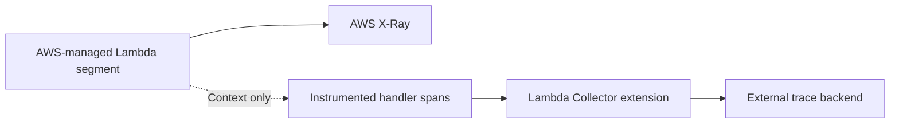

# How to Diagnose a Missing AWS Lambda Parent Span in External Traces

Author: [nawazdhandala](https://www.github.com/nawazdhandala)

Tags: OpenTelemetry, AWS

Description: Distinguish AWS-managed X-Ray segments from exported application spans, then inspect propagation and Lambda flush behavior.

A Lambda child span can reference a parent that is absent from an external trace backend even when the child exported correctly. One common explanation is that the parent belongs to AWS-managed X-Ray tracing while the application sends only its own OpenTelemetry spans to the external destination.

Propagation carries identifiers and sampling decisions. It does not transport the parent span itself. First identify who owns the missing span, then investigate whether that producer exports to the backend you are searching.

## Compare the actual span relationship

Export a small span sample into a simplified JSON array with trace ID, span ID, and parent span ID. This local check finds parent references absent from that sample.

```python
spans = [
    {"trace_id": "trace-a", "span_id": "child-1", "parent_span_id": "aws-parent"},
    {"trace_id": "trace-a", "span_id": "child-2", "parent_span_id": "child-1"},
]
known = {(s["trace_id"], s["span_id"]) for s in spans}
for span in spans:
    parent = span["parent_span_id"]
    if parent and (span["trace_id"], parent) not in known:
        print("parent outside sample:", parent)
```

The result means only that the parent is outside the selected sample. It might exist in another backend, account, time range, or trace representation. Do not label it lost until those boundaries are checked.



## Inspect Lambda configuration without exposing secrets

Read only the relevant configuration fields. The following command lists layer versions, runtime, and tracing mode; it intentionally avoids dumping every environment variable.

```bash
aws lambda get-function-configuration \
  --function-name telemetry-test \
  --query '{Runtime:Runtime,Layers:Layers[].Arn,Tracing:TracingConfig.Mode}'
```

AWS active tracing produces managed Lambda trace segments in X-Ray for sampled invocations. An OpenTelemetry instrumentation layer and Collector extension have their own export route. Adding an OTLP exporter does not automatically mirror AWS service segments into that route.

Check that the instrumentation layer matches the runtime and architecture, its wrapper is active, and the Collector layer is present if the configuration expects a local receiver. Current community guidance uses the wrapper setting shown below, but layer release compatibility remains specific to the function.

```bash
export AWS_LAMBDA_EXEC_WRAPPER=/opt/otel-handler
export OTEL_SERVICE_NAME=telemetry-test
export OTEL_EXPORTER_OTLP_ENDPOINT=http://localhost:4318
export OTEL_EXPORTER_OTLP_PROTOCOL=http/protobuf
```

These are deployment environment values, not commands that configure an existing Lambda by themselves. Choose the protocol supported by the language layer and local Collector configuration.

## Separate missing production from missing delivery

If the application invocation span is absent but its children exist, inspect wrapper initialization, manual span lifecycle, and competing instrumentation. If the parent is present at Collector input but absent downstream, investigate filters, sampling, export failures, and backend ingestion limits.

Lambda execution environments can freeze after invocation. Use the lifecycle behavior supported by the instrumentation and extension rather than relying on a background thread to export eventually. Test short successful invocations, exceptions, timeouts, cold starts, and warm starts. A child ending earlier can export while a parent left open or interrupted never reaches the exporter.

Verify propagator compatibility as well. W3C and X-Ray formats represent context differently; a configured extractor must understand the incoming carrier. Generating a new root can make a graph look complete while breaking the causal link, so do not use it as a cosmetic fix.

Finally, decide whether the external backend needs the AWS-managed segment or only a correctly named handler span. Document that boundary in the dashboard. A missing managed ancestor may be an expected cross-backend limitation, whereas a missing application invocation span is an instrumentation or delivery defect worth fixing.

## References

The [community question](https://stackoverflow.com/questions/78900023/aws-lambda-open-telemetry-missing-parent-span) motivated this investigation. The implementation references are [official reference 1](https://docs.aws.amazon.com/lambda/latest/dg/services-xray.html), [official reference 2](https://opentelemetry.io/docs/platforms/faas/lambda-auto-instrument/).
