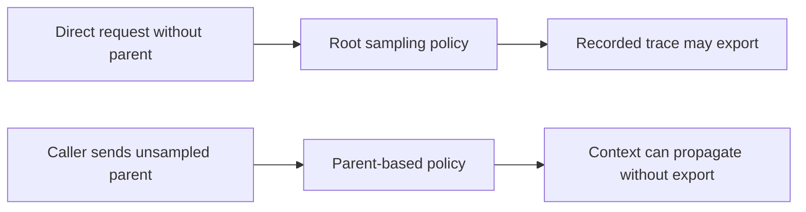

# How to Diagnose ASP.NET Traces Missing Only on Service-to-Service Calls

Author: [nawazdhandala](https://www.github.com/nawazdhandala)

Tags: OpenTelemetry, .NET

Description: Inspect incoming sampling flags, ASP.NET Activity state, and parent-based sampling before changing exporters.

An ASP.NET API may produce traces when called directly but disappear when another service calls it. That pattern often points to incoming trace context. A direct request starts a new trace, while a service-to-service request can carry an unsampled parent decision that a parent-based sampler honors.

Do not begin by replacing the exporter if the same process exports direct requests successfully. Compare request headers, Activity state, and sampling configuration for the two paths. The examples assume ASP.NET Core with the OpenTelemetry .NET SDK and registered ASP.NET Core instrumentation.

## Reproduce with controlled parent flags

In a staging endpoint, send otherwise identical requests with sampled and unsampled remote parents. The last byte of the W3C header differs between these examples.

```bash
curl http://localhost:5000/diagnostic \
  -H 'traceparent: 00-4bf92f3577b34da6a3ce929d0e0e4736-00f067aa0ba902b7-01'
curl http://localhost:5000/diagnostic \
  -H 'traceparent: 00-4bf92f3577b34da6a3ce929d0e0e4737-00f067aa0ba902b8-00'
```

Use different trace IDs so results do not merge. A proxy might strip or replace the header, so inspect what reaches the API rather than only what the caller sends.

A temporary endpoint can report the current Activity state without logging full request headers or credentials:

```csharp
app.MapGet("/diagnostic", () => {
    var activity = System.Diagnostics.Activity.Current;
    return Results.Json(new {
        traceId = activity?.TraceId.ToString(),
        parentSpanId = activity?.ParentSpanId.ToString(),
        recorded = activity?.Recorded,
        allDataRequested = activity?.IsAllDataRequested
    });
});
```

Restrict or remove this diagnostic route after testing. An Activity can exist for propagation even when the SDK does not export it. A nonempty trace ID alone is therefore not evidence that a span should appear in the backend.



## Confirm which sampler is configured

A typical explicit registration looks like this:

```csharp
builder.Services.AddOpenTelemetry()
    .WithTracing(tracing => tracing
        .SetSampler(new ParentBasedSampler(new AlwaysOnSampler()))
        .AddAspNetCoreInstrumentation()
        .AddHttpClientInstrumentation()
        .AddOtlpExporter());
```

This fragment requires the OpenTelemetry hosting, ASP.NET Core instrumentation, HTTP instrumentation, and OTLP exporter packages, plus their namespaces. Keep package versions aligned. The root sampler keeps newly created traces, while the parent-based wrapper respects remote sampling decisions. It does not mean all incoming requests are exported.

If policy requires capturing errors regardless of upstream sampling, design an explicit recording and tail-sampling strategy across the service boundary. Changing only the API to always-on can produce partial traces and inconsistent decisions. Do not remove propagation just to make the API appear as an unrelated root.

## Follow the next missing boundary

If both controlled requests are recorded but only one reaches the backend, inspect Collector filters and tail-sampling decisions. If neither is recorded, confirm instrumentation registration occurs before requests are handled and that the provider remains alive for the process lifetime.

If the caller creates a trace but downstream operations detach, inspect async context flow and manually created Activities. Avoid suppressing execution context unintentionally. For custom ActivitySources, ensure the source name is registered with the provider and that the source is reused rather than repeatedly created and disposed.

Compare direct and service calls through the same route, authentication path, load balancer, and deployment version. A different ingress path can select another Pod or configuration and mimic a sampling issue.

The expected result of this diagnostic is a clear boundary: not recorded because of policy, recorded but not exported, exported but filtered, or stored but not found. Each has a different remedy, and the incoming sampled flag is often the fastest way to narrow the search.

## References

The [community question](https://stackoverflow.com/questions/76610220/net-api-tracing-with-opentelemetry) motivated this investigation. The implementation references are [official reference 1](https://opentelemetry.io/docs/languages/dotnet/traces/best-practices/), [official reference 2](https://www.w3.org/TR/trace-context/), [official reference 3](https://opentelemetry.io/docs/concepts/sampling/).
