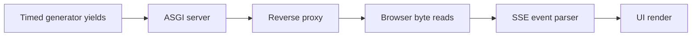

# How to Diagnose Buffered LLM Streams with FastAPI Chunk Timestamps

Author: [nawazdhandala](https://www.github.com/nawazdhandala)

Tags: AI, FastAPI, Python, Observability

Description: Locate stream buffering by comparing FastAPI yields, direct HTTP reads, and browser event arrival times through each proxy hop.

When a browser shows an entire answer at once, the model may still have streamed correctly. Buffering can happen in the application, reverse proxy, client library, or rendering code. Replace the model temporarily with a deterministic timed stream. That removes model variability and lets you locate the first boundary where evenly spaced events become a burst.

This walkthrough uses Python 3.11 or later, FastAPI with its compatible Starlette version, Uvicorn, and a browser with the Fetch API. Install and lock those packages in your application environment. The diagnostic endpoint emits no user data and should be enabled only where you intend to expose diagnostic behavior.

## Make the server's emission schedule visible

Save this example as `stream_app.py`. Each Server-Sent Event has an integer sequence number and the server's elapsed time. The timestamp is taken immediately before yielding. A yield records application intent to send; it does not prove bytes reached the browser or were flushed by a proxy.

```python
import asyncio
import json
import time
from fastapi import FastAPI
from fastapi.responses import StreamingResponse

app = FastAPI()

@app.get("/diagnostic-stream")
async def diagnostic_stream():
    async def events():
        started = time.perf_counter()
        for sequence in range(6):
            payload = {"sequence": sequence,
                       "server_elapsed_s": time.perf_counter() - started}
            yield "data: " + json.dumps(payload) + "\n\n"
            await asyncio.sleep(0.4)
    return StreamingResponse(events(), media_type="text/event-stream",
                             headers={"Cache-Control": "no-cache",
                                      "X-Accel-Buffering": "no"})
```

Use asynchronous waiting in an asynchronous generator. A blocking sleep can stall unrelated work on the event loop. The `X-Accel-Buffering` header is relevant to Nginx deployments that honor it; it is not a universal instruction to every intermediary. Compression and CDN behavior must be checked independently.

```bash
python -m pip install fastapi uvicorn
uvicorn stream_app:app --host 127.0.0.1 --port 8000
# Run in another terminal. -N disables curl's output buffering.
curl -N http://127.0.0.1:8000/diagnostic-stream
```

First test the application directly. Then repeat through the reverse proxy and public endpoint. Keep the same endpoint and client so you change one network boundary at a time. If the direct path already bursts, adjusting CDN settings will not address the earliest fault.



## Timestamp browser reads and complete events

Run this browser-console example on the same origin as the diagnostic endpoint. It records byte-read times separately from parsed event times. A Fetch read may split an event or contain several events, so a buffer must survive across reads. This parser is deliberately limited to the single-line `data` frames emitted above; use a complete SSE parser for arbitrary provider streams.

```javascript
(async () => {
  const started = performance.now();
  const response = await fetch('/diagnostic-stream');
  if (!response.ok || !response.body) throw new Error('Stream unavailable');
  const reader = response.body.getReader();
  const decoder = new TextDecoder();
  let pending = '';
  while (true) {
    const {value, done} = await reader.read();
    if (done) break;
    console.log('read_ms', performance.now() - started, value.byteLength);
    pending += decoder.decode(value, {stream: true});
    let boundary;
    while ((boundary = pending.indexOf('\n\n')) >= 0) {
      const frame = pending.slice(0, boundary);
      pending = pending.slice(boundary + 2);
      if (frame.startsWith('data: ')) {
        console.log('event_ms', performance.now() - started,
                    JSON.parse(frame.slice(6)));
      }
    }
  }
})();
```

You should see increasing sequence numbers and server elapsed times near 0.4-second increments. The browser's absolute elapsed values will include connection and network delay. Compare gaps within each clock, not differences between unrelated server and browser clocks.

If server emission gaps are steady but all browser reads arrive together, inspect buffering between those boundaries. If browser reads are timely while the UI updates once, inspect code that calls `response.text()`, accumulates content until completion, or batches state updates. A correct transport can still have a slow rendering path.

## Confirm the hypothesis with a controlled change

For a suspected Nginx buffer, inspect the effective location configuration and test disabling response buffering only for the streaming route. For suspected compression, repeat the test without compression on that route. Do not change several layers at once or infer success from one lucky request.

After restoring the model stream, retain sequence numbers and lightweight arrival timing in a sampled diagnostic path. Test early disconnects, error frames, non-ASCII text split across reads, and partial final frames. The synthetic endpoint establishes where buffering occurs; it does not prove that your production SSE parser correctly handles every vendor event or that every deployment proxy preserves streaming.

## References

This tutorial addresses the problem in the [community question](https://stackoverflow.com/questions/79952304/fastapi-streamingresponse-buffers-llm-tokens-until-completion-when-consumed-by-n). Implementation details were checked against these primary sources:

- [Official documentation 1](https://www.starlette.io/responses/)
- [Official documentation 2](https://www.python-httpx.org/async/)
