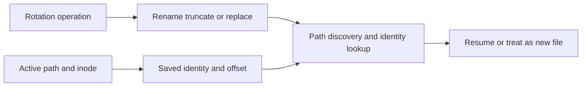

# How to Diagnose Fluent Bit Re-reading Rotated Files with Saved Offsets

Author: [nawazdhandala](https://www.github.com/nawazdhandala)

Tags: Fluent Bit, Linux

Description: Inspect Tail database identity, rotation strategy, file truncation, and path matching before changing saved-offset behavior.

A saved Tail offset does not mean every later file at that path will resume at that byte. Fluent Bit identifies files using metadata and database state, while rotation can rename, truncate, replace, or reuse files. The same inode number can also be reused after deletion, so inode equality alone is incomplete evidence.

Begin with the exact rotation mechanism and the Tail configuration. Rename-and-create and copytruncate have different behaviors. A wildcard matching both the active file and rotated copies can create duplicate ingestion even when the database works as designed.

## Inspect the input contract

A typical Tail input has a dedicated database and a bounded active-file pattern:

```ini
[INPUT]
    Name                tail
    Path                /var/log/application/current.log
    Tag                 application.logs
    DB                  /var/lib/fluent-bit/application-tail.db
    DB.Compare_Filename false
    Read_from_Head      Off
    Rotate_Wait         10
```

Use a database unique to that input and preserve its volume across process restarts. `Read_from_Head` affects files without a recognized saved position; it is not a command to ignore all existing offsets.

`DB.Compare_Filename` changes whether lookup checks both filename and inode. It can help in some inode-reuse scenarios while changing rename behavior. Do not toggle it without testing the rotation scheme you actually use.



## Capture metadata around rotation

On a Linux host, collect inode, size, and timestamps for the active and rotated paths before and after the event:

```bash
stat -c '%n inode=%i size=%s modified=%y' \
  /var/log/application/current.log \
  /var/log/application/current.log.1
```

Compare the file size with the saved offset. If a file shrinks below the previous offset, truncation handling may reset reading. A copytruncate rotation can also race with writes between copying and truncation, so neither duplicate-free nor loss-free behavior should be assumed.

Use a read-only SQLite connection to inspect the database schema and records. First inspect the schema rather than assuming column names across versions:

```bash
sqlite3 'file:/var/lib/fluent-bit/application-tail.db?mode=ro' '.schema'
```

The database can use WAL mode. Copying only the main database file while Fluent Bit is active may omit recent state in the WAL. Prefer a consistent snapshot or supported SQLite backup procedure for offline analysis, and never edit the live offset database casually.

## Look for duplicate readers and overlapping paths

Check whether two Tail inputs or two Fluent Bit instances read the same file. Verify the generated configuration as well as the hand-written file; Helm charts and platform integrations may add another input.

A pattern such as `/var/log/application/*.log*` can include rotated files and compressed archives. Narrow the active pattern or explicitly exclude backups according to your collection design. Keep rotated files available long enough for the original file descriptor to drain.

## Build a numbered rotation fixture

Write a small sequence of unique lines, rotate using the real production mechanism in a test directory, append more lines, restart Fluent Bit, and compare output sequence numbers. Test both a clean shutdown and an abrupt process termination with the same persistent database volume.

Record whether the missing or duplicate records occur before rotation, during discovery, after restart, or during output retry. A duplicated backend record can originate from at-least-once output delivery even when Tail read it only once.

Finally, distinguish offset durability from delivery durability. The Tail database records how far input reading progressed; filesystem chunks represent work awaiting output. Both must survive the relevant restart if you expect replay protection and backlog recovery. The right fix follows the identified boundary, whether that is path overlap, database persistence, truncation, inode reuse, or output deduplication.

## References

The [community question](https://stackoverflow.com/questions/79814338/why-does-fluent-bit-re-read-a-rotated-log-file-even-when-the-inode-remains-the-s) motivated this investigation. The implementation references are [official reference 1](https://docs.fluentbit.io/manual/data-pipeline/inputs/tail), [official reference 2](https://docs.fluentbit.io/manual/administration/buffering-and-storage).
