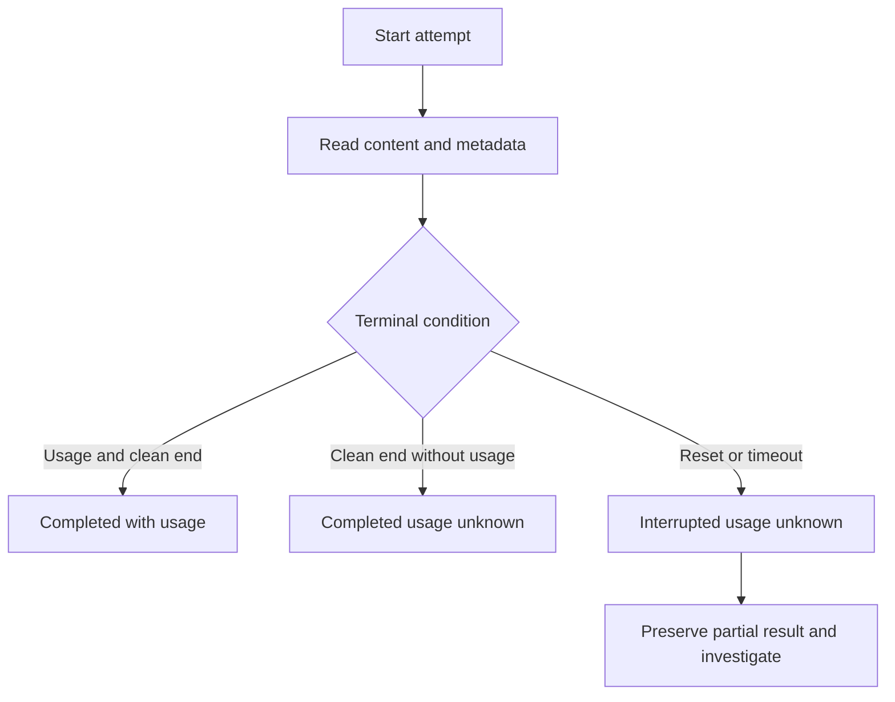

# How to Diagnose HTTP/2 Resets While Collecting LLM Stream Usage

Author: [nawazdhandala](https://www.github.com/nawazdhandala)

Tags: AI, LLM, Python, Observability

Description: Preserve partial-stream evidence, distinguish missing usage from zero cost, and isolate HTTP/2 failures with a controlled transport matrix.

An HTTP/2 reset near the end of a streamed response is particularly confusing when you have just enabled usage reporting. The text may look complete while the final accounting event never arrives. Treat content completion, transport completion, and usage availability as separate facts. A reset alone does not establish that usage reporting caused the failure.

This tutorial uses the OpenAI Chat Completions streaming contract as one concrete example. Other compatible endpoints can differ. Confirm the provider and API version before adopting its fields. The documented `stream_options.include_usage` option requests a final usage chunk, but the documentation explicitly warns that an interrupted stream may never deliver it.

## Preserve the right failure record

Record a request identifier, selected transport, number of content chunks, whether a finish reason arrived, and whether usage arrived. Store safe exception classifications rather than complete authorization headers or prompt bodies. The record below is an application schema, not a vendor response.

```json
{
  "attempt_id": "attempt-17",
  "transport": "HTTP/2",
  "content_chunks": 28,
  "finish_reason_seen": true,
  "usage_seen": false,
  "terminal_state": "transport_error",
  "usage_state": "unknown",
  "retry_parent": null
}
```

Missing usage is unknown, not zero. It also does not mean the provider did no work. A client can lose its connection after generation has been billed. Keep estimated usage distinct from settled usage, and reconcile later only through supported provider accounting sources.



## Handle empty final choices safely

Usage chunks can have an empty choices array. Code that blindly indexes `choices[0]` can raise an application exception at exactly the moment usage arrives. That is a different failure from an HTTP/2 stream reset. Check both paths independently.

```python
chunks = [
    {"choices": [{"delta": {"content": "Hello"}, "finish_reason": None}],
     "usage": None},
    {"choices": [{"delta": {}, "finish_reason": "stop"}], "usage": None},
    {"choices": [], "usage": {"prompt_tokens": 12, "completion_tokens": 1}},
]
text_parts, usage, finished = [], None, False
for chunk in chunks:
    if chunk.get("usage") is not None:
        usage = chunk["usage"]
    for choice in chunk.get("choices", []):
        content = choice.get("delta", {}).get("content")
        if content:
            text_parts.append(content)
        finished |= choice.get("finish_reason") is not None
assert "".join(text_parts) == "Hello"
assert usage["completion_tokens"] == 1 and finished
print({"finished": finished, "usage_seen": usage is not None})
```

Run this fixture before the network experiment. It proves your aggregation handles the documented final-chunk shape. It does not exercise the provider, proxy, or HTTP client.

## Change one transport variable at a time

The following diagnostic client requires `openai` and `httpx[http2]`. Set `OPENAI_MODEL` to a supported deployed model and `HTTP2` to `0` or `1`. Explicitly disabling SDK retries makes attempt counts easier to interpret during the experiment. Adapt the endpoint only if your provider documents compatible behavior.

```python
import os
import httpx
from openai import OpenAI

with httpx.Client(http2=os.getenv("HTTP2") == "1", timeout=60.0) as transport:
    with OpenAI(http_client=transport, max_retries=0) as client:
        stream = client.chat.completions.create(
            model=os.environ["OPENAI_MODEL"],
            messages=[{"role": "user", "content": "Define exponential backoff."}],
            stream=True,
            stream_options={"include_usage": True},
        )
        with stream:
            for chunk in stream:
                if chunk.usage is not None:
                    print("usage", chunk.usage.model_dump())
                for choice in chunk.choices:
                    if choice.finish_reason is not None:
                        print("finish_reason", choice.finish_reason)
```

Run a small matrix: HTTP/1.1 and HTTP/2, usage disabled and enabled, direct and proxied connections. Record the actually negotiated protocol when your transport instrumentation makes it available; allowing HTTP/2 does not guarantee the connection used it. Keep request length and timeout configuration constant.

If failures occur only through one proxy, inspect that hop's reset reasons, idle limits, and upstream logs. If they occur only with usage enabled, capture the final event framing and verify endpoint support before reporting a provider issue. If the server finishes but your parser fails, fix the parser rather than changing transport settings.

Do not automatically replay a partly delivered answer into the same user-visible stream. A retry is a new attempt and may produce different text or duplicate downstream tool effects. Preserve partial content with an interrupted state, use idempotency where the external operation supports it, and make any recovery policy explicit.

## References

This tutorial addresses the problem in the [community question](https://stackoverflow.com/questions/79088852/http-2-server-reset-the-stream-http-2-error-code-internal-error-when-enabling). Implementation details were checked against these primary sources:

- [Official documentation 1](https://developers.openai.com/api/reference/resources/chat/subresources/completions/methods/create)
- [Official documentation 2](https://www.python-httpx.org/async/)
