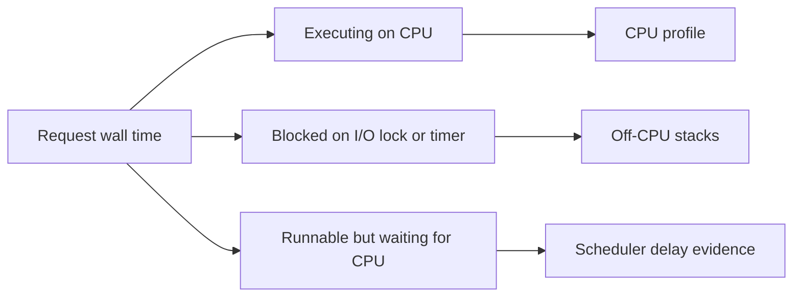

# How to Diagnose Latency That CPU Profiles Cannot Explain

Author: [nawazdhandala](https://www.github.com/nawazdhandala)

Tags: Profiling, Linux

Description: Combine CPU sampling with bounded off-CPU and scheduler evidence to locate request time spent waiting rather than executing.

A request can take two seconds while using only a few milliseconds of CPU. A CPU profile will correctly show little activity because the process spent most of the time waiting for a socket, lock, disk, timer, or scheduler. The missing time is not necessarily a sampling failure; it may be outside the measurement's scope.

Use a request trace or timestamped latency event to identify the slow interval, then collect CPU and off-CPU evidence for the relevant process. Avoid profiling every process on a busy node when one service is the subject of the investigation.

## Capture CPU execution first

On a Linux host with suitable permissions and `perf`, collect a short process-scoped sample:

```bash
perf record -F 99 -g -p 1234 -o cpu.data -- sleep 30
perf report -i cpu.data --stdio
```

Replace PID 1234 with the host-visible target PID. Container PID namespaces can make a PID from inside the Pod refer to a different process on the node. Record binary and symbol information needed for analysis.

If the profile shows little CPU during a confirmed slow request, inspect waiting rather than immediately raising the sampling frequency.



## Measure off-CPU stacks

BCC's `offcputime` aggregates time between scheduling off and returning to CPU. A process-scoped folded capture can feed a flame-graph renderer:

```bash
sudo /usr/share/bcc/tools/offcputime -p 1234 -f 30 > offcpu.folded
```

Tool installation paths vary. Confirm options with the installed tool's help and use a kernel/BCC combination supported by your environment. This capture requires privileges and should be bounded in duration and scope.

The output's weights represent accumulated off-CPU time, not CPU samples. Across many threads, total waiting time can exceed the capture's wall-clock duration. A wide `epoll_wait` stack may simply show idle workers, so identify which threads served the slow request.

## Separate blocked time from runnable delay

Read pressure information and inspect scheduler evidence for the target cgroup:

```bash
cat /proc/pressure/cpu
cat /proc/pressure/io
cat /sys/fs/cgroup/cpu.pressure
```

The cgroup path must correspond to the application. Pressure indicates delayed work at a broader scope; it does not identify the exact request or lock. Combine it with scheduling traces, application queues, and the off-CPU stack rather than treating it as a complete diagnosis.

A trace might show a slow database span while the application thread waits in a socket read. That supports dependency waiting, but the database itself may be waiting on disk, locks, or its own scheduler. Follow the causal boundary instead of optimizing the application's idle stack.

## Use a controlled reproduction

Reproduce one slow request or a representative bounded load in staging. Capture the same interval with request IDs, thread or task identity where available, and dependency timings. Compare a healthy interval with the slow interval.

For lock contention, identify the contended lock and the owner or critical section. A futex wait alone does not prove a deadlock; it can be ordinary synchronization. For I/O, compare operation latency and queueing at the storage or network boundary.

Async runtimes complicate attribution because one OS thread serves many logical tasks. Off-CPU stacks describe thread behavior, while a request trace describes logical work. Use both rather than assigning the entire event-loop wait to one request.

Finally, measure the effect of a targeted fix on request latency, not just the width of one stack. Reducing harmless idle waiting can make a graph look different without improving users' requests. The useful result accounts for the wall-clock delay across execution, blocked waiting, and runnable contention with evidence at each boundary.

## References

The [community question](https://stackoverflow.com/questions/23098153/how-to-use-linux-perf-tool-to-generate-off-cpu-profile) motivated this investigation. The implementation references are [official reference 1](https://raw.githubusercontent.com/iovisor/bcc/master/tools/offcputime_example.txt), [official reference 2](https://raw.githubusercontent.com/torvalds/linux/master/tools/perf/Documentation/perf-record.adoc), [official reference 3](https://docs.kernel.org/accounting/psi.html).
