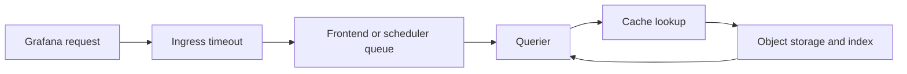

# How to Diagnose Loki Query Timeouts When CPU Usage Stays Low

Author: [nawazdhandala](https://www.github.com/nawazdhandala)

Tags: Loki, Grafana

Description: Separate query queueing, object-store waits, cache misses, and timeout layers before adding Loki CPU capacity.

Low CPU does not imply a Loki query has spare execution capacity. A request can spend most of its lifetime queued, waiting for object storage, fetching index data, or blocked by a downstream timeout. Average CPU across a read deployment can also hide one busy worker and several idle replicas.

Start with one reproducible query, a fixed time range, and the same tenant. Record the exact query and response statistics so changes can be compared under controlled conditions.

## Reduce the search without changing its meaning

Use the narrowest known stream labels and a cheap line filter before parsing JSON:

```logql
{namespace="checkout", app="api"}
  |= "reservation failed"
  | json
  | __error__=""
  | reason_code="OUT_OF_STOCK"
```

A text filter still requires reading relevant chunks, but it can reduce the number of lines sent into parsing. A broad selector over days of data can remain expensive even when the final result contains only a few lines.

Call the API for a short fixed range and retain its statistics:

```bash
curl --fail-with-body --get http://localhost:3100/loki/api/v1/query_range \
  --data-urlencode 'query={namespace="checkout",app="api"} |= "reservation failed"' \
  --data-urlencode 'start=2026-11-15T12:00:00Z' \
  --data-urlencode 'end=2026-11-15T12:15:00Z' \
  --data-urlencode 'limit=100' > query-result.json
```

Add the authenticated tenant mechanism used by your deployment. Do not compare a direct unauthenticated query with a Grafana request routed through a different tenant or proxy.



## Inspect waiting separately from execution

Use query statistics and Loki's query logs to distinguish queue time, execution time, bytes processed, cache behavior, and storage requests. Exact fields vary by release and query engine, so inspect the returned `data.stats` object rather than assuming one field name.

```python
import json
from pathlib import Path
result = json.loads(Path("query-result.json").read_text())
print(json.dumps(result.get("data", {}).get("stats", {}), indent=2))
```

If most time is in the queue, inspect worker connectivity, per-tenant limits, outstanding requests, and dashboard concurrency. If queue time is low but storage latency dominates, inspect object-store throttling, network throughput, DNS, and cache health. More CPU cannot directly remove an object-store latency bottleneck.

## Locate the timeout that actually fires

A browser, Grafana data proxy, ingress proxy, query frontend, and querier can each impose a deadline. Record the status code and component log at the failure boundary. Raising only Loki's query timeout is ineffective if the ingress closes the request earlier.

The configuration fragment below illustrates a Loki-side query timeout, not a recommended universal value:

```yaml
limits_config:
  query_timeout: 2m
```

Verify the option against the deployed Loki version and effective tenant overrides. Increase a timeout only after understanding why the work takes that long; otherwise the change can retain more queued work and memory while users still wait.

## Compare cold and warm behavior

Run the same fixed historical query twice and compare statistics. A large difference can indicate cache effects, but do not claim a cache improvement from one uncontrolled request. Concurrent load, compaction, and storage variability can also change timing.

Check per-Pod CPU, throttling, network, memory, and query counts. Averages across replicas can conceal uneven scheduling. Test whether adding a read replica actually increases completed subqueries rather than merely increasing the number of idle Pods.

A useful diagnosis names the dominant waiting boundary and shows that the chosen change reduces it for the same query and time range. Preserve result correctness, tenant fairness, and queue stability while optimizing latency; a faster empty response is not a successful query optimization.

## References

The [community question](https://www.reddit.com/r/grafana/comments/1kwh1wr/) motivated this investigation. The implementation references are [official reference 1](https://grafana.com/docs/loki/latest/configure/), [official reference 2](https://grafana.com/docs/loki/latest/query/log_queries/), [official reference 3](https://grafana.com/docs/loki/latest/reference/loki-http-api/).
