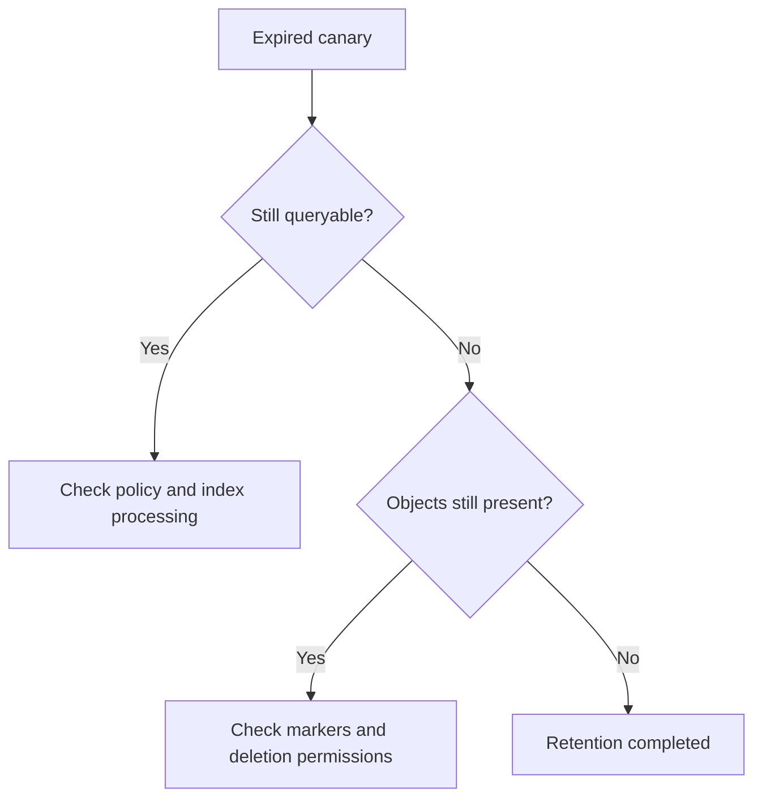

# How to Diagnose Loki Retention When Old Chunks Never Disappear

Author: [nawazdhandala](https://www.github.com/nawazdhandala)

Tags: Loki, Storage, Observability

Description: Trace Loki retention through eligibility, index compaction, deletion markers, and object-store removal to locate stuck old chunks.

Old objects in a Loki bucket do not, by themselves, prove retention is broken. Retention is a pipeline: determine eligibility, rewrite the index, record deletion work, wait, and remove chunks. Diagnose the stage that stopped making progress before changing the retention duration or manually removing files.

The examples assume Loki 3.x with TSDB, access to compactor logs, and a test bucket or read-only object inventory. They intentionally avoid deletion commands. Legacy index configurations use different mechanisms; first identify the active schema rather than copying a modern compactor stanza into an older installation.

## Establish what should expire

Record the ingestion time, stream labels, tenant, and policy active when the test data arrived. A recently changed retention setting is not proof that previously ingested records should disappear under it. Use a canary written after the change and let its full retention interval pass. Query the exact stream over a bounded historical interval; an empty broad dashboard can hide a query problem.

```yaml
# Relevant fragments; retain your existing storage configuration.
schema_config:
  configs:
    - from: "2026-01-01"
      store: tsdb
      object_store: s3
      schema: v13
      index:
        prefix: loki_index_
        period: 24h
compactor:
  working_directory: /var/loki/compactor
  retention_enabled: true
  delete_request_store: s3
  retention_delete_delay: 2h
limits_config:
  retention_period: 168h
```

Do not edit an existing schema's start date as a troubleshooting shortcut. The fragment illustrates the required relationship between TSDB and its index period. Verify the configuration actually loaded by the compactor and that exactly the intended compactor deployment owns retention. Chart values and container configuration are different layers.

## Follow the evidence through each stage

Read logs around at least two retention cycles. Look for failed table processing, object-store authorization failures, timeouts, and disk errors. Search terms below are intentionally broad because exact log messages vary by release. Preserve the full surrounding error, tenant, and table name.

```bash
kubectl -n observability logs statefulset/loki-compactor \
  --since=6h > compactor-review.log
rg -i 'retention|marker|delete|denied|timeout|error' compactor-review.log
kubectl -n observability get pod,pvc -l app.kubernetes.io/component=compactor
```

If the query still finds the canary, investigate policy matching and index processing. If it no longer finds the canary but chunks persist, focus on markers and the sweeper. A restarted compactor with ephemeral marker storage can lose pending work. Persistent marker files are therefore part of correctness, not merely a performance optimization.



## Compare inventory snapshots without guessing

A bucket can grow even while old chunks are being removed if incoming data exceeds deleted data. Export daily totals for the relevant prefix and compare both additions and removals. This self-contained Python fixture shows why a positive net change does not establish a retention failure.

```python
before = {"old-a": 100, "old-b": 200, "keep": 300}
after = {"keep": 300, "new-a": 500, "new-b": 600}
removed = sum(size for key, size in before.items() if key not in after)
added = sum(size for key, size in after.items() if key not in before)
print({"removed_bytes": removed, "added_bytes": added,
       "net_bytes": sum(after.values()) - sum(before.values())})
assert removed == 300 and added == 1100
```

The expected result includes 300 bytes removed and 800 bytes of net growth. Real object inventories need version IDs if versioning is enabled; a delete marker and a physically reclaimed old object version are not the same event. Separate chunk, index, and temporary prefixes rather than treating every bucket object as a chunk.

## Repair the failing stage

Restore missing deletion permissions only for the intended bucket and prefix, fix persistent storage, or correct a policy mismatch. Then observe another canary cycle. Do not clear the compactor working directory to make warnings disappear. Do not reduce deletion delay below the time required for index readers to refresh. Keep object lifecycle expiration longer than Loki retention, as the official documentation requires, and account for any protected versions. A successful repair has three pieces of evidence: the expected stream stops returning expired records, deletion work progresses, and the relevant old objects actually disappear.

## References

The [community question](https://stackoverflow.com/questions/73138278/why-my-loki-log-retention-is-not-working) motivated this walkthrough. Implementation references:

- [Official reference 1](https://grafana.com/docs/loki/latest/operations/storage/retention/)
