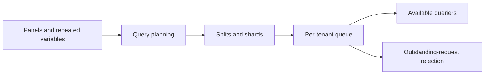

# How to Diagnose Loki Too Many Outstanding Requests Errors

Author: [nawazdhandala](https://www.github.com/nawazdhandala)

Tags: Loki, Grafana

Description: Find the saturated frontend or scheduler queue and reduce query fan-out before raising outstanding-request limits.

Loki's too-many-outstanding-requests error usually indicates a query queue has reached a configured per-tenant limit. It does not necessarily mean the cluster has exhausted CPU. A few broad searches can split into many subqueries while workers are waiting on storage or occupied by other requests.

Identify which component emits the error. Deployments using a query scheduler have a different queue boundary from deployments where the frontend owns the queue. Raising an unrelated limit can leave the original failure unchanged.

## Count the query work being created

A dashboard can launch several panels at once, repeat them across variables, and refresh before the prior batch finishes. The following calculation illustrates the multiplication before additional query sharding:

```python
panels = 12
repeated_services = 8
time_splits_per_query = 6
print("potential subqueries:", panels * repeated_services * time_splits_per_query)
```

This yields 576 potential pieces for one dashboard load. It is not a measurement of Loki's exact plan, but it explains why one browser can create substantial queued work.



## Locate the active queue configuration

For a scheduler-based topology, inspect the effective scheduler setting:

```yaml
query_scheduler:
  max_outstanding_requests_per_tenant: 2048
```

For a frontend-owned queue, the corresponding configuration location differs:

```yaml
frontend:
  max_outstanding_per_tenant: 2048
```

These are illustrative fragments, not instructions to set both blindly. Verify field names and defaults against the deployed Loki version. Tenant overrides, worker connectivity, and topology determine which queue handles the request.

Inspect queue duration and queue depth metrics exposed by your release, as well as the number of connected queriers. A configured capacity of 2048 is irrelevant if no healthy worker is consuming the queue.

## Reduce expensive fan-out first

Narrow time ranges and stream selectors during interactive investigation. Apply cheap line filters before JSON parsing:

```logql
{namespace="checkout", app="api"}
  |= "payment failed"
  | json
  | __error__=""
```

Avoid automatically refreshing long historical searches every few seconds. Cancel obsolete searches when changing filters, and check whether the proxy propagates cancellation to Loki. A browser abandoning a request does not always mean every backend operation stops immediately.

Review split intervals and parallelism together. Smaller time splits can improve parallel execution but also produce more outstanding tasks. If object storage is the bottleneck, increasing concurrency can increase contention without increasing completed throughput.

## Restore fairness and capacity deliberately

Compare tenants and, where configured, actors within a tenant. Hierarchical scheduler queues can improve fairness among users or applications, but require an appropriate trusted actor identity. Do not let arbitrary public headers create unlimited scheduling identities.

If worker CPU and memory have capacity but queues remain long, inspect object-store latency, cache performance, and disconnected workers. If workers are genuinely saturated, scale read capacity while verifying that the new replicas connect and receive work.

Only then consider increasing the queue limit for measured bursts. A larger queue increases waiting capacity, not service rate, and can turn immediate rejections into timeouts with higher memory use. Set an acceptable queue-delay objective and verify it under the expected dashboard workload.

## Confirm recovery with the original workload

Repeat the same dashboard or fixed query set after the change. Compare rejection rate, queue delay, completed queries per second, end-to-end latency, and storage pressure. Verify other tenants still receive acceptable service.

Keep a reduced incident dashboard that uses bounded selectors and modest refresh rates. During an outage, operators often open many copies of the heaviest dashboard at once. A predictable investigation workflow prevents the query system from becoming a second incident while the underlying application is already failing.

## References

The [community question](https://www.reddit.com/r/grafana/comments/1bdukrs/) motivated this investigation. The implementation references are [official reference 1](https://grafana.com/docs/loki/latest/configure/), [official reference 2](https://grafana.com/docs/loki/latest/operations/query-fairness/), [official reference 3](https://grafana.com/docs/loki/latest/query/log_queries/).
