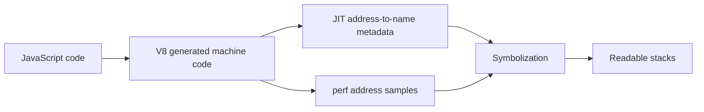

# How to Diagnose Missing JavaScript Symbols in Linux perf Profiles

Author: [nawazdhandala](https://www.github.com/nawazdhandala)

Tags: Node.js, Profiling, Linux

Description: Generate and preserve V8 JIT symbol data, align PID namespaces, and distinguish native symbols from JavaScript stack recovery.

Linux `perf` samples machine addresses. Native executable symbols may be available from ELF files, but V8 generates JavaScript machine code at runtime. Without suitable JIT symbol information, JavaScript work can appear as unknown addresses even though sampling itself succeeded.

Separate three questions: were samples collected, can addresses be named, and can stacks be unwound? A symbol map solves naming for generated code; it does not automatically repair missing stack frames or provide perfect source-level attribution.

## Check supported V8 profiling options

Inspect the exact Node.js binary used by the service:

```bash
node --version
node --v8-options | rg 'perf-basic-prof|perf-prof|interpreted-frames-native-stack'
```

V8 flags are version-dependent. Use only flags supported by that binary and retain the output with the capture metadata. Avoid assuming a flag from an old Node.js tutorial still has identical behavior.

For versions supporting basic perf maps, launch a controlled workload with:

```bash
node --perf-basic-prof --interpreted-frames-native-stack application.js
```

The process typically writes JIT map information under `/tmp` using its PID. Preserve that file while the process and generated code are still relevant. Container PID and mount namespaces can make the map visible under a different path or PID than the host-side profiler expects.



## Capture and inspect before rendering

Record a short process-scoped profile:

```bash
perf record -F 99 -g -p 1234 -o node.data -- sleep 30
perf report -i node.data --stdio
```

Use the host-visible PID when running on the host. Confirm the process remains alive for the intended interval and that the capture includes the slow workload. A mostly idle capture can contain little JavaScript regardless of symbol configuration.

Inspect `perf report` before generating a flame graph. If names are already missing there, the rendering script is unlikely to be the root cause. Preserve the exact Node binary, native addons, JIT metadata, and `perf.data` together.

## Distinguish missing JavaScript and native symbols

Unknown native addon frames need matching ELF symbols or debug information for the addon and its libraries. V8 JIT maps do not name arbitrary stripped native libraries. Conversely, installing system debug symbols does not recreate JavaScript code maps that were never emitted.

For newer JIT-dump workflows, Node and perf may support a different metadata path requiring an injection step. Follow the official instructions for the deployed version rather than mixing a basic map workflow with a JIT-dump workflow. Record which method produced the artifacts.

Stack unwinding can be affected by frame pointers, DWARF information, optimized code, and architecture. A named leaf with a broken parent stack indicates a different problem from a completely unnamed address range. Inspect both before changing compiler or runtime flags.

## Use a runtime profile as a cross-check

Node's built-in CPU profiler provides a separate view of JavaScript execution:

```bash
node --cpu-prof --cpu-prof-dir=./profiles application.js
```

Create the output directory first and let the process exit cleanly so the profile is written. This captures the process lifetime unless you use a bounded inspector-based session. It is useful for comparison, but its sampling and stack representation are not identical to Linux perf.

Finally, run a known CPU-heavy JavaScript function and confirm its name appears in both views. Then reproduce the intermittent production path. Keep symbol artifacts until analysis is complete, and measure the overhead of the chosen JIT metadata flags before enabling them broadly. A readable profile requires a reproducible artifact pipeline, not only a successful `perf record` command.

## References

The [community question](https://stackoverflow.com/questions/27842281/unknown-events-in-nodejs-v8-flamegraph-using-perf-events) motivated this investigation. The implementation references are [official reference 1](https://nodejs.org/en/learn/diagnostics/flame-graphs), [official reference 2](https://nodejs.org/api/cli.html), [official reference 3](https://raw.githubusercontent.com/torvalds/linux/master/tools/perf/Documentation/perf-record.adoc).
