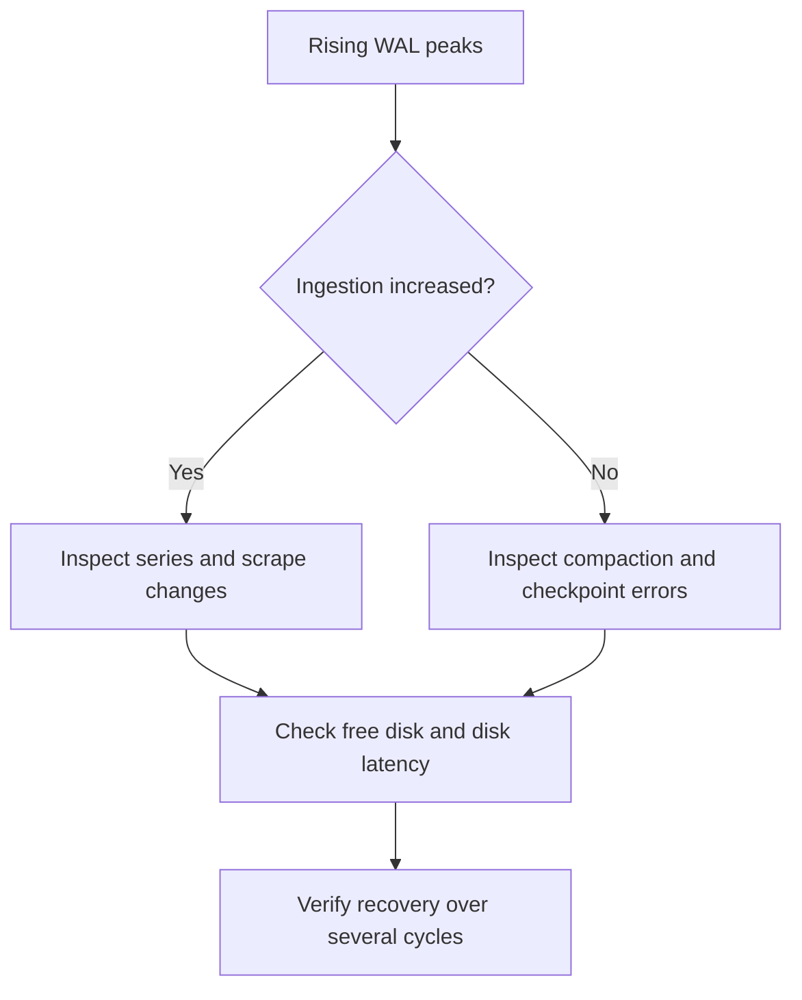

# How to Diagnose Prometheus WAL Growth Before Disk Runs Out

Author: [nawazdhandala](https://www.github.com/nawazdhandala)

Tags: Prometheus, Storage, Monitoring

Description: Separate normal Prometheus WAL peaks from ingestion churn, stalled compaction, and remote-write lag before persistent storage fills.

The Prometheus write-ahead log is expected to grow between cleanup events. The useful question is whether its peak is rising across comparable cycles, not whether the directory is larger than it was five minutes ago. Start by separating a normal sawtooth pattern from sustained growth and by confirming which process owns the volume.

This investigation assumes Prometheus 3.x in server mode on a supported local filesystem. Keep all diagnostics read-only while collecting evidence. Agent mode, replay after a restart, and a recently changed scrape configuration can produce different patterns, so include the process version and recent changes in the investigation notes.

## Measure components on the same clock

Record the WAL, head chunks, total used disk, and process restart times. A directory named `wal` may belong to a sidecar or another service, so verify the `storage.tsdb.path` flag first. The following command is an example snapshot on a host where the data volume is mounted at `/prometheus`.

```bash
date -u '+%Y-%m-%dT%H:%M:%SZ'
du -sk /prometheus/wal /prometheus/chunks_head
df -k /prometheus
```

Repeat snapshots through several hours with your normal monitoring system. Include checkpoint directories in WAL usage. Looking only at numbered segment files can miss temporary overlap during checkpoint creation. Avoid a tight filesystem polling loop on an already overloaded disk.

## Correlate growth with samples and series

A spike in sample rate suggests more ingestion. Rapid series creation with modest sample growth suggests churn, for example a request identifier accidentally promoted to a metric label. Both can increase resource demand, but their fixes differ.

```promql
rate(prometheus_tsdb_head_samples_appended_total[15m])
```

```promql
rate(prometheus_tsdb_head_series_created_total[15m])
```

Also inspect Prometheus logs for head compaction failures, checkpoint errors, disk latency, and permission problems. A growing WAL plus repeated compaction failure is stronger evidence than disk growth alone. Check whether the latest normal blocks are appearing without moving or deleting them. If deployment restarts repeatedly interrupt recovery, fixing the restart loop may be more important than changing retention.



## Forecast runway conservatively

Use a linear projection as an incident planning aid, not as a storage-law assumption. A recent positive slope is useful for deciding whether expansion must happen immediately. A negative slope after cleanup does not prove the next peak will fit. This fixture computes runway from two comparable peak measurements.

```python
first_peak_gib = 28
last_peak_gib = 40
elapsed_hours = 6
free_gib = 30
growth_gib_per_hour = (last_peak_gib-first_peak_gib)/elapsed_hours
runway_hours = free_gib/growth_gib_per_hour if growth_gib_per_hour > 0 else None
print({"growth_gib_per_hour": growth_gib_per_hour, "runway_hours": runway_hours})
assert runway_hours == 15
```

The example produces 15 hours of runway at the observed peak-growth rate. Put uncertainty beside that number: incoming traffic, scheduled jobs, and compaction can change it. Compare it with the time required to expand the volume and verify the filesystem sees the new size. A forecast without an operational lead time is not actionable.

## Do not confuse remote lag with WAL retention

Inspect `prometheus_remote_storage_samples_pending` and remote-write errors separately. The sender reads from the WAL, but normal server-mode WAL cleanup does not become an unlimited archive for a failed receiver. Raising queue capacity or shard count blindly can increase memory pressure and trigger restarts without solving disk growth. Review receiver throughput and local CPU before tuning.

Do not remove live WAL files as routine cleanup. That can discard recent data and interfere with recovery. Time-based block retention is also not a direct WAL-size control. Prefer adding emergency headroom, reverting an accidental high-cardinality scrape, or repairing a proven compaction failure. After the intervention, verify multiple peak-to-peak cycles, successful checkpoints, and remote freshness. Preserve the original measurements so the next capacity review uses the corrected workload rather than the incident spike.

## References

The [community question](https://stackoverflow.com/questions/63958695/prometheus-wal-keeps-on-growing-indefinitely) motivated this walkthrough. Implementation references:

- [Official reference 1](https://prometheus.io/docs/prometheus/latest/storage/)
- [Official reference 2](https://prometheus.io/docs/practices/remote_write/)
