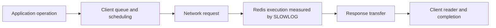

# How to Diagnose Redis Timeouts When SLOWLOG Shows Nothing Slow

Author: [nawazdhandala](https://www.github.com/nawazdhandala)

Tags: Redis, .NET, Monitoring

Description: Separate Redis execution time from client queueing, network transfer, and .NET scheduling to explain timeouts with a clean server slow log.

Redis SLOWLOG measures server command execution, not the complete time a client waits for a result. A command can execute quickly while its request waits in a client queue, its response crosses a slow network, or the .NET process struggles to read and complete it. A clean slow log narrows the investigation; it does not prove the end-to-end path is healthy.

This walkthrough applies to StackExchange.Redis 2.x with a supported Redis server. Timeout diagnostic fields evolve between client releases, so record the exact package version and consult its matching documentation. Keep exception details in a controlled log because endpoint names and command information can be sensitive.

## Capture both sides of the timeout

Record the application timestamp, operation type, payload-size class, elapsed time, and complete diagnostic field names. Do not infer that an input-buffer field has identical meaning across every library version. A large inbound buffer can indicate responses waiting to be consumed, but it must be interpreted with reader state, CPU, and scheduling evidence.

```json
{"operation":"GET","elapsed_ms":5100,"payload_class":"large","client_version":"2.x-pin-in-lockfile","server_slowlog_match":false,"investigation":"compare client queue, reader progress, and network transfer"}
```

This is an internal incident record, not a literal StackExchange.Redis exception schema. Preserve the real exception separately with appropriate redaction. Correlate several failures rather than choosing one field from one timeout as the entire explanation.

## Inspect bounded server evidence

Use your approved Redis authentication and TLS configuration. The commands below read a small slow-log sample and server status. Slow-log entries can include command arguments, so handle their output as sensitive.

```bash
redis-cli SLOWLOG GET 20
redis-cli INFO clients
redis-cli INFO stats
```

Check the configured slow-log threshold and retention before concluding nothing slow happened. An event below the threshold or already evicted from the log will not appear. Also inspect server CPU, persistence activity, connection churn, and network throughput through your normal monitoring system.



## Account for large replies and shared connections

A fast GET returning a large value can occupy network and client processing time. Other operations sharing the connection can experience head-of-line effects. The arithmetic fixture shows a lower-bound transfer estimate from payload size and effective throughput, excluding latency and protocol overhead.

```python
payload_mib = 20
effective_mib_per_second = 5
transfer_seconds = payload_mib/effective_mib_per_second
print({"idealized_transfer_seconds":transfer_seconds})
assert transfer_seconds == 4
```

These invented numbers are not a Redis benchmark. Measure actual value sizes and throughput. Consider reducing oversized values or separating workloads only after establishing the mechanism; adding connections without understanding the client and server load can make behavior worse.

## Check client lifetime and .NET execution

Reuse a `ConnectionMultiplexer` according to the library's guidance rather than creating one per request. The following fragment represents application startup and a later asynchronous read. Dispose the multiplexer at application shutdown, not after each operation.

```csharp
using StackExchange.Redis;
var configuration = Environment.GetEnvironmentVariable("REDIS_CONFIGURATION")
    ?? throw new InvalidOperationException("Missing Redis configuration");
var multiplexer = await ConnectionMultiplexer.ConnectAsync(configuration);
var database = multiplexer.GetDatabase();
RedisValue value = await database.StringGetAsync("synthetic:read-only-key");
// Keep multiplexer for the application lifetime; dispose it during shutdown.
```

Inspect CPU saturation, long garbage-collection pauses, thread-pool starvation, sync-over-async calls, and blocking continuations around the failure. Compare client read progress with network bytes and server response behavior. A timeout increase can mask a growing queue without improving throughput.

Reproduce with small and large values in a controlled environment, then compare synchronous and asynchronous call paths under representative concurrency. Keep the same server and network path where possible. The final diagnosis should identify which interval dominates outside Redis execution and show that the targeted change reduces it. That is stronger evidence than either a clean SLOWLOG or a larger timeout setting alone.

## References

The [community question](https://stackoverflow.com/questions/69714891/stackexchange-redis-timeout-issue-high-input-stream-buffer) motivated this walkthrough. Implementation references:

- [Official reference 1](https://redis.io/docs/latest/commands/slowlog-get/)
- [Official reference 2](https://github.com/StackExchange/StackExchange.Redis/blob/main/docs/Timeouts.md)
- [Official reference 3](https://github.com/StackExchange/StackExchange.Redis/blob/main/docs/Basics.md)
- [Official reference 4](https://redis.io/docs/latest/operate/oss_and_stack/management/optimization/latency/)
