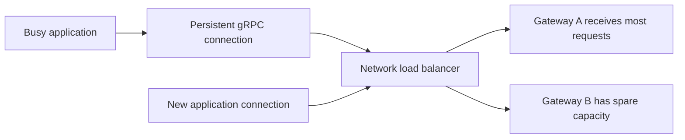

# How to Diagnose Uneven OTLP Traffic Behind a Network Load Balancer

Author: [nawazdhandala](https://www.github.com/nawazdhandala)

Tags: OpenTelemetry, Kubernetes

Description: Identify connection pinning, compare Collector ingestion rates, and choose a balancing strategy that fits OTLP traffic.

A network load balancer can report healthy targets while one Collector handles most of the telemetry. The missing distinction is between balancing connections and balancing export requests. OTLP over gRPC commonly reuses a connection for many requests. Adding a healthy target does not redistribute requests already traveling over established connections.

This investigation assumes Collector gateways with separately scraped internal metrics and clients using OTLP/gRPC. The configuration fragments use Collector 0.120.0. Check the documentation shipped with your distribution before applying them to a different release.

## Compare the work, not just the targets

Start with the accepted span rate per gateway. These are Collector internal metric names; inspect your actual scrape because suffixes and labels can differ between releases and telemetry settings.

```promql
sum by (instance) (
  rate(otelcol_receiver_accepted_spans{receiver="otlp"}[5m])
)
```

Compare the busiest and quietest instances over the same interval. Then inspect exporter queue utilization and CPU. High accepted traffic with a full queue suggests an overloaded gateway. Equal accepted traffic with unequal CPU suggests different span sizes, processors, or backend behavior. A span counter alone cannot distinguish those cases.

```promql
max by (instance) (otelcol_exporter_queue_size)
/
max by (instance) (otelcol_exporter_queue_capacity)
```

In a Linux gateway network namespace, inspect established connections. Use equivalent connection metrics from your proxy if shell access is unavailable.

```bash
ss -nt state established '( sport = :4317 )'
```

A small number of connections carrying a large share of traffic makes connection pinning plausible. It does not prove a faulty load balancer: one application may legitimately emit far more spans than another. Compare client identity, bytes received, and connection lifetime before changing infrastructure.



## Choose where redistribution happens

For stateless gateways, a gRPC-aware layer 7 proxy can distribute RPCs across upstream connections. Alternatively, a client with a resolver that discovers all gateway addresses can balance directly. A single virtual IP still hides individual gateways from that resolver. Changing the client balancing algorithm without changing discovery may therefore accomplish nothing.

For a Collector client that resolves multiple real endpoints, this version supports the following exporter fragment:

```yaml
exporters:
  otlp/gateways:
    endpoint: dns:///otel-gateways.observability.svc.cluster.local:4317
    balancer_name: round_robin
    tls:
      ca_file: /etc/otel/ca.pem
```

Use a headless Kubernetes Service for that hostname and verify its DNS answers contain the intended endpoints. The certificate must also validate the name used by the client. Do not disable certificate verification merely to make the topology change work.

## Run a controlled comparison

Keep offered load stable, add a gateway, and chart accepted spans, connection count, export latency, queue usage, and failures. A successful change should distribute incoming work without increasing retries or losing records. Record the workload mix: equal connections are not necessarily equal bytes or processor cost.

Do not apply arbitrary balancing to tail-sampling Collectors. All spans in a trace need a consistent destination for the sampling decision. Put a trace-aware routing tier before stateful samplers, and scale that tier separately. Also check metric aggregation state before moving metric streams between instances.

If traffic remains uneven after adding request-aware balancing, investigate tenant size, oversized batches, asymmetric backend throttling, and per-instance configuration differences. The useful outcome is a demonstrated explanation of the skew and a measured improvement under the same load, not merely a greener target-health dashboard.

## References

The [community question](https://www.reddit.com/r/OpenTelemetry/comments/1ciojw4) motivated this investigation. The implementation references are [official reference 1](https://opentelemetry.io/docs/collector/scaling/), [official reference 2](https://raw.githubusercontent.com/open-telemetry/opentelemetry-collector/v0.120.0/config/configgrpc/README.md).
