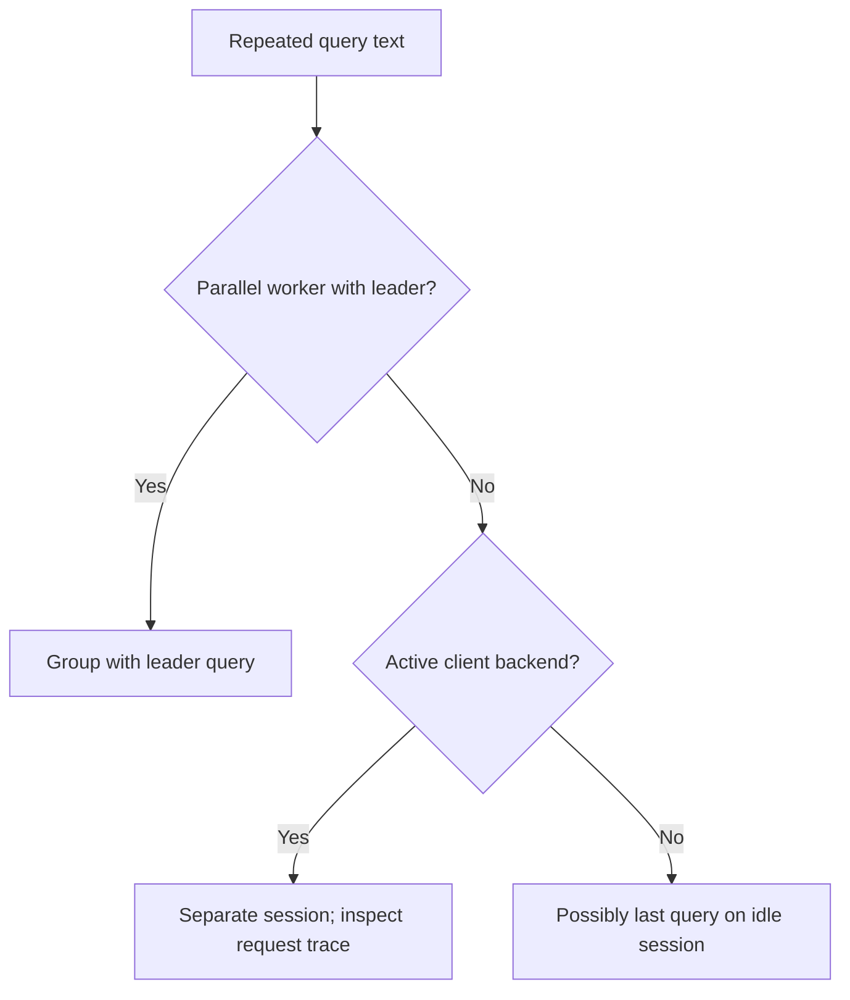

# How to Distinguish Duplicate Queries from PostgreSQL Parallel Workers

Author: [nawazdhandala](https://www.github.com/nawazdhandala)

Tags: PostgreSQL, Monitoring, SRE

Description: Use backend_type and leader_pid to group PostgreSQL parallel workers before concluding that identical query text means duplicate application requests.

Several rows in `pg_stat_activity` showing the same query can represent one parallel query, several independent application requests, or repeated idle sessions displaying their last command. Query text alone cannot distinguish them. Inspect backend type, leader PID, state, and session identity before counting duplicate work.

These read-only examples target PostgreSQL 17. Use appropriate monitoring privileges and avoid exporting sensitive query text unnecessarily. Parallel-worker visibility is a point-in-time observation: short queries may finish before the diagnostic query runs, and worker availability can differ from what the planner requested.

## Identify leaders and workers

A parallel worker can reference its leader through `leader_pid`. Grouping by the leader when present connects related activity rows. Keep backend type visible because other background processes can also appear in the activity view.

```sql
SELECT pid, leader_pid, backend_type, application_name, state,
       query_start, wait_event_type, wait_event, LEFT(query, 160) AS query_sample
FROM pg_stat_activity
WHERE state = 'active'
ORDER BY COALESCE(leader_pid, pid), pid;
```

A client backend and two parallel workers may show similar query text while serving one application request. Three separate client backends with no shared leader represent different sessions, though they can still be legitimate concurrent requests. Use application tracing to determine whether that concurrency was intended.

## Count query groups separately from processes

The following aggregate reports the number of active processes associated with each leader. It is a diagnostic grouping, not a universal count of application operations. A single transaction can issue many sequential queries, and external connection poolers can obscure the original request identity.

```sql
SELECT COALESCE(leader_pid, pid) AS query_group_pid,
       COUNT(*) AS active_processes,
       COUNT(*) FILTER (WHERE backend_type = 'parallel worker') AS parallel_workers
FROM pg_stat_activity
WHERE state = 'active'
  AND backend_type IN ('client backend', 'parallel worker')
GROUP BY COALESCE(leader_pid, pid)
ORDER BY active_processes DESC;
```

Exclude your diagnostic backend if necessary when building a dashboard. Do not add worker query durations together and call the result user-visible latency; workers execute concurrently. Process count and elapsed request duration are different dimensions of cost.



## Inspect the plan without running the workload

Use plain `EXPLAIN` to inspect whether the query can use a parallel plan. The example assumes your application has an `orders` table with an `amount` column; adapt it to the actual query and schema. Plain EXPLAIN plans but does not execute the query.

```sql
EXPLAIN (COSTS OFF)
SELECT SUM(amount)
FROM orders
WHERE created_at >= DATE '2026-11-01';
```

Look for Gather or Gather Merge and the planned worker count. A plan can request more workers than are available at execution time. Do not use `EXPLAIN ANALYZE` on an expensive production query just to check for parallelism; it actually executes the statement.

## Investigate genuine duplicate requests

If independent client backends run the same query unexpectedly, compare application name, client address, backend start, and request traces. Retry behavior, duplicate message delivery, concurrent UI requests, and accidental task fan-out can all create legitimate-looking duplicate SQL. Parameterized queries may share text while operating on different business objects.

Also inspect state. An idle session showing the last SELECT is not still executing it. A long transaction can hold resources after the query completes, which is a separate lifecycle issue. Keep transaction age and state-change time beside query text when reviewing evidence.

The acceptance test is a controlled parallel query in staging followed by two independent client queries. Your diagnostic view should show one leader group in the first case and two client groups in the second. This prevents normal database parallelism from being misdiagnosed as an application retry bug while preserving a clear path to investigate real duplicate work.

## References

The [community question](https://stackoverflow.com/questions/77618910/postgres-pg-stat-activity-is-it-normal-if-there-are-duplicate-activity) motivated this walkthrough. Implementation references:

- [Official reference 1](https://www.postgresql.org/docs/17/monitoring-stats.html)
- [Official reference 2](https://www.postgresql.org/docs/17/how-parallel-query-works.html)
