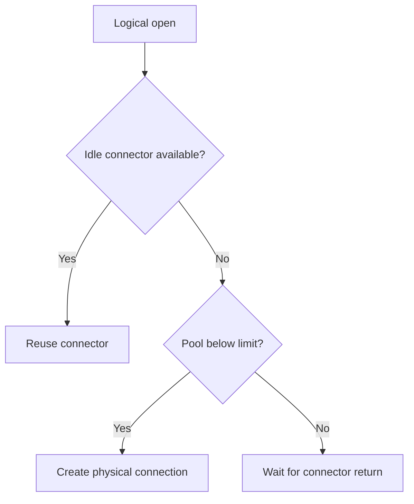

# How to Distinguish New Database Connections from Pool Waits

Author: [nawazdhandala](https://www.github.com/nawazdhandala)

Tags: .NET, PostgreSQL, OpenTelemetry

Description: Use controlled warm-pool and saturated-pool experiments, physical-open traces, and server sessions to explain slow database connection acquisition.

Opening a pooled database connection is a logical operation. It may reuse an idle physical connection, wait for another caller to return one, or create a new physical connection. A stopwatch around `OpenConnectionAsync` measures the total acquisition path, so its duration alone cannot identify the cause.

This tutorial uses Npgsql 10 and PostgreSQL 17 terminology. Run the controlled experiment only against a disposable local database. The example deliberately constrains a pool to one connector and holds it briefly to create an understandable wait. It is not a production load test and should not be used to size a real pool.

## Create a known pool-wait case

Use one shared data source. Acquire its only connection, start a second acquisition, then return the first connection after a short delay. The second operation cannot obtain an idle connector until the first is released.

```csharp
using Npgsql;
using System.Diagnostics;

var raw = Environment.GetEnvironmentVariable("LOCAL_TEST_DATABASE")
    ?? throw new InvalidOperationException("Set a disposable local database connection string");
var settings = new NpgsqlConnectionStringBuilder(raw)
{
    MaxPoolSize = 1,
    Timeout = 5
};
await using var source = NpgsqlDataSource.Create(settings.ConnectionString);
var held = await source.OpenConnectionAsync();
var timer = Stopwatch.StartNew();
var waiting = source.OpenConnectionAsync().AsTask();
await Task.Delay(200);
await held.DisposeAsync();
await using var acquired = await waiting;
Console.WriteLine($"Acquisition took {timer.Elapsed.TotalMilliseconds:F1} ms");
```

The measured time includes scheduling overhead and is not expected to equal exactly 200 milliseconds. The causal setup is the important part: the pool is full and the waiter proceeds only after release. Add robust cleanup and cancellation handling before turning this demonstration into a reusable test harness.

## Observe physical opens separately

Enable Npgsql tracing using its documented OpenTelemetry integration and inspect physical connection-open spans. The provider setup below is a fragment requiring the corresponding OpenTelemetry and Npgsql.OpenTelemetry packages.

```csharp
using OpenTelemetry;
using OpenTelemetry.Trace;
using var provider = Sdk.CreateTracerProviderBuilder()
    .AddNpgsql()
    .AddConsoleExporter()
    .Build();
```

Compare a cold first acquisition with a warm reuse and the saturated-pool experiment. A new physical-open span supports connection establishment work; its absence during a warm wait supports reuse after contention. Sampling and exporter failures can hide spans, so absence alone is not conclusive unless tracing coverage is known.



## Compare server-side sessions

Use a stable application name to identify the test connections. PostgreSQL sees physical sessions, not every logical checkout from a client pool. The following read-only query helps distinguish new backend creation from reuse.

```sql
SELECT pid, application_name, backend_start, state, wait_event_type, wait_event
FROM pg_stat_activity
WHERE application_name = 'pool-diagnostic'
ORDER BY backend_start;
```

Set `Application Name=pool-diagnostic` in the local test connection string. Repeated logical opens can reuse the same backend PID. A growing set of backend start times suggests new physical connections, but proxies and external poolers can introduce another layer that changes the interpretation.

## Diagnose the production pattern

If physical creation is slow, investigate DNS, TCP establishment, TLS, authentication, server connection limits, and network errors. If waiting dominates, inspect connection hold duration, long transactions, unclosed readers, and concurrency. A timeout message should be captured with its exception type and stack, without logging credentials or raw sensitive SQL.

Check pool fragmentation too. Different connection strings or data-source instances can create independent pools, each with its own maximum. Across many application replicas, the total possible connections can exceed PostgreSQL's budget even when each local pool looks modest.

The acceptance evidence is a matched set of acquisition timings, pool occupancy, physical-open traces, and backend observations. That combination distinguishes connection establishment from contention and points toward a remedy that addresses the actual bottleneck.

Repeat each controlled case several times and label cold versus warm results explicitly. A first connection can include startup work that later acquisitions avoid, while a connection lifetime policy can create occasional new physical opens in an otherwise warm pool. Compare distributions rather than subtracting unrelated percentile values: the difference between p95 logical-open time and p95 physical-open time is not necessarily p95 pool-wait time. To attribute individual requests, use correlated spans or event timestamps from the same operation and preserve their parent-child relationship.

## References

The [community question](https://stackoverflow.com/questions/80013695/how-to-distinguish-npgsql-connection-pool-wait-time-from-ef-core-begintransactio) motivated this walkthrough. Implementation references:

- [Official reference 1](https://www.npgsql.org/doc/diagnostics/metrics.html)
- [Official reference 2](https://www.npgsql.org/doc/diagnostics/tracing.html)
- [Official reference 3](https://www.npgsql.org/doc/connection-string-parameters.html)
- [Official reference 4](https://www.postgresql.org/docs/17/monitoring-stats.html)
