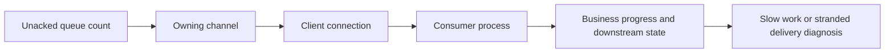

# How to Distinguish Slow RabbitMQ Consumers from Stranded Deliveries

Author: [nawazdhandala](https://www.github.com/nawazdhandala)

Tags: RabbitMQ, Monitoring, SRE

Description: Trace unacknowledged messages to channels and connections, compare business progress, and recover with correct acknowledgement ownership.

Unacknowledged RabbitMQ deliveries belong to the channel that received them. Another consumer cannot safely acknowledge those delivery tags on its own channel. When messages appear stranded, identify the owning channel and whether its application is making progress before deciding how to recover.

The examples use RabbitMQ 4.x AMQP 0-9-1 and read-only CLI commands. They do not close connections or discard messages. A slow consumer and a deadlocked consumer can have the same unacknowledged count at one instant, so collect a short timeline rather than relying on one screenshot.

## Locate the outstanding deliveries

Start with queue counts and channel-level unacknowledged messages. Prefetch helps explain why a consumer holds a particular number of deliveries. A high prefetch value can make one stalled channel hold substantial work while other consumers appear idle.

```bash
rabbitmqctl list_queues -p / name messages_ready messages_unacknowledged consumers
rabbitmqctl list_channels connection number consumer_count messages_unacknowledged prefetch_count
```

Then map the connection to its client. Use application-provided connection names when available in your client library and management tooling. Network addresses alone can point to a shared host or proxy rather than the responsible process.

```bash
rabbitmqctl list_connections name peer_host peer_port state channels
rabbitmqctl list_consumers -p /
```

Correlate this with application logs, process health, thread or task activity, and downstream requests. A healthy TCP connection does not prove that the message handler is progressing. Heartbeats detect connection liveness, not every possible application deadlock.



## Define progress at the business boundary

Record when the handler starts, when its side effect commits, and when acknowledgement is sent. A consumer may finish the business action but fail before acknowledging, creating a redelivery risk. The internal record below separates those milestones.

```json
{"event_id":"shipment-17","handler_started":"2026-11-15T10:00:00Z","side_effect_committed":true,"acknowledgement_sent":false,"consumer_instance":"worker-3","channel_number":2}
```

Keep message identifiers stable across retries and make the side effect idempotent. A redelivery after connection loss does not mean the original attempt definitely did nothing. The broker cannot infer whether an external database or payment operation committed before the connection failed.

## Choose recovery from ownership evidence

If the consumer is slow but progressing, investigate handler latency, downstream capacity, and prefetch before restarting it. If it is stuck, coordinate with the application owner to stop or recover the affected consumer. Closing a channel or connection can cause unacknowledged deliveries to be requeued, but the action has consequences and may lead to duplicate processing.

Canceling a consumer subscription stops new deliveries but does not itself complete outstanding ones. Acknowledgements must use the correct channel and delivery tags. Do not attempt to manufacture acknowledgements from an unrelated process to make the queue look empty.

RabbitMQ supports consumer acknowledgement timeouts, with behavior and applicability depending on the broker version and queue type. Review the deployed documentation and test the application's recovery behavior before changing them. A timeout can reclaim stuck work, but it can also interrupt legitimately long processing if configured below the real workload duration.

## Verify recovery without losing the evidence

Use a disposable queue to test a slow handler, a hung handler, and a crash after the side effect but before acknowledgement. Confirm that idempotency prevents duplicate business effects and that recovered deliveries eventually receive valid acknowledgements. Observe unique completion count, oldest unfinished work, and channel state together.

Retain the original channel and client evidence in the incident record before the process is restarted. Once the connection disappears, the ownership trail can be harder to reconstruct. The investigation is complete when the team can explain why the handler stopped progressing and demonstrate safe redelivery, not merely when unacknowledged count returns to zero.

## References

The [community question](https://stackoverflow.com/questions/7063224/how-can-i-recover-unacknowledged-amqp-messages-from-other-channels-than-my-conne) motivated this walkthrough. Implementation references:

- [Official reference 1](https://www.rabbitmq.com/docs/confirms)
- [Official reference 2](https://www.rabbitmq.com/docs/man/rabbitmqctl.8)
- [Official reference 3](https://www.rabbitmq.com/docs/consumers)
