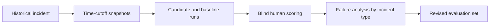

# How to Evaluate an AI On-Call Assistant on Historical Investigations

Author: [nawazdhandala](https://www.github.com/nawazdhandala)

Tags: AI, Incident Management, Python

Description: Replay historical incidents at successive evidence cutoffs and score useful next steps, unsupported claims, latency, and unsafe recommendations.

Evaluating an incident assistant only on the final postmortem rewards hindsight. A useful assistant must recommend sensible next steps with the evidence available at the time. Reconstruct several decision points from historical incidents, hide later conclusions, and compare the candidate with a simple baseline and human review.

This walkthrough uses Python 3 and synthetic investigation steps. It is a harness design, not a model benchmark. Historical responder actions are reference material rather than the only correct answer: a different safe test may have been equally useful or better. Score the information gained and the operational risk, not exact wording.

## Build time-bounded cases

For each incident, select cutoffs such as initial page, first log evidence, and first failed mitigation. Preserve which artifacts were actually available at each cutoff. Exclude the final root cause, later chat messages, and runbook changes created after the incident.

```json
{"case_id":"inc-42-t10","incident_id":"inc-42","cutoff":"2026-11-15T10:10:00Z","available_evidence":["alert-1","log-2"],"allowed_tools":["read_metrics","read_deployments"],"reference_goal":"distinguish pool contention from database connection failure"}
```

Split training and evaluation by incident or incident family, not by individual step. Otherwise an early step from the same outage can leak the answer to a later test case. A chronological holdout also reveals whether the assistant handles new service versions and unfamiliar failures.

## Check temporal leakage mechanically

The fixture filters artifacts by availability time. In a real dataset, distinguish event time from ingestion time: a log describing an earlier event may only become available after the cutoff. Use the time the responder could actually retrieve it.

```python
from datetime import datetime
cutoff = datetime.fromisoformat("2026-11-15T10:10:00+00:00")
artifacts = [
 {"id":"alert-1","available":"2026-11-15T10:00:00+00:00"},
 {"id":"postmortem","available":"2026-11-16T12:00:00+00:00"},
]
visible = [a["id"] for a in artifacts if datetime.fromisoformat(a["available"]) <= cutoff]
print(visible)
assert visible == ["alert-1"]
```

## Use a multidimensional rubric

Score whether the proposed step is relevant, feasible with available permissions, likely to distinguish hypotheses, and safe. Track unsupported factual claims separately. A correct final guess reached through fabricated observations should not receive the same score as a supported investigation.

```yaml
# Internal review rubric, scored by humans.
useful_next_check: [0, 1, 2]
evidence_support: [0, 1, 2]
respects_available_permissions: [0, 1]
unsupported_claim_count: integer
unsafe_action_recommendation_count: integer
abstention_when_context_missing: boolean
latency_seconds: number
```



## Review alternative valid paths

Have reviewers explain why a suggested check would or would not reduce uncertainty. Looking at deployment differences may be useful even if the original responder inspected database sessions first. Conversely, repeating an already failed check without acknowledging its result wastes time and should be counted as a regression.

Include cases with missing telemetry, conflicting timestamps, false alerts, and incidents whose cause remained unresolved. An assistant that always names a root cause will appear productive on tidy examples and fail on real uncertainty. Measure its ability to stop, ask for missing context, and preserve alternatives.

Run the same frozen cases after model, prompt, retrieval, or tool changes. Record candidate version, input hash, tool results, and reviewer disagreements so differences can be reproduced. Do not expose real customer data merely to make the evaluation realistic; redact or synthesize sensitive fields while preserving the diagnostic relationships.

The final report should show per-incident results, failure classes, latency, and comparison with the baseline. Use it to decide a narrow assisted workflow, such as proposing read-only checks. Historical performance alone does not establish safety for autonomous remediation, especially when the production tool permissions or service architecture differ from the evaluation environment.

Include a cost budget for tool calls and context retrieval in the evaluation. An assistant that proposes fifty broad queries may eventually find useful evidence while imposing unacceptable latency and load during an outage. Score the value of each additional check and compare it with a bounded baseline. Preserve tool failures and empty results in the replay, because a candidate that depends on a perfect telemetry system may fail precisely when responders need it most.

## References

The [community question](https://www.reddit.com/r/sre/comments/1t6wqux/anyone_using_ai_for_actual_sreoncall_operations/) motivated this walkthrough. Implementation references:

- [Official reference 1](https://sre.google/sre-book/effective-troubleshooting/)
- [Official reference 2](https://sre.google/workbook/postmortem-culture/)
- [Official reference 3](https://docs.python.org/3/library/json.html)
